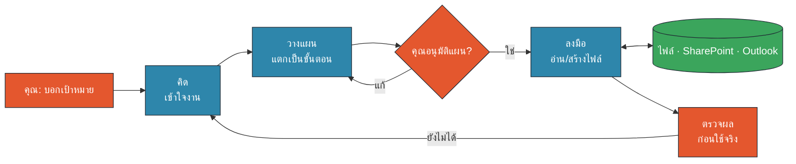
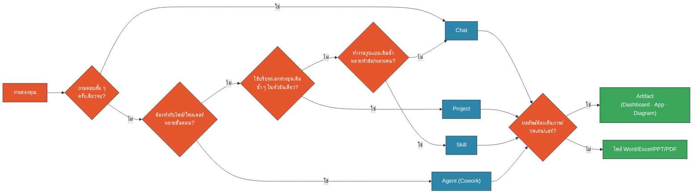
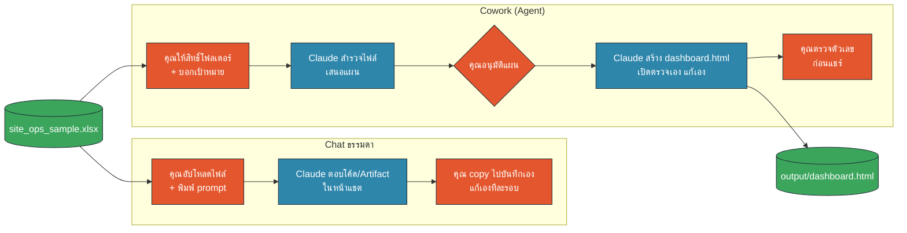
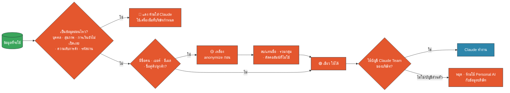
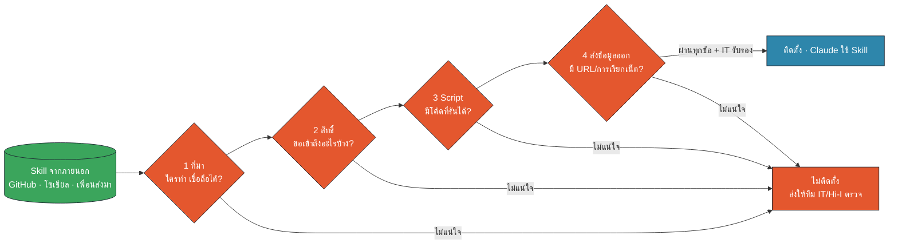
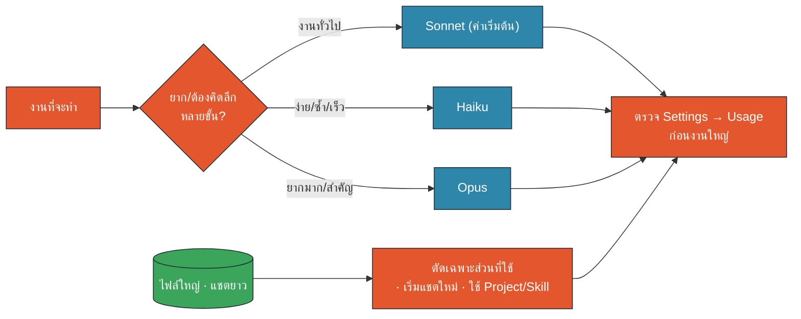
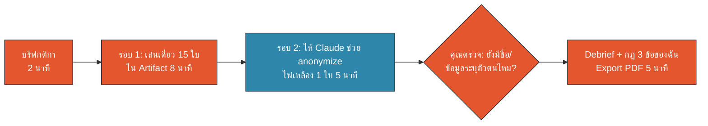

<!-- type: section -->
# M1 · Claude Foundation & Security First

เข้าใจ Claude แบบ Agent · เลือกเครื่องมือให้ถูกงาน · ใช้อย่างปลอดภัยตั้งแต่วันแรก

09:15–10:15 · 60 นาที (บรรยาย 40 · Workshop 20)

???
[0:00] ทักทาย 30 วินาที แล้วเข้าเรื่องทันที โมดูลนี้ "บังคับ" ตามข้อกำหนดของทีม Hi-I
เป้าหมาย: ก่อนจะให้ Claude ทำงานกับไฟล์จริงตอน M2–M7 ทุกคนต้องรู้ "เส้นแดง" ของข้อมูลก่อน

---

# 60 นาทีนี้เราจะได้อะไร

- รู้ว่า Claude / Cowork ทำงานแบบ **Agent** อย่างไร
- เลือก Chat · Project · Skill · Agent · Artifact ได้ถูกงาน
- เห็นความต่าง Chat vs Cowork จาก Demo จริง
- รู้ความต่าง Personal / Team / Enterprise และข้อจำกัดของ Team
- แยกข้อมูล 🟢 🟡 🔴 ได้ก่อนใส่ Claude
- ใช้ model และ usage รายสัปดาห์อย่างคุ้มค่า

???
[0:30] อ่านเร็ว ๆ ไม่ต้องอธิบายทีละข้อ บอกว่าท้ายโมดูลจะมีเกม Data Traffic Light ให้แข่งกัน ใครได้ 15/15 ได้ badge Data Guardian
Requirement ที่ครอบคลุม: 2 (Security), 8 (เลือกเครื่องมือ), 9 (Third-party Skill), 13 (usage)

---
<!-- type: story -->
# เมษายน 2023: วิศวกร Samsung วาง source code ลงแชตบอต AI

- วิศวกรขอให้ AI ช่วยตรวจโค้ด → วางโค้ดภายในลงไปทั้งก้อน
- ข้อมูลออกไปอยู่บนเซิร์ฟเวอร์ภายนอก ลบคืนไม่ได้ง่าย ๆ
- พฤษภาคม 2023 Samsung สั่งห้ามใช้ generative AI บนอุปกรณ์บริษัท
- ไม่มีใครตั้งใจทำร้ายบริษัท แค่ **อยากทำงานให้เร็วขึ้น**

> บทเรียน: ความเสี่ยงส่วนใหญ่มาจาก "ความหวังดี + ไม่รู้เส้นแดง"

???
[1:30] เล่าเป็นเรื่อง 1 นาที ไม่ต้องเน้นว่าเป็นเครื่องมือของใคร ประเด็นคือ "พฤติกรรมผู้ใช้"
ที่มา: Bloomberg, 2 May 2023 "Samsung Bans Staff's AI Use After Spotting ChatGPT Data Leak" (ดู SOURCES.md #1, #2 Bangkok Post ฉบับภาษาอังกฤษ)
ถามห้อง: "ใครเคยวางอะไรลง AI แล้วมานึกทีหลังว่า ไม่น่าเลย?" (ไม่ต้องให้ตอบออกเสียง)
เชื่อมต่อ: วันนี้เราใช้ Claude Team ของบริษัท แต่หลักเดียวกัน: เส้นแดงต้องชัดก่อนเริ่มใช้

---
<!-- type: section -->
# 1 · Claude / Cowork คืออะไร
จาก "แชตบอต" สู่ "Agent ที่ลงมือทำงานให้"

???
[2:30] Section 1 ใช้เวลา ~6 นาที

---

# Claude ที่เราใช้ในบริษัท

| ส่วน | ทำอะไร |
|---|---|
| **Chat** | ถาม-ตอบ ร่างข้อความ สรุปไฟล์ที่แนบ |
| **Cowork** (ใน Claude Desktop) | Agent ที่ทำงานกับไฟล์/โฟลเดอร์ในเครื่องเราได้หลายขั้นตอน |
| **Connector** | เชื่อม SharePoint และ Outlook (M365) ที่ IT อนุมัติ |
| **Artifact** | ผลงานแบบเปิดดู/กดเล่นได้ เช่น dashboard, app เล็ก ๆ |

บัญชีที่ใช้: **Claude Team ของบริษัท** เท่านั้น

???
[3:00] เปิด Claude Desktop ให้เห็นแท็บ Chat และ Cowork สั้น ๆ (ถ้ามีจอ)
ย้ำ: connector ที่ใช้ในหลักสูตรมีแค่ SharePoint และ Outlook จะลงลึกใน M3

---

# Chatbot vs Agent ต่างกันตรงไหน

| | Chatbot | Agent |
|---|---|---|
| รับงาน | คำถามทีละข้อ | **เป้าหมาย** |
| วิธีทำ | ตอบเป็นข้อความ | คิด → วางแผน → ลงมือ |
| เครื่องมือ | ไม่มี/น้อย | อ่าน-เขียนไฟล์ รันโค้ด ใช้ Connector |
| บทบาทเรา | คนพิมพ์คำถาม | **หัวหน้างาน** ที่อนุมัติและตรวจผล |

???
[4:00] เปรียบเทียบง่าย ๆ: Chatbot = ที่ปรึกษาที่ตอบคำถาม, Agent = ผู้ช่วยที่เราสั่งงานแล้วเขาไปทำมาให้
ประโยคจำ: "เราเปลี่ยนจากคนพิมพ์ prompt เป็นหัวหน้างานของ AI"

---

# วงจรการทำงานของ Agent: คิด → วางแผน → ลงมือ

🟧 คน (HITL) · 🟦 AI · 🟩 Data/Connector

???
[5:00] ชี้ทีละกล่อง: เป้าหมายมาจากเรา, Claude คิดและวางแผน, **เราอนุมัติแผน** (Human-in-the-Loop), แล้วจึงลงมือกับไฟล์/SharePoint/Outlook, สุดท้ายเราตรวจผล
ถ้าผลยังไม่ได้ วนกลับไปคิดใหม่ ไม่ใช่เริ่มจากศูนย์

---

# Plan → Approve → Execute

- Cowork จะ **เสนอแผนก่อน** แล้วรอเรา
- อ่านแผนเหมือนอ่านใบสั่งงาน: ไฟล์ไหน ทำอะไร ผลอยู่ที่ไหน
- งานที่ **ลบ ย้าย เขียนทับ ส่งออก** ต้องมีจุดอนุมัติเสมอ
- สงสัยตรงไหน สั่งแก้แผนได้ก่อนเริ่ม
- ผลลัพธ์ = ร่าง จนกว่าคนจะตรวจ

???
[6:00] นี่คือหลัก Human-in-the-Loop (HITL) ที่จะเจอทุกโมดูล ใช้คำว่า "Plan → Approve → Execute" ให้ตรงกันทั้งหลักสูตร
M2 จะฝึกจริงกับโฟลเดอร์ ~1,500 ไฟล์

---

# ตัวอย่างงานแบบ Agent (บริบทบริษัทพลังงาน · ข้อมูลสมมติ)

- รวม Excel ผลผลิต Site A–H หลายไฟล์ → สรุปแนวโน้ม
- จัดโครงสร้างโฟลเดอร์งานเก่าหลายปี (M2)
- ดึงอีเมลอัปเดตโครงการจาก Outlook → รายงานสัปดาห์ (M3, M6)
- ทำ Monthly Operations Report จาก 5 แหล่ง (M4)
- ตั้งงานซ้ำทุกสัปดาห์ พร้อมจุดให้คนตรวจ (M6)

???
[7:30] สไลด์นี้คือ "ตัวอย่างหนังตัวอย่าง" ของทั้งวัน ชี้ว่าแต่ละข้อจะได้ทำในโมดูลไหน
ทุกตัวเลข/ชื่อ site ในหลักสูตรเป็นข้อมูลสมมติ

---
<!-- type: section -->
# 2 · เลือกเครื่องมือให้ถูกงาน
Chat · Project · Skill · Agent (Cowork) · Artifact

???
[8:30] Section 2 ใช้เวลา ~8 นาที เป็น requirement 8

---

# 5 เครื่องมือในภาพเดียว

| เครื่องมือ | เหมาะกับ | ตัวอย่าง |
|---|---|---|
| **Chat** | งานสั้น ครั้งเดียวจบ | ร่างอีเมล อธิบายสูตร |
| **Project** | หัวข้อเดียว ใช้บริบทเดิมซ้ำ | โครงการปิดเหมืองสมมติ |
| **Skill** | วิธีทำงานแบบเดิม ใช้ซ้ำทุกหัวข้อ | รูปแบบรายงานมาตรฐาน |
| **Agent (Cowork)** | หลายขั้น กับไฟล์/โฟลเดอร์ | รวม 20 ไฟล์ Excel |
| **Artifact** | ผลลัพธ์ที่ดู/กด/แชร์ได้ | dashboard, เกม, diagram |

???
[9:00] อธิบายภาพรวมก่อน แล้วแต่ละสไลด์ถัดไปลงทีละตัว
จุดที่คนสับสนบ่อย: Project vs Skill → Project = "ห้องเก็บบริบทของเรื่องหนึ่ง", Skill = "สูตรวิธีทำงานที่หยิบไปใช้ได้ทุกเรื่อง"

---

# Chat

- เริ่มเร็วที่สุด ไม่ต้องตั้งค่า
- เหมาะ: ถามความรู้ ร่างข้อความ สรุปไฟล์ 1–2 ไฟล์
- แชตยาวมาก = ใช้ usage มาก และเริ่มลืมบริบทต้น ๆ
- เคล็ดลับ: งานใหม่ = **เริ่มแชตใหม่**

???
[10:00] ตัวอย่างสด (ถ้ามีเวลา): "ช่วยอธิบาย XLOOKUP พร้อมตัวอย่างสมมติ"
โยงไป usage: แชตยาวทุกข้อความต้องอ่านประวัติทั้งหมด ยิ่งยาวยิ่งเปลือง (ลงรายละเอียดใน Section 5)

---

# Project

- "ห้อง" ของงานหนึ่งเรื่อง: เก็บเอกสารและคำสั่งประจำไว้
- ทุกแชตในห้องเห็นบริบทเดียวกัน ไม่ต้องอัปโหลดซ้ำ
- แชร์ให้เพื่อนในทีมได้ (บัญชี Team ของบริษัท)
- ระวัง: ไฟล์ใน Project ต้องผ่าน Data Traffic Light ก่อน

???
[11:00] ตัวอย่าง: Project "รายงานประจำเดือน Site A–H" เก็บ template + คำอธิบายตัวชี้วัด + ตัวอย่างรายงานเก่า (ข้อมูลสมมติ)
ข้อควรระวัง: ใส่ไฟล์ครั้งเดียว ทุกคนที่แชร์เห็น ต้องคิดก่อนใส่

---

# Skill

- "สูตรวิธีทำงาน" ที่ Claude โหลดมาใช้เมื่อเกี่ยวข้อง
- เขียนครั้งเดียว ใช้ได้ทุกแชต ทุก Project ทุกคนในทีม
- ตัวอย่าง: รูปแบบรายงานมาตรฐาน โทนภาษา โครงหัวข้อ
- ช่วยลดการพิมพ์คำสั่งยาวซ้ำ ๆ = ประหยัด usage
- ⚠️ Skill จากภายนอก **อาจไม่ผ่าน audit** (Section 4)

???
[12:00] ลงมือสร้างจริงใน M5 ที่นี่แค่ให้รู้จักแนวคิด
ปูไปเรื่อง third-party Skill: Skill คือไฟล์คำสั่ง + บางครั้งมี script ที่รันได้ ถ้ามาจากคนไม่รู้จัก = เหมือนติดตั้งโปรแกรมแปลกหน้า

---

# Agent (Cowork)

- ให้สิทธิ์ **เฉพาะโฟลเดอร์ที่จำเป็น**
- Claude สำรวจไฟล์ เสนอแผน รอเราอนุมัติ แล้วลงมือ
- สร้าง/แก้ไฟล์จริงในเครื่อง: Word, Excel, PPT, HTML
- ใช้ร่วมกับ Connector SharePoint / Outlook ได้
- กฎทองก่อนให้แก้ไฟล์: **copy-before-write**

???
[13:00] copy-before-write = ทำสำเนาก่อนให้ Claude แก้ จะลงลึกใน M3 (ไฟล์บน SharePoint ที่หลายคนแก้พร้อมกัน)
แนะนำ: สร้างโฟลเดอร์ทำงานแยก เช่น Documents/Claude-Work แล้วให้สิทธิ์แค่โฟลเดอร์นั้น

---

# Artifact

- ผลงานที่ "เปิดแล้วใช้ได้เลย" ข้างหน้าแชต
- Dashboard · App เล็ก ๆ · Prototype · Diagram · เกม
- ปรับได้หลายเวอร์ชันด้วยการคุยต่อ
- แชร์ภายในองค์กรผ่านบัญชีบริษัท
- เกม Data Traffic Light วันนี้ก็เป็น Artifact

???
[14:00] เมื่อไรใช้ Word/Excel/PPT แทน Artifact: เมื่อต้องส่งเป็นไฟล์ทางการ แนบอีเมล หรือคนรับไม่มี Claude → M4 ลงรายละเอียด
Artifact ที่เรียก AI ข้างในจะใช้ usage ของ Team plan เกมวันนี้ไม่เรียก AI

---

# Decision tree: งานนี้ใช้อะไรดี?

🟧 คน (HITL) · 🟦 AI · 🟩 Data/Connector

???
[15:00] เดินตามต้นไม้ 1 รอบด้วยโจทย์: "ทำ dashboard ผลผลิตจาก Excel 6 site"
→ ไม่ใช่ถามสั้น → ทำกับไฟล์หลายขั้น → Agent (Cowork) → ต้องเห็นภาพ → Artifact/HTML
ย้ำว่าต้นไม้นี้คือ "จุดเริ่ม" ไม่ใช่กฎตายตัว เครื่องมือใช้ร่วมกันได้

---

# Quick quiz: ใช้อะไรดี? (ยกมือ 1–5)

1. ร่างอีเมลขอบคุณ supplier 1 ฉบับ
2. ทุกเดือนต้องทำรายงานรูปแบบเดิม ให้ทั้งทีมใช้
3. รวม 30 ไฟล์ Excel ในโฟลเดอร์ แล้วทำสรุป
4. คุยเรื่องโครงการเดียวต่อเนื่อง 3 เดือน
5. อยากได้หน้าจอให้ผู้บริหารกดดูตัวเลข

`1 Chat · 2 Skill · 3 Agent (Cowork) · 4 Project · 5 Artifact`

???
[16:00] ให้ห้องตอบพร้อมกันทีละข้อ ใช้เวลา 1 นาที (เฉลยบรรทัดล่างสุด เปิดหลังตอบ หรือปิดไว้ถ้าใช้ PDF)
คำตอบอื่นอาจถูกได้ เช่น ข้อ 2 ใช้ Project + Skill ร่วมกัน ชมคนที่ให้เหตุผลได้

---
<!-- type: section -->
# 3 · Demo: Chat vs Cowork
งานเดียวกัน · ไฟล์เดียวกัน · ผลต่างกันแค่ไหน

???
[17:00] Section 3 ใช้เวลา ~8 นาที (demo ~6 นาที) เตรียมไฟล์ไว้ก่อนเริ่มคลาส ดู prompts.md M1-P01, M1-P02

---

# โจทย์ Demo

- ไฟล์: `site_ops_sample.xlsx` (ข้อมูลสมมติ 6 site × 21 เดือน)
- เป้าหมาย: **HTML dashboard** ผลผลิตแผน vs จริง และต้นทุน
- รอบ 1: Chat + แนบไฟล์ + prompt `M1-P01`
- รอบ 2: Cowork + โฟลเดอร์ + prompt `M1-P02`
- จับเวลา และนับว่า **เราต้องลงมือเองกี่ครั้ง**

???
[17:30] ไฟล์อยู่ที่ materials/m1/data/site_ops_sample.xlsx (สร้างด้วย gen_site_ops.py)
ก่อน demo: คัดลอกไฟล์ไปไว้ในโฟลเดอร์ demo/M1 แยก และเปิด Settings → Usage ไว้ในแท็บหนึ่งเพื่อโชว์การใช้ usage
ให้ผู้เรียนช่วยนับ "จำนวนครั้งที่คนต้อง copy/บันทึก/แก้เอง"

---

# งานเดียวกัน 2 วิธี

🟧 คน (HITL) · 🟦 AI · 🟩 Data/Connector

???
[18:00] ทำ demo จริงตาม prompts.md:
1) Chat: แนบไฟล์ วาง M1-P01 → ได้ Artifact/โค้ด → เราต้อง copy ไปบันทึกเป็น .html เอง ถ้าตัวเลขผิดต้องสั่งแก้แล้ว copy ใหม่
2) Cowork: ชี้โฟลเดอร์ วาง M1-P02 → Claude สำรวจไฟล์ เสนอแผน (หยุดตรงนี้ ชี้ว่าเป็น HITL) → อนุมัติ → Claude สร้าง output/dashboard.html และตรวจผลเอง
แผนสำรองถ้าเน็ต/usage มีปัญหา: เปิดไฟล์ผลที่เตรียมไว้ล่วงหน้า (ทำใน dry-run)

---

# สิ่งที่เห็นจาก Demo

| | Chat | Cowork |
|---|---|---|
| รับไฟล์ | แนบทีละไฟล์ | เข้าถึงโฟลเดอร์ที่อนุญาต |
| แผนงาน | ไม่มี ตอบเลย | เสนอแผนให้อนุมัติ |
| ผลลัพธ์ | อยู่ในแชต ต้อง copy เอง | ไฟล์จริงในโฟลเดอร์ |
| ตรวจ/แก้ | เราสั่งแก้ทีละรอบ | Claude เปิดตรวจและแก้เอง |
| เหมาะ | งานเล็ก ไฟล์เดียว | งานหลายขั้น หลายไฟล์ |

???
[23:00] สรุปร่วมกับห้อง: ถามว่านับได้กี่ครั้งที่คนต้องลงมือเอง
จุดสำคัญ: ทั้ง 2 วิธี "เราต้องตรวจตัวเลข" ก่อนใช้จริง AI ทำร่าง คนรับผิดชอบผล

---

# ข้อสังเกตเรื่องความปลอดภัยจาก Demo

- ไฟล์ demo เป็น **ข้อมูลสมมติ** ไฟล์งานจริงต้องผ่าน 🟢🟡🔴 ก่อน
- Cowork เห็นทุกไฟล์ในโฟลเดอร์ที่ให้สิทธิ์ → ให้แค่ที่จำเป็น
- ผลลัพธ์ต้องตรวจก่อนแชร์ (ตัวเลข สูตร ข้อสรุป)
- Dashboard นี้ไม่ refresh เอง เป็นภาพ ณ เวลาที่สร้าง (M6)

???
[24:00] เชื่อมเข้าสู่ Section 4 Security: "เครื่องมือเก่งขึ้น = ความรับผิดชอบเราก็มากขึ้น"
เรื่อง dashboard refresh เป็น awareness ของ M6 แค่แตะไว้

---
<!-- type: section -->
# 4 · Security First
Personal / Team / Enterprise · นโยบายบริษัท · Data Traffic Light · Skill จากภายนอก

???
[25:00] Section 4 ใช้เวลา ~10 นาที เป็นหัวใจของ requirement 2 และ 9

---

# Personal vs Team vs Enterprise

| | Personal (Free/Pro/Max) | **Team (ที่เราใช้)** | Enterprise |
|---|---|---|---|
| เจ้าของบัญชี | ตัวเรา | บริษัท | บริษัท |
| ผู้ดูแลระบบ (admin) | ไม่มี | มี ควบคุมพื้นฐาน | ควบคุมละเอียด |
| Audit log / Compliance API | ไม่มี | จำกัด | มีครบกว่า |
| ใช้กับข้อมูลบริษัท | ❌ ห้าม | ✅ ตามนโยบาย | ✅ ตามนโยบาย |

<small>ตรวจรายละเอียดล่าสุดที่ claude.com/pricing และ Anthropic Help Center</small>

???
[25:30] พูดตรงไปตรงมา: Team มีการควบคุมของผู้ดูแลและบันทึกการใช้งานน้อยกว่า Enterprise (เช่น audit log เต็มรูปแบบ, Compliance API, การตั้ง data retention เป็น feature ของ Enterprise)
ฟีเจอร์เปลี่ยนบ่อย วิทยากรตรวจหน้า pricing/help center อีกครั้งในสัปดาห์อบรม (ดู Open questions ใน README)
ประเด็นที่ต้องได้: "Personal ห้ามใช้กับข้อมูลบริษัท" ไม่มีข้อยกเว้น

---

# Team plan: ระบบดูแลได้บางส่วน ที่เหลือคือ "วินัยของเรา"

- ระบบตรวจย้อนหลังได้ไม่ละเอียดเท่า Enterprise
- ไม่มีใครมาเตือนก่อนเราวางข้อมูลผิด
- การแชร์ Project/Artifact ทำได้ง่าย → แชร์ผิดก็ง่าย
- ดังนั้นความปลอดภัยส่วนหนึ่ง **อยู่ที่ผู้ใช้ทุกคน**

> Team = รถที่มีเบรก แต่ไม่มีระบบเบรกอัตโนมัติ คนขับต้องเหยียบเอง

???
[27:00] ใช้ analogy รถ ให้จำง่าย
ไม่ต้องทำให้กลัวเกินไป Team ปลอดภัยกว่า Personal มาก (บริษัทเป็นเจ้าของบัญชี มี admin) แต่การกันข้อมูลอ่อนไหวไม่ให้เข้าไปเป็นหน้าที่ของเรา

---

# นโยบายบ้านปู: 2 กฎที่ไม่มีข้อยกเว้น

1. **ข้อมูลอ่อนไหวไม่ใส่ Claude** ใช้เครื่องมือที่บริษัทกำหนดสำหรับข้อมูลอ่อนไหวเท่านั้น
2. **ห้ามใช้ Personal AI กับข้อมูลบริษัท** ไม่ว่าจะเป็นบัญชี Claude ส่วนตัวหรือ AI อื่น

+ ใช้เฉพาะ Connector ที่ IT อนุมัติ: **SharePoint, Outlook**

???
[28:00] อ่านช้า ๆ ทั้ง 2 ข้อ ให้ทุกคนพูดตาม (ถ้าบรรยากาศเอื้อ)
"เครื่องมือที่บริษัทกำหนดสำหรับข้อมูลอ่อนไหว" — ชื่อเครื่องมือ/ช่องทางจริงให้ยืนยันกับ Hi-I ก่อนวันอบรม (Open question)
Google Drive และ connector อื่นไม่อนุญาต

---

# อะไรคือ "ข้อมูลอ่อนไหว"

- ข้อมูลส่วนบุคคล: เลขบัตร เงินเดือน บัญชีธนาคาร สุขภาพ
- ข้อมูลการเงินที่ **ยังไม่เปิดเผย** ต่อสาธารณะ
- ความลับทางการค้า: ราคา สัญญา การเจรจา
- รหัสผ่าน API key ข้อมูลเข้าระบบ
- เอกสารที่มีชั้นความลับตามนโยบายบริษัท

???
[29:00] เชื่อมกับ PDPA: ข้อมูลสุขภาพ ศาสนา ประวัติอาชญากรรม ฯลฯ เป็นข้อมูลอ่อนไหวพิเศษ
ข้อสังเกต: "ข้อมูลที่ประกาศแล้ว" เปลี่ยนจากแดงเป็นเขียวได้ เช่น งบการเงินหลังประกาศต่อตลาด

---

# Data Traffic Light: ถามตัวเองก่อนวางทุกครั้ง

🟧 คน (HITL) · 🟦 AI · 🟩 Data/Connector

???
[30:00] นี่คือ diagram ที่จะใช้ในเกม workshop และทบทวนอีกครั้งใน M8
สังเกตว่าเกือบทุกกล่องเป็นสีส้ม = การตัดสินใจของ "คน" ไม่ใช่ AI
ด่านสุดท้าย: แม้ข้อมูลเขียว ก็ต้องใช้บัญชี Team ของบริษัทเท่านั้น

---

# 🟡 เหลือง → anonymize ยังไง

| ก่อน | หลัง |
|---|---|
| คุณสมมติ ใจดี (หัวหน้ากะ) | หัวหน้ากะ A |
| 081-234-5678 | (ลบออก) |
| บริษัทสมมติ ก จำกัด | Customer 01 |
| 14 ก.ย. 2026 กะดึก Site A | ก.ย. 2026 · Site A |

- ตัดคอลัมน์ที่ไม่ได้ใช้ทิ้งก่อน
- เก็บตารางจับคู่ชื่อจริงไว้ **นอก** Claude

???
[31:00] เน้น: anonymize ดีที่สุดคือ "ไม่ส่งสิ่งที่ไม่จำเป็น" ตั้งแต่แรก
ถ้าลบชื่อแล้วยังเดาตัวคนได้ (เช่น มีคนเดียวในแผนก) ให้รวมกลุ่มให้ใหญ่ขึ้น หรือถือเป็นแดง
Workshop รอบ 2 จะฝึกใช้ Claude ช่วย anonymize ข้อความสมมติ (prompt M1-P04)

---

# ความเสี่ยงใหม่: Skill จากภายนอก

- Skill = คำสั่ง + ไฟล์ + บางครั้งมี **script ที่รันได้**
- แชร์กันง่ายบน GitHub/โซเชียล แต่ **ยังไม่มีใคร audit**
- Skill ที่ไม่หวังดีอาจสั่งให้อ่านไฟล์หรือส่งข้อมูลออก
- ใช้ Skill ที่บริษัทสร้างหรือรับรองก่อนเสมอ

???
[32:00] Requirement 9 ระดับ "แนะนำแนวคิด" ใน M1 ลงมือตรวจจริงด้วย checklist ใน M5
Anthropic เองระบุในเอกสาร Skills สำหรับองค์กรว่า Skill ที่ไม่หวังดีอาจสั่งให้ Claude รันโค้ด เข้าถึงไฟล์ หรือส่งข้อมูลออก และไม่ควรใช้ Skill จากแหล่งที่ไม่น่าเชื่อถือโดยไม่ audit (SOURCES #3)

---

# 4 คำถามก่อนติดตั้ง Skill (ลงมือจริงใน M5)

🟧 คน (HITL) · 🟦 AI · 🟩 Data/Connector

???
[33:00] จำง่าย 4 คำ: ที่มา · สิทธิ์ · Script · ส่งออก
ถ้าไม่แน่ใจข้อไหน = ไม่ติดตั้ง ส่งให้ทีม IT/Hi-I ตรวจ

---
<!-- type: story -->
# เคสจริง ธ.ค. 2025: Skill ที่ "ดูดี" แต่แอบซ่อนคำสั่ง

- นักวิจัย Cato Networks นำ Skill แบบ open-source (สร้าง GIF) มาดัดแปลง
- แทรกฟังก์ชันที่ดูปกติ แต่ไปดาวน์โหลดโค้ดภายนอกมารัน
- ในเครื่องทดสอบ: ผู้ใช้อนุมัติครั้งเดียว → ไฟล์ถูกเข้ารหัสโดย ransomware
- Anthropic ย้ำ: ผู้ใช้ต้องใช้เฉพาะ **Skill ที่เชื่อถือได้**

> ติดตั้ง Skill = ติดตั้งโปรแกรม คิดแบบเดียวกัน

???
[34:00] เป็น proof-of-concept ในสภาพแวดล้อมทดสอบของนักวิจัย (Cato CTRL, 2 Dec 2025) ไม่ใช่การโจมตีบริษัทใด ใช้ให้เห็นว่าเป็นไปได้จริง
จุดสอน: Claude ตรวจโค้ดที่มองเห็นได้ แต่ไม่เห็นโค้ดที่ถูกดาวน์โหลดภายหลัง → การอนุมัติครั้งแรกของคนจึงสำคัญมาก
ที่มา: Cato Networks blog และ Axios (SOURCES #4, #5) · Anthropic enterprise Skills docs (SOURCES #3)
ไม่ต้องลงรายละเอียดเทคนิค เน้นพฤติกรรม: "Skill ฟรีจากอินเทอร์เน็ต = โปรแกรมแปลกหน้า"

---
<!-- type: section -->
# 5 · ใช้ให้คุ้ม
เลือก model · weekly usage limit

???
[35:00] Section 5 ใช้เวลา ~4 นาที requirement 13 (แนะนำแนวคิด ลงมือจริงใน M8)

---

# เลือก model ให้เหมาะกับงาน

🟧 คน (HITL) · 🟦 AI · 🟩 Data/Connector

???
[35:30] ชื่อรุ่นในเมนูอาจมีเลขเวอร์ชันต่างไปตามวันอบรม ให้ดูจากเมนูเลือก model จริง
หลักคิด: Sonnet สำหรับงานทั่วไป, Haiku งานง่าย/เร็ว, Opus งานยาก/สำคัญ ใช้ usage มากกว่า
ถ้ามี Team plan บางรุ่นอาจจำกัดหรือใช้ usage เร็วกว่า ดู Open question ใน README

---

# Weekly usage limit: รู้ไว้ก่อนชน

- Team plan มี **โควตาต่อคน** ต่อรอบการใช้งาน และรายสัปดาห์
- ดูการใช้และเวลารีเซ็ตที่ **Settings → Usage**
- ใช้มากเมื่อ: แชตยาว · ไฟล์ใหญ่ · model ใหญ่ · Agent ทำหลายขั้น
- Artifact ที่เรียก AI ข้างในก็ใช้โควตา
- ชนแล้วต้องรอรอบใหม่ → วางแผนงานใหญ่ให้ดี

???
[37:00] โชว์หน้า Settings → Usage จริง (ถ้าเปิดได้) ตัวเลขและรอบรีเซ็ตขึ้นกับการตั้งค่าของบริษัท/Anthropic ณ วันอบรม ให้ยืนยันใน dry-run
อย่าให้ตัวเลขโควตาเฉพาะเจาะจงในห้อง เพราะเปลี่ยนได้
ข้อเท็จจริงจาก Help Center (SOURCES #6): limit เป็นรายคน ไม่ใช่รวมทั้งทีม · weekly limit รีเซ็ตเวลาคงที่ของแต่ละบัญชี · ที่นั่ง Standard/Premium ต่างกัน · องค์กรเปิด usage credits ให้ใช้ต่อหลังชน limit ได้ (ขึ้นกับการตั้งค่าของ admin บ้านปู)

---

# 5 นิสัยประหยัด usage

1. งานใหม่ = เริ่มแชตใหม่
2. ส่งเฉพาะส่วนที่ใช้ ไม่แนบทั้งไฟล์ถ้าไม่จำเป็น
3. เริ่มด้วย Sonnet ยกระดับเป็น Opus เมื่อจำเป็น
4. งานซ้ำ → ใช้ Project/Skill แทนพิมพ์คำสั่งยาว
5. ให้ Claude **วางแผนก่อน** ลดการทำผิดแล้วแก้ซ้ำ

???
[38:00] ข้อ 5 เชื่อมกับ Plan → Approve → Execute: แผนที่ดีประหยัดทั้งเวลาและ usage
M8 จะมีแบบฝึกเลือก model/วิธีให้คุ้ม

---
<!-- type: section -->
# Workshop · Data Traffic Light
20 นาที · ข้อมูลนี้ใส่ Claude ได้ไหม?

???
[40:00] เปลี่ยนโหมดเป็น workshop ส่งลิงก์ Artifact (หรือไฟล์ data-traffic-light.html) ให้ทุกคนก่อนเริ่ม

---

# กติกาเกม

🟧 คน (HITL) · 🟦 AI · 🟩 Data/Connector

- ไพ่ 15 ใบ: 🟢 ใช้ได้ · 🟡 ต้อง anonymize · 🔴 ห้ามใส่ Claude
- ทุกใบเป็น **ข้อมูลสมมติ** · คู่มืออยู่ใน workshop.md

???
[40:30] รอบ 1 (8 นาที): เล่นเดี่ยว คีย์ลัด 1/2/3 ดูเหตุผลทุกใบแม้ตอบถูก
รอบ 2 (5 นาที): เลือกไพ่เหลือง 1 ใบ ใช้ prompt M1-P04 ให้ Claude ช่วย anonymize แล้วตรวจเองว่ายังเหลือข้อมูลระบุตัวตนไหม
Debrief (5 นาที): โหวตใบที่ยากที่สุด เขียนกฎ 3 ข้อของฉัน แล้ว Export PDF
วิทยากรเดินดู ถามคนที่ตอบใบ C10 (ปริมาณขาย + ชื่อลูกค้า) ว่าทำไมตอบแบบนั้น

---

# Debrief: ใบที่คนพลาดบ่อย

- **C05** รายงานที่ประกาศแล้ว = 🟢 แต่ฉบับร่าง = 🔴
- **C10** ตัดชื่อลูกค้าได้ = 🟡 · มีราคา/สัญญา = 🔴
- **C15** ข้อมูลสุขภาพ ลบชื่อแล้วก็ยัง 🔴
- ไม่แน่ใจ → ถือเป็นสีที่ **เข้มกว่า** ไว้ก่อน

???
[54:00] ใช้ผลจริงของห้อง: ถามว่าใบไหนตอบผิดเยอะที่สุด (ดูจากการยกมือ)
หลัก "ไม่แน่ใจ ให้เข้มไว้ก่อน" สำคัญที่สุด
ถ้ามีเวลา ถาม: "ข้อมูลเขียว แต่ใช้บัญชี Claude ส่วนตัว ได้ไหม?" → ไม่ได้ (กฎข้อ 2)

---

# สรุป M1 · พกติดตัวไปทั้งวัน

- Claude/Cowork = Agent: คิด → วางแผน → ลงมือ · **เราอนุมัติและตรวจ**
- เลือกเครื่องมือด้วย decision tree
- บัญชีบริษัทเท่านั้น · ข้อมูลอ่อนไหวไม่ใส่ Claude
- 🟢🟡🔴 ก่อนวางทุกครั้ง · ไม่แน่ใจให้เข้มไว้ก่อน
- Skill ภายนอก: ที่มา · สิทธิ์ · Script · ส่งออก
- ถัดไป M2: Cowork กับไฟล์และโฟลเดอร์จริง

???
[58:00] ปิดด้วยการให้ทุกคนพูดกฎ 1 ข้อที่จำได้ แล้วพักเบรก 10:15–10:30
เตือน: ระหว่างพักให้ตรวจว่า Cowork เปิดได้และมีไฟล์ Sample Data Pack พร้อมสำหรับ M2
