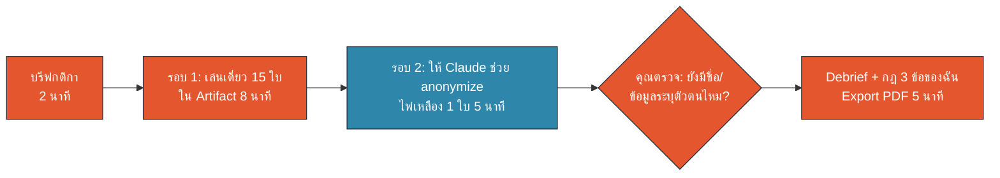

# M1 Workshop · Data Traffic Light (20 นาที)

ข้อมูลในทุกขั้นเป็นข้อมูลสมมติ · Artifact: `artifacts/data-traffic-light.html` · Prompt: `prompts.md`

## หน้า 1 · ภาพรวมและกติกา (2 นาที)

**เป้าหมาย:** ฝึกตัดสินใจว่าข้อมูลแบบไหนใส่ Claude ได้ ก่อนเริ่มใช้งานจริงใน M2–M7


🟧 คน (HITL) · 🟦 AI · 🟩 Data/Connector

| สี | ความหมาย | ทำอย่างไร |
|---|---|---|
| 🟢 เขียว ใช้ได้ | ข้อมูลสาธารณะ ความรู้ทั่วไป template เปล่า | ใช้ได้ด้วยบัญชี Claude Team ของบริษัท |
| 🟡 เหลือง ต้อง anonymize | ข้อมูลงานที่มีชื่อคน เบอร์ อีเมล ชื่อคู่ค้า/ลูกค้า | ลบ/แทนชื่อ รวมกลุ่ม ตัดคอลัมน์ที่ไม่ใช้ **ก่อน** วาง |
| 🔴 แดง ห้ามใส่ Claude | ข้อมูลส่วนบุคคลอ่อนไหว การเงินที่ยังไม่เปิดเผย ความลับการค้า รหัสผ่าน | ใช้เครื่องมือที่บริษัทกำหนดสำหรับข้อมูลอ่อนไหวเท่านั้น |

**กติกา 3 ข้อ**
1. ไม่แน่ใจ → เลือกสีที่ **เข้มกว่า** ไว้ก่อน
2. ใช้บัญชี Claude Team ของบริษัทเท่านั้น ห้ามใช้ Personal AI กับข้อมูลบริษัท
3. ทุกใบเป็นข้อมูลสมมติ ห้ามนำข้อมูลจริงจากงานมาทดลองใน workshop นี้

✅ **Checkpoint:** เปิด Artifact ได้ ใส่ชื่อเล่น/ชื่อทีมมุมขวาบนแล้ว

## หน้า 2 · รอบ 1: จัดประเภทไพ่ 15 ใบ (8 นาที)

**เป้าหมาย:** จัดไพ่ทุกใบเป็น 🟢 🟡 🔴 และอ่านเหตุผลของทุกใบ

**ขั้นตอน**
1. เปิด `data-traffic-light.html` (วิทยากรส่งลิงก์ Artifact หรือไฟล์ให้)
2. อ่านชื่อไพ่และ "ตัวอย่างข้อมูล" ในกล่องเทา
3. กดปุ่มสี หรือคีย์ลัด **1** เขียว · **2** เหลือง · **3** แดง
4. อ่าน **เหตุผล** และ **ทำให้ปลอดภัยอย่างไร** ทุกใบ แม้ตอบถูก
5. กด Enter ไปใบถัดไป จนครบ 15 ใบ

**จดไว้ระหว่างเล่น**

| ใบที่ลังเลที่สุด | ฉันตอบ | เฉลย | ฉันเรียนรู้อะไร |
|---|---|---|---|
| | | | |
| | | | |

✅ **Checkpoint:** เห็นหน้าผลคะแนน และแถบสรุป 🟢/🟡/🔴 ที่ตอบถูก
💡 ได้ 15/15 = badge 🏆 Data Guardian ระดับทอง · ทำเสร็จก่อนเวลา กด "เล่นอีกรอบ" ไพ่จะสลับลำดับ

## หน้า 3 · รอบ 2: ฝึก anonymize ไพ่เหลือง (5 นาที)

**เป้าหมาย:** ฝึก "ตาดู" ว่าข้อความไหนยังระบุตัวคนได้ และฝึกตรวจผลของ AI (Human-in-the-Loop)

1. เลือกไพ่ 🟡 1 ใบ (แนะนำ C06 บันทึกการประชุม หรือ C09 รายงาน near-miss)
2. เปิด Chat ใหม่ในบัญชี Claude Team แล้ววาง prompt `M1-P04` พร้อมข้อความสมมติจากไพ่

```text
ข้อความด้านล่างเป็นข้อมูลสมมติเพื่อฝึก anonymize
ช่วยทำ 3 อย่าง:
1) ชี้ว่าส่วนไหนระบุตัวบุคคลหรือคู่ค้าได้ (ชื่อ เบอร์ อีเมล ชื่อบริษัท วันเวลาที่เจาะจง)
2) เขียนข้อความใหม่ที่แทนชื่อด้วยบทบาท/รหัส (เช่น หัวหน้ากะ A, Customer 01) และลบเบอร์/อีเมล
3) บอกว่าหลังแก้แล้ว ยังมีอะไรที่อาจเดาตัวคนได้อีกไหม

ข้อความ:
"""
ผู้เข้าประชุม: คุณสมมติ ใจดี (081-234-5678), คุณทดลอง รักงาน, วิศวกร Site B
สรุป: เลื่อนตรวจสายพานลำเลียงไปวันที่ 21 ต.ค. กะดึก คุณทดลองรับผิดชอบ
"""
```

3. ตรวจผลด้วยตัวเอง แล้วถ้าต้องการ ใช้ `M1-P05` ให้ Claude ตรวจซ้ำ

✅ **Checkpoint (คนตรวจ):** ไม่มีชื่อคน เบอร์ อีเมล ชื่อบริษัทคู่ค้า · วันเวลาไม่เจาะจงจนเดาตัวคนได้ · เนื้องานยังครบ
⚠️ งานจริง: ต้อง anonymize **ก่อน** วางลง Claude ไม่ส่งข้อมูลจริงให้ AI ช่วยลบ

## หน้า 4 · Debrief + กฎ 3 ข้อของฉัน (5 นาที)

**เป้าหมาย:** สรุปบทเรียนเป็นกฎส่วนตัวที่ใช้ได้พรุ่งนี้

**คุยในกลุ่ม 2 นาที**
- ใบไหนยากที่สุด และทำไม?
- ใบไหน "เปลี่ยนสีได้" ถ้าบริบทเปลี่ยน (เช่น C05 ร่าง vs ประกาศแล้ว, C10 มีราคาหรือไม่)
- ถ้าข้อมูลเป็น 🟢 แต่ใช้บัญชี Claude ส่วนตัว ได้ไหม? (คำตอบ: ไม่ได้)

**เขียนในช่อง "กฎ 3 ข้อของฉัน" ใน Artifact** ตัวอย่าง:
1. ก่อนแนบไฟล์ เปิดดูว่ามีคอลัมน์ชื่อ/เลขบัตร/เงินเดือนไหม ถ้ามี = ไม่แนบ
2. งานที่มีชื่อลูกค้า แทนเป็น Customer 01–n และเก็บตารางจับคู่ไว้นอก Claude
3. ไม่แน่ใจ ถามทีม IT/Hi-I ก่อน และถือเป็นสีที่เข้มกว่าไว้ก่อน

**Export PDF:** กดปุ่ม **⬇ Export PDF** → เลือก "Save as PDF" → ได้คะแนน กฎ 3 ข้อ และเฉลยทั้ง 15 ใบในไฟล์เดียว

✅ **Checkpoint:** มี PDF ของตัวเอง 1 ไฟล์ · พูดกฎได้อย่างน้อย 1 ข้อ
➡️ ต่อไป M2: ใช้ Cowork กับไฟล์และโฟลเดอร์จริง (ข้อมูลสมมติจาก Sample Data Pack)
