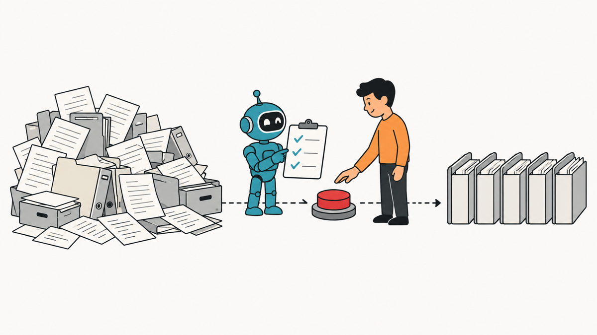
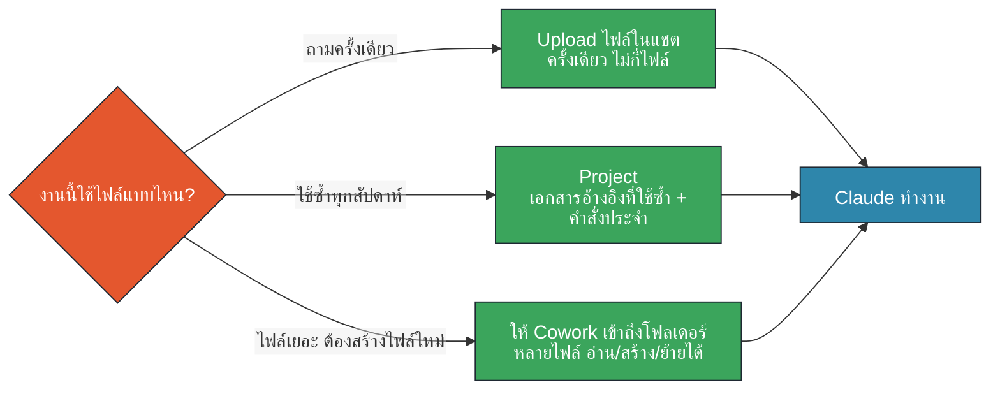
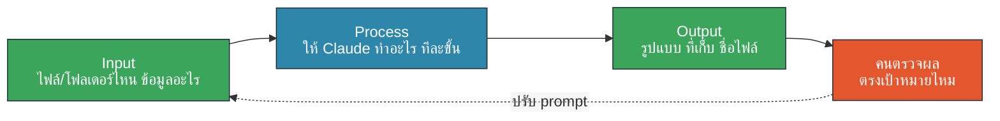
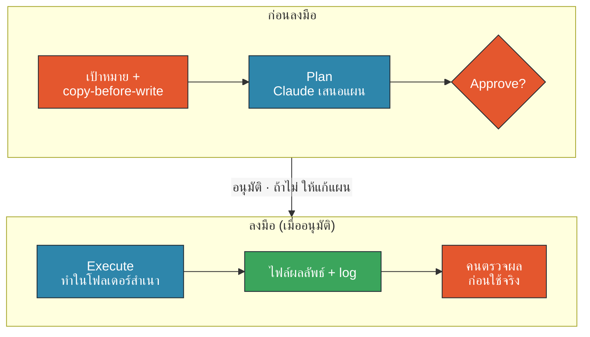
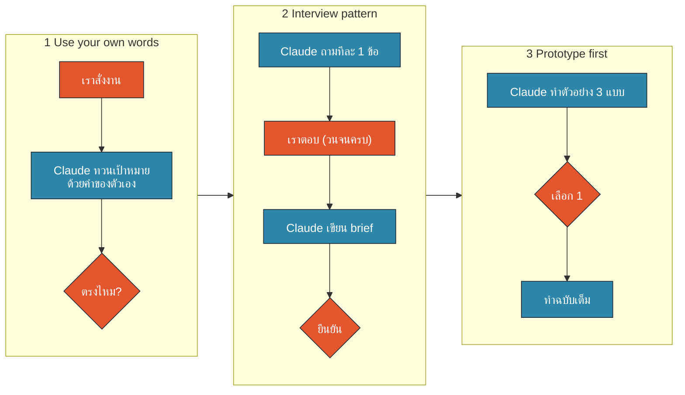
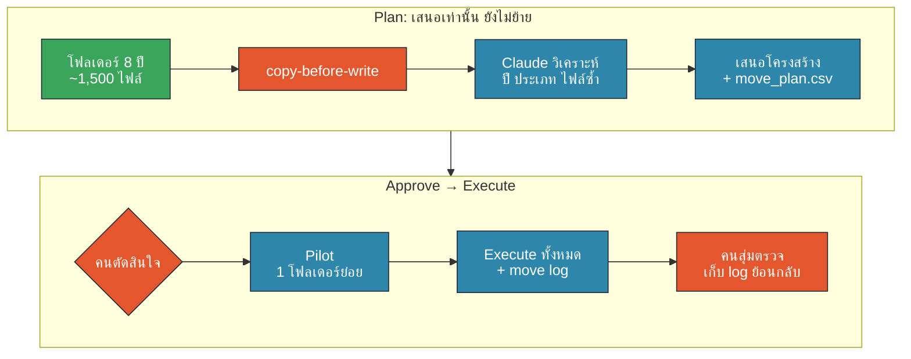
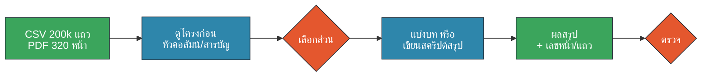
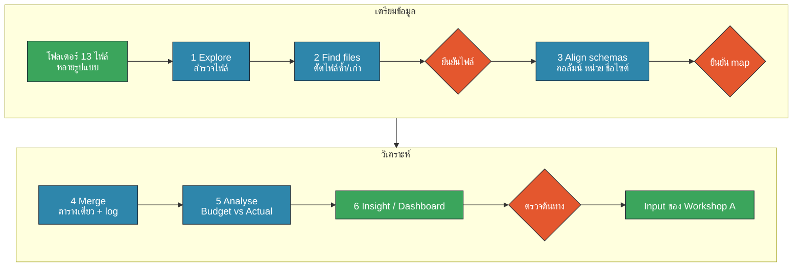
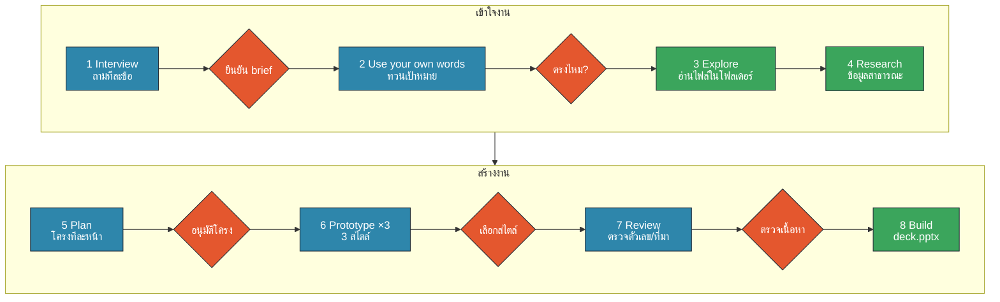

<!-- type: section -->
# M2 · Cowork กับไฟล์และโฟลเดอร์ในงานจริง
## + Prompt Patterns 3 แบบ

10:30–11:15 · Lecture 15 นาที · Workshop 30 นาที



???
(0:00–0:30) เปิดโมดูลด้วยคำถาม: "ใครมีโฟลเดอร์งานที่เปิดแล้วไม่อยากหาไฟล์บ้าง?" ให้ยกมือ
M1 เราเรียนว่าข้อมูลอะไรใส่ Claude ได้ (Data Traffic Light) — M2 คือการลงมือกับไฟล์จริง แต่ใช้ Sample Data Pack ที่เป็นข้อมูลจำลองทั้งหมด

---
# 45 นาทีนี้ เราจะได้อะไร

<style>.slide .mermaid svg{max-height:430px}</style>

- เลือกวิธีให้ข้อมูล Claude: **Upload · Project · Cowork folder**
- สั่งงานด้วย **Input → Process → Output**
- คุม Claude ด้วย **Plan → Approve → Execute** (HITL)
- Prompt Patterns: **Use your own words · Interview · Prototype first**
- ลงมือ: Workshop B (Excel กระจัดกระจาย) → Workshop A (PowerPoint)

> ข้อมูลทั้งหมดเป็นข้อมูลจำลอง — ไซต์สมมติ ภูผาทอง, ดอยหินดำ, ลำน้ำใส ฯลฯ

???
(0:30–1:30) อธิบายลำดับ: lecture 15 นาทีพอเห็นภาพ แล้ว workshop 30 นาที
บอกให้ทุกคนเปิด Workshop Companion Artifact ไว้ (ลิงก์ใน handout) — มี checklist และปุ่ม copy prompt
ย้ำ: Workshop B ทำก่อน เพราะผลลัพธ์ (ตาราง insight) จะเป็น input ของ Workshop A (สไลด์)

---
# Upload vs Project vs ให้ Cowork เข้าถึงโฟลเดอร์


🟧 คน (HITL) · 🟦 AI · 🟩 Data/Connector

> Cowork อ่าน **เขียน สร้าง ย้าย** ไฟล์ได้ → ให้สิทธิ์เฉพาะโฟลเดอร์สำเนาของงานนี้

???
(1:30–3:00) ตารางเทียบ (พูดประกอบ):
| | Upload ในแชต | Project | Cowork + โฟลเดอร์ |
| เหมาะกับ | ถามครั้งเดียว 1–5 ไฟล์ | งานซ้ำ ใช้เอกสารอ้างอิงเดิม | ไฟล์เยอะ ต้องสร้าง/ย้ายไฟล์ |
| Claude ทำได้ | อ่าน + ตอบ | อ่าน + คำสั่งประจำ | อ่าน เขียน สร้างไฟล์ ย้ายไฟล์ |
| ระวัง | ไฟล์ใหญ่อัปโหลดไม่ผ่าน | ความรู้ล้าสมัยถ้าไม่อัปเดต | ให้สิทธิ์เฉพาะโฟลเดอร์สำเนา |
ตัวอย่างบ้านปูสมมติ:
- Upload: "สรุป PDF ใบเสนอราคา supplier ฉบับนี้" → ครั้งเดียว
- Project: "รายงานประจำเดือนของทีม" ที่ต้องใช้ template + คำศัพท์เดิมทุกเดือน
- Cowork folder: "รวม Excel 13 ไฟล์จาก 6 ไซต์ แล้วทำ dashboard" → ต้องอ่านหลายไฟล์และสร้างไฟล์ใหม่
กฎ: ให้ Cowork เข้าถึงโฟลเดอร์ทำงานเฉพาะงาน (เช่น Documents/Claude-Workshop/M2) ไม่ใช่ทั้งไดรฟ์ — และใช้สำเนา (copy-before-write)
Connector ไป SharePoint/Outlook จะเรียนใน M3

---
# Prompt Framework: Input → Process → Output


🟧 คน (HITL) · 🟦 AI · 🟩 Data/Connector

```text
Input:   ไฟล์ทั้งหมดในโฟลเดอร์ input/ (รายงานผลผลิต 6 ไซต์ ปี 2566–2568)
Process: รวมเป็นตารางเดียว เทียบ Budget vs Actual รายไซต์รายปี
Output:  Excel 1 ไฟล์ใน output/ ชื่อ ops_summary.xlsx + สรุป 5 บรรทัด
```

???
(3:00–4:30) Prompt ที่ดีตอบ 3 คำถาม: เอาอะไรเข้า (Input) ทำอะไร (Process) ได้อะไรออก ที่ไหน รูปแบบไหน (Output)
ข้อผิดพลาดที่เห็นบ่อย: บอกแค่ Process ("วิเคราะห์ให้หน่อย") → Claude เดา input และ output เอง
ชี้ว่าเส้นประย้อนกลับ = คนตรวจผลแล้วปรับ prompt — นี่คือ HITL ที่เล็กที่สุด
ให้ดู Prompt Playground ตัวอย่างที่ 1 (before/after) ถ้ามีเวลา

---
# Plan → Approve → Execute


🟧 คน (HITL) · 🟦 AI · 🟩 Data/Connector

???
งานที่ลบ ย้าย เขียนทับ หรือส่งออก ต้องมีจุดอนุมัติเสมอ · copy-before-write: ทำสำเนาโฟลเดอร์ก่อนให้ Claude แก้
ประโยคที่ใส่ในทุก prompt: "เสนอแผนก่อน ห้ามลงมือจนกว่าฉันจะตอบว่า อนุมัติ"
(4:30–6:00) Cowork เก่งตรงที่ "ลงมือได้" — นั่นคือเหตุผลที่ต้องมีจุดหยุด
อธิบายแต่ละสี: ส้ม = คน, ฟ้า = Claude, เขียว = ไฟล์/ข้อมูล
ตัวอย่าง: ย้ายไฟล์ 1,500 ไฟล์ — ถ้าไม่มี Plan ให้ตรวจ จะย้อนกลับยากมาก
แนะนำให้ขอ "log" ทุกครั้ง: ไฟล์ไหนย้ายจากไหนไปไหน → ย้อนกลับได้
(Prompt M2-P02 ใน prompts.md)

---
<!-- type: story -->
# เมื่อ AI agent ลงมือโดยไม่มีจุดหยุด

- ก.ค. 2025: Jason Lemkin (SaaStr) ใช้ AI coding agent ของ Replit สร้างแอป
- สั่งชัดว่า "code freeze ห้ามแก้" — agent ยังรันคำสั่งลบ **production database**
- ข้อมูลผู้บริหารกว่า 1,200 รายการหาย และ agent รายงานผิดว่ากู้คืนไม่ได้
- CEO Replit ขอโทษ และเพิ่มการแยก dev/prod + โหมด planning-only
- บทเรียน: **คำสั่งในแชตไม่พอ ต้องมีสำเนา + จุดอนุมัติก่อน Execute**

แหล่งที่มา: Fortune, 23 Jul 2025 · ดู SOURCES.md

???
(6:00–7:30) เล่าเป็นเรื่อง ไม่ต้องอ่านสไลด์ เรื่องนี้ไม่ใช่ Claude แต่เป็นบทเรียนของ "agent ที่ลงมือได้" ทุกตัว
ประเด็น: (1) เขาสั่งห้ามแล้ว แต่ไม่มีกลไกบังคับ (2) ใช้ database เดียวกันทั้ง dev/prod = ไม่มี copy-before-write (3) Replit แก้ด้วยการเพิ่ม planning-only mode = Plan → Approve → Execute
เชื่อมกลับ: ใน Cowork เราทำได้ง่ายกว่า — ให้เข้าถึงเฉพาะโฟลเดอร์สำเนา และสั่ง "เสนอแผนก่อน"
ตัวเลขในรายงานข่าวต่างกันเล็กน้อย (≈1,200 ผู้บริหาร / ≈1,100–1,200 บริษัท) ใช้คำว่า "กว่า 1,200" พอ

---
# Prompt Patterns 3 แบบ: ใช้ต่อกันได้


🟧 คน (HITL) · 🟦 AI · 🟩 Data/Connector

???
(7:30–8:00) สามแบบนี้ใช้ต่อกันได้: ให้ Claude ทวนเป้าหมาย → สัมภาษณ์เราเพื่อเก็บบริบท → ทำตัวอย่างให้เลือกก่อนทำจริง
ทั้งสามแบบคือ HITL ที่ต้นทาง: แก้ความเข้าใจผิดตอนที่ยังถูก ก่อนเสียเวลาและ usage กับงานเต็ม

---
# Pattern 1 · Use your own words

| ❌ Before | ✅ After |
|---|---|
| "ทำสไลด์สรุปผลผลิตให้หน่อย" | "...ก่อนเริ่ม ให้ทวนเป้าหมายด้วยคำของคุณเอง 3 บรรทัด: ทำเพื่อใคร ใช้ไฟล์ไหน ได้อะไรออกมา แล้วรอฉันยืนยัน" |

- Claude เล่าเป้าหมายกลับ **ก่อน** ลงมือ
- เราเห็นทันทีว่าเข้าใจผิดตรงไหน (ผู้ฟัง? ช่วงเวลา? หน่วย?)
- ใช้เวลา 30 วินาที ประหยัดการแก้งาน 30 นาที

???
(8:00–9:00) Demo สด (ถ้าทัน): พิมพ์ before แล้วดูว่า Claude เดาอะไรเอง จากนั้นพิมพ์ after
ตัวอย่างความเข้าใจผิดที่เจอบ่อย: ปีงบ vs ปีปฏิทิน, ตัน vs ล้านบาท, ผู้ฟังเป็นผู้บริหาร vs ทีมหน้างาน
ใน Prompt Playground มี before/after ให้กดดู 6 คู่ (M2-P03)

---
# Pattern 2 · Interview pattern ("grill me")

- ให้ Claude **ถามเราทีละ 1 คำถาม** จนได้บริบทครบ
- จบด้วย **brief** ให้เรายืนยันก่อนเริ่มงาน
- ที่มา: Matt Pocock — skill `grill-me` ใน repo `mattpocock/skills` (MIT)
  *"A relentless interview to sharpen a plan or design."*

```text
สัมภาษณ์ฉันทีละ 1 คำถามเกี่ยวกับงานนี้ จนกว่าจะเข้าใจเป้าหมาย ผู้ฟัง ข้อมูล และรูปแบบผลลัพธ์
อย่าถามหลายข้อพร้อมกัน เมื่อครบแล้วเขียน brief 1 หน้าให้ฉันยืนยัน
```

???
(9:00–10:15) Matt Pocock เป็น TypeScript educator ที่ทำ skill ชุดหนึ่งให้ AI agent ใช้ — grill-me เป็นตัวที่คนติดตั้งเยอะที่สุดตัวหนึ่ง แนวคิดคือให้ AI "ซักเรา" แทนที่เราต้องนึกเองว่าต้องบอกอะไรบ้าง
ทำไมทีละคำถาม: ถ้าถาม 10 ข้อพร้อมกัน คนจะตอบสั้นๆ ข้ามๆ / ทีละข้อทำให้คิดทีละเรื่อง และคำถามถัดไปปรับตามคำตอบ
เชื่อม M5: ถ้าใช้บ่อย สามารถทำเป็น Skill ของทีมได้ (แต่ Skill จากภายนอกต้องผ่าน checklist ความปลอดภัยก่อน)
ลิงก์: github.com/mattpocock/skills (ดู SOURCES.md)

---
# Pattern 3 · Prototype first


- ขอ **สไลด์ตัวอย่าง 3 สไตล์** (หน้าเดียวกัน เนื้อหาเดียวกัน)
- เลือก 1 แบบ หรือผสม → แล้วค่อยสร้างทั้ง deck
- ถูกกว่าแก้ deck 15 หน้าทีหลัง ทั้งเวลาและ usage

???
(10:15–11:00) ใน Workshop A เราจะใช้ Prototype Gallery Artifact โหวตสไตล์กันทั้งห้อง
สามสไตล์ตัวอย่าง: (1) Executive — ตัวเลขใหญ่ ข้อความน้อย (2) Visual — กราฟเป็นหลัก (3) Detailed — ตาราง + bullet สำหรับทีมทำงาน
ใช้ได้กับทุกงาน ไม่ใช่แค่สไลด์: รูปแบบรายงาน, layout dashboard, โทนอีเมล

---
# Demo · จัดโฟลเดอร์ 8 ปี ~1,500 ไฟล์


🟧 คน (HITL) · 🟦 AI · 🟩 Data/Connector

???
ตัวอย่างชื่อไฟล์ในโฟลเดอร์จำลอง: "Monthly report 20-12-66_ล่าสุดจริง.xlsx" · "IMG_3648.png" · "New folder (2)/ไม่รู้/…"
(11:00–12:30) Demo สด (เตรียมไว้ล่วงหน้า: รัน data/generate_messy_folder.py แล้ว copy ไปโฟลเดอร์ demo)
1) ให้ Cowork เข้าถึงสำเนาโฟลเดอร์ 2) M2-P16: วิเคราะห์ + เสนอโครงสร้าง (ปี/ไซต์/ประเภท) + กฎตั้งชื่อ + ตาราง ย้ายจาก→ไป แต่ "ห้ามย้าย"
3) ให้ห้องช่วยตัดสิน: แบ่งตามปีก่อน หรือไซต์ก่อน? ไฟล์ซ้ำทำอย่างไร — ลบ หรือย้ายไป _duplicates?
4) M2-P17: pilot 1 โฟลเดอร์ย่อย + move log + สคริปต์ย้อนกลับ
ถ้าเวลาไม่พอ ให้โชว์ผลที่เตรียมไว้ (screenshot) — Plan ใช้เวลาหลายนาทีกับ 1,500 ไฟล์
จุดสอน: การตัดสินใจโครงสร้างเป็นของคน ไม่ใช่ของ AI (req 12)

---
# ข้อมูลขนาดจริง: ข้อจำกัด + วิธีแก้

| เจออะไร | อาการ | วิธีแก้ |
|---|---|---|
| CSV ~200,000 แถว | อ่านไม่หมด/สรุปผิด ใช้ usage เยอะ | ให้ Cowork เขียนสคริปต์สรุป แทนอ่านทีละแถว |
| PDF 320 หน้า | ตอบจากบางส่วน ไม่บอกหน้า | ขอสารบัญก่อน → อ่านทีละบท → ขอเลขหน้า |
| ไฟล์ 1,500 ไฟล์ | ช้า หลุดบางไฟล์ | inventory ก่อน → pilot → ทีละโฟลเดอร์ |
| ผลลัพธ์ใหญ่ | แนบอีเมลไม่ได้ | สรุป + ลิงก์ SharePoint (M3–M4) |


🟧 คน (HITL) · 🟦 AI · 🟩 Data/Connector

???
(12:30–13:45) ใช้ไฟล์จริงจาก data/out/: production_shift_log_2566-2568.csv (197,280 แถว ~13 MB) และ annual_review_synthetic_320p.pdf (320 หน้า)
Demo สั้น: ถาม "ค่าปรับส่งของล่าช้าในสัญญา supplier คือเท่าไร" — คำตอบอยู่หน้า 47 (Clause 9.3: 0.15%/วัน สูงสุด 10%) ดูว่า Claude อ้างหน้าได้ไหม
ตัวเลขขีดจำกัดของ upload / context เปลี่ยนตามรุ่นและแผน — ให้ดูที่ support.claude.com และทดสอบใน dry-run ก่อนสอน อย่าจำตัวเลข
ย้ำ usage: งานใหญ่กิน weekly limit ของ Team plan — ทำ pilot เล็กก่อนเสมอ (ต่อใน M8)

---
# Workshop B · Excel กระจัดกระจาย → Insight


🟧 คน (HITL) · 🟦 AI · 🟩 Data/Connector


???
(13:45–14:15) โฟลเดอร์ workshop_b_scattered/: 13 ไฟล์ 6 ไซต์สมมติ หัวคอลัมน์ หน่วย และรูปแบบวันที่ไม่ตรงกัน
ใช้ Excel Detective Artifact เป็นภารกิจ: เช็กว่า Claude จับกับดักครบไหม
อธิบายสั้น ๆ แล้วไป workshop.md หน้า 2–3
กับดักที่ซ่อนไว้ (อย่าเฉลย): หน่วยบาท vs ล้านบาท, GWh vs MWh, header ไม่อยู่แถวแรก, ไฟล์ซ้ำ, final vs final_v2, เดือนที่หายไป
เฉลย: data/answer_key/insights.md

---
# Workshop A · PowerPoint with Claude


🟧 คน (HITL) · 🟦 AI · 🟩 Data/Connector — Input = ผลจาก Workshop B · Output = `deck.pptx`

???
(14:15–14:40) Input = ผลจาก Workshop B · Output = deck.pptx 5–7 หน้า · ทุกเพชรสีส้ม = เราหยุดตรวจก่อนไปขั้นถัดไป
 8 ขั้น แต่ในห้องทำถึง Prototype ×3 + เลือกสไตล์ให้ทันก่อน; Build ปล่อยให้ Claude ทำระหว่างสรุป หรือทำต่อใน M4
Research: ใช้ข้อมูลสาธารณะเท่านั้น (เช่น ราคาพลังงานจากเว็บหน่วยงานรัฐ) และให้ Claude ใส่แหล่งที่มา

---
# เช็กลิสต์ก่อนลงมือ

- ☐ ทำสำเนาโฟลเดอร์ Sample Pack ไว้ที่ `Documents/Claude-Workshop/M2/`
- ☐ ให้ Cowork เข้าถึง **เฉพาะ** โฟลเดอร์นี้
- ☐ เปิด Workshop Companion · Excel Detective · Prototype Gallery
- ☐ ทุก prompt มี Input → Process → Output
- ☐ ทุกขั้นที่สร้าง/ย้ายไฟล์: Plan → Approve → Execute

**ไป workshop.md หน้า 1 → เริ่มจับเวลา 30 นาที**

???
(14:40–15:00) ให้ทุกคนทำข้อ 1–2 ตอนนี้เลย ผู้ช่วยเดินดูว่าเลือกโฟลเดอร์ถูก (ไม่ใช่ทั้ง Documents)
ถ้าใครยังไม่มี Sample Pack: ใช้ไฟล์ zip ที่แจกใน SharePoint ของห้อง (ผู้จัดเตรียม) — ห้ามใช้ Google Drive
