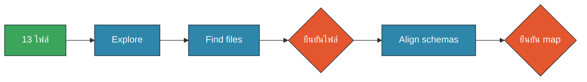
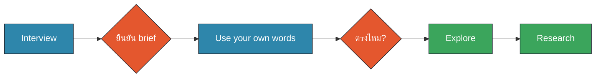

# M2 Workshop · Cowork กับไฟล์และโฟลเดอร์ + Prompt Patterns (30 นาที)

ข้อมูลทั้งหมดเป็นข้อมูลจำลอง (ไซต์สมมติ คนสมมติ อีเมล @example.com) · Prompt เต็มอยู่ใน `prompts.md` · เปิด **Workshop Companion** Artifact คู่กันเพื่อ copy prompt และติ๊ก checklist
สีในแผนภาพ: 🟧 คน (HITL) · 🟦 AI · 🟩 Data/Connector

## หน้า 1 · เตรียมโฟลเดอร์ทำงาน (3 นาที · 10:45–10:48)

**เป้าหมาย:** Cowork เห็นเฉพาะโฟลเดอร์สำเนาของ workshop นี้ (copy-before-write)

1. แตก Sample Data Pack (จาก SharePoint ของห้องอบรม) แล้ว **คัดลอก** ไปไว้ที่
   `Documents/Claude-Workshop/M2/input/` — ต้องเห็นโฟลเดอร์ `workshop_b_scattered/`
2. สร้างโฟลเดอร์ว่าง `Documents/Claude-Workshop/M2/output/`
3. เปิด Claude Desktop → Cowork → เลือกโฟลเดอร์ `Documents/Claude-Workshop/M2` (**ไม่ใช่** ทั้ง Documents)
4. เปิด Artifact 3 ตัว: Workshop Companion · Excel Detective · Prototype Gallery

**Prompt ทดสอบ (M2-P02 แบบย่อ):**
```text
บอกรายชื่อโฟลเดอร์ย่อยและจำนวนไฟล์ในโฟลเดอร์ที่คุณเข้าถึงได้ ห้ามสร้าง แก้ ย้าย หรือลบไฟล์ใด ๆ
```

✅ **Checkpoint (คนตรวจ):** Claude เห็นแค่ `input/` และ `output/` · นับได้ 13 ไฟล์ใน `workshop_b_scattered/` (รวมโฟลเดอร์ย่อย `เก่า_ไม่ใช้/`)
⚠️ ถ้า Claude เห็นไฟล์งานจริงของคุณ = เลือกโฟลเดอร์กว้างเกินไป ให้เลือกใหม่

ทำไม: Cowork สร้าง เขียน ย้ายไฟล์ได้จริง การจำกัดโฟลเดอร์ + ทำงานบนสำเนา คือเข็มขัดนิรภัยชั้นแรก

## หน้า 2 · Workshop B ตอนที่ 1: Explore → Find files → Align schemas (6 นาที · 10:48–10:54)

**สถานการณ์ (สมมติ):** คุณวิไลวรรณได้รับรายงานจาก 6 ไซต์ทางอีเมลตลอด 3 ปี แต่ละไซต์ใช้รูปแบบไฟล์ของตัวเอง ผู้บริหารขอ "Budget vs Actual ทุกไซต์ ปี 2566–2568" ภายในบ่ายนี้



**ขั้น 1 · Explore + Find files (3 นาที)**: copy **M2-P06** (Input → Process → Output ครบ, สั่งว่ายังไม่รวมข้อมูล)

✅ **Checkpoint:** เปิด Excel Detective ภารกิจ 1–3 แล้วเทียบกับตาราง inventory ของ Claude
- ไฟล์ซ้ำ / เวอร์ชันเก่า / นอกช่วงปี ถูกแยกออกครบไหม?
- ถ้า Claude ยังไม่เห็น ให้ถามต่อ เช่น "SiteA_ภูผาทอง_2568 มี 2 ไฟล์ ใช้ไฟล์ไหน เพราะอะไร?"
- พิมพ์ยืนยันรายการไฟล์ที่จะใช้

**ขั้น 2 · Align schemas (3 นาที)**: copy **M2-P07** → Claude เสนอตาราง mapping ต่อไฟล์

✅ **Checkpoint:** เทียบกับ Excel Detective ภารกิจ 4–6 (หน่วย, header, ชื่อไซต์, วันที่ พ.ศ./ค.ศ.)
- ตัวคูณแปลงหน่วยถูกไหม (บาท ÷ 1,000,000 · GWh × 1,000 · พันบาท ÷ 1,000)
- อนุมัติ mapping ด้วยคำว่า "อนุมัติ mapping" เท่านั้น ถ้าผิดให้แก้ก่อน

💡 Pattern ที่ใช้: Plan → Approve → Execute — Claude ต้องรอเราก่อนรวมข้อมูลทุกครั้ง

## หน้า 3 · Workshop B ตอนที่ 2: Merge → Analyse → Insight (6 นาที · 10:54–11:00)

**ขั้น 3 · Merge (2 นาที)**: copy **M2-P08** → ได้ `output/ops_merged.xlsx` (sheet `data` + `issues`)

✅ **Checkpoint:** 6 ไซต์ × 36 เดือน = **216 แถว** (หรือ 215 + 1 แถวที่บันทึกว่าข้อมูลหาย)
- sheet `issues` ต้องมีเรื่อง "ผาแดง พ.ย. 2567 ไม่มีข้อมูล" — และ **ต้องไม่เดาเติม**
- สุ่ม 1 ตัวเลขกลับไปเปิดไฟล์ต้นทางเทียบ (เช่น ดอยหินดำ ก.ย. 2567)

**ขั้น 4 · Analyse + Insight / Dashboard (4 นาที)**: copy **M2-P09**

✅ **Checkpoint:** เทียบ insight ของ Claude กับ Excel Detective ภารกิจ 7–9
- ไซต์ไหน ปีไหน ผลิตต่ำกว่างบมากที่สุด? เหตุผลอยู่ในไฟล์ไหน?
- ไซต์ไหนต้นทุนต่อหน่วยไต่ขึ้นต่อเนื่องในปี 2568?
- ทุกตัวเลขใน dashboard มีที่มาไหม? Artifact มีปุ่ม Export PDF ไหม?

**ผลลัพธ์ที่ต้องมีก่อนไปหน้า 4:** `output/ops_insight.xlsx` + สรุป insight 5 บรรทัดในแชต → นี่คือ **Input ของ Workshop A**

⏱ ถ้าเวลาไม่พอ: ข้าม dashboard ให้ Claude สรุป insight 5 บรรทัดอย่างเดียว แล้วไปต่อ

💡 สังเกต usage: งานรวมไฟล์หลายไฟล์ใช้ usage มากกว่าแชตทั่วไป — ทำเป็นขั้น ๆ และตรวจทีละขั้นช่วยลดการทำซ้ำ

## หน้า 4 · Workshop A ตอนที่ 1: Interview → Use your own words → Explore → Research (6 นาที · 11:00–11:06)

**เป้าหมาย:** ได้ brief ที่ถูกต้องก่อนเริ่มทำสไลด์ 5–7 หน้า สำหรับผู้บริหาร (สมมติ)



**ขั้น 1–2 · Interview + Use your own words (3 นาที)**: copy **M2-P10**
- ตอบทีละข้อ สั้น ๆ ตามบทบาทสมมติ: ผู้ฟัง = คณะผู้บริหารสายปฏิบัติการ (สมมติ), อยากได้ = อนุมัติงบแก้ถนนขนส่งไซต์ดอยหินดำ และตรวจสอบต้นทุนผาแดง
- แนวคิดนี้มาจาก skill "grill-me" ของ Matt Pocock: ให้ AI ซักเราทีละคำถาม

✅ **Checkpoint:** Claude ถาม **ทีละ 1 ข้อ** จริงไหม? brief มี เป้าหมาย · ผู้ฟัง · Input · Output · ข้อห้าม · เกณฑ์ว่าเสร็จ ครบไหม? การทวนเป้าหมาย 3 บรรทัดตรงกับที่คุณคิดไหม → ถ้าไม่ตรง แก้ตอนนี้

**ขั้น 3–4 · Explore + Research (3 นาที)**: copy **M2-P11**

✅ **Checkpoint:**
- ตารางตัวเลขระบุ sheet/เซลล์ต้นทางครบไหม
- ข้อมูลภายนอกเป็นแหล่งสาธารณะ มีลิงก์และวันที่ไหม — **ห้ามใส่ข้อมูลภายในจริงของบริษัท**
- ถ้าลิงก์ดูแปลกหรือไม่มีจริง ให้ตัดออก (AI อาจอ้างแหล่งผิดได้)

## หน้า 5 · Workshop A ตอนที่ 2: Plan → Prototype ×3 → Review → Build (6 นาที · 11:06–11:12)

**ขั้น 5 · Plan (1 นาที)**: copy **M2-P12** → อ่านโครงทีละหน้า · หัวข้อสไลด์ควรเป็น "ประโยคข้อสรุป" ไม่ใช่คำเดียว → พิมพ์ "อนุมัติโครง" หรือสั่งแก้

**ขั้น 6 · Prototype ×3 (2 นาที)**: copy **M2-P13** → ได้ `output/prototype_styles.pptx` 3 หน้า (Executive · Visual · Detailed)

✅ **Checkpoint:** เปิดไฟล์ดูทั้ง 3 แบบ → ไปที่ **Prototype Gallery** โหวตแบบที่คิดว่าเหมาะกับผู้ฟังที่สุด และเขียนเหตุผล 1 บรรทัด

**ขั้น 7 · Review (1 นาที)**: copy **M2-P14** (ใส่เลขสไตล์ที่เลือก)

✅ **Checkpoint:** ดูตาราง ✅/⚠️ ของ Claude แล้วสุ่มตรวจเอง 2 ตัวเลขกับ `ops_merged.xlsx` — คนเป็นคนตัดสินสุดท้าย

**ขั้น 8 · Build (2 นาที — ปล่อยให้ทำงานระหว่างสรุป)**: copy **M2-P15** → `output/deck.pptx`

✅ **Checkpoint:** ไม่มีไฟล์เดิมถูกเขียนทับ · มี speaker notes · หน้าสุดท้ายมีแหล่งที่มา
ถ้ายังไม่เสร็จ ไม่เป็นไร — ใน M4 Document Factory เราจะต่อยอดรายงานนี้

💡 ทำไม Prototype ก่อน: เปลี่ยนสไตล์ตอนมี 1 หน้า ถูกกว่าแก้ deck ทั้งชุด ทั้งเวลาและ usage

## หน้า 6 · ลองเอง: จัดโฟลเดอร์แบบ Plan only + สรุป (3 นาที · 11:12–11:15)


**เป้าหมาย:** ฝึกสั่งให้ Claude "เสนอแต่ไม่ลงมือ" กับโฟลเดอร์รก (วิทยากรสาธิตเต็มกับ ~1,500 ไฟล์แล้ว)

1. วิทยากรแจก `messy_folder_sample/` (ประมาณ 100 ไฟล์ ตัดมาจากชุด 1,500 ไฟล์) → คัดลอกไปไว้ใน `input/`
2. copy **M2-P16** แก้ path เป็น `input/messy_folder_sample`

✅ **Checkpoint (คนตัดสินใจ):**
- Claude **ไม่ได้** ย้ายหรือเปลี่ยนชื่อไฟล์ใดเลย (เช็กโฟลเดอร์เดิมยังเหมือนเดิม)
- เลือก 1 ใน 2 โครงสร้างที่ Claude เสนอ และตอบให้ได้ว่าทำไม
- ไฟล์ที่ Claude "ไม่มั่นใจ" ถูกส่งไป `_ตรวจด้วยคน/` ไม่ถูกลบ

**สรุปท้ายโมดูล — ติ๊กใน Workshop Companion:**
- ☐ ฉันเลือกได้ว่าเมื่อไรใช้ Upload / Project / Cowork folder
- ☐ ทุก prompt ของฉันมี Input → Process → Output
- ☐ ฉันหยุดตรวจก่อน Claude สร้าง/ย้ายไฟล์ทุกครั้ง (Plan → Approve → Execute)
- ☐ ฉันใช้ Use your own words · Interview · Prototype first ได้
- ☐ ฉันรู้วิธีรับมือไฟล์ใหญ่: ดูโครงก่อน · แบ่ง · ให้เขียนสคริปต์ · ขอเลขหน้า

➡️ ต่อไป M3: เชื่อม SharePoint และ Outlook (AI → Connect → Data → Execute)
