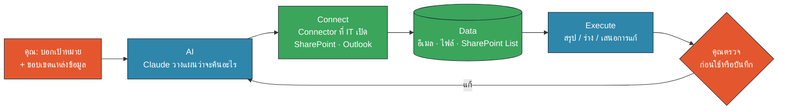
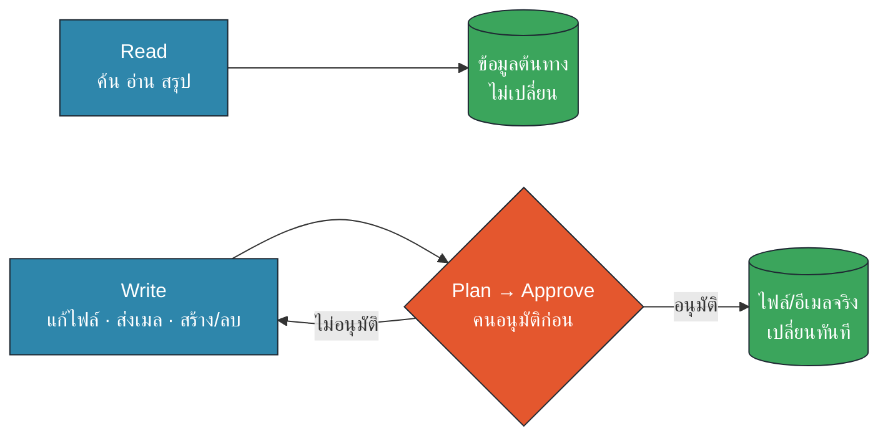
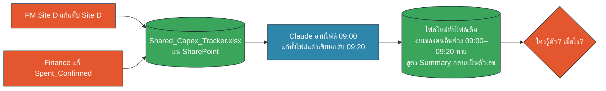
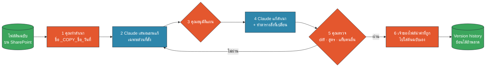
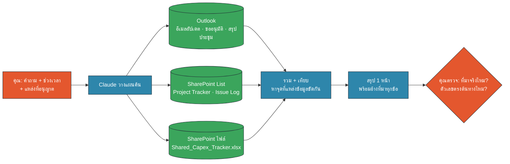
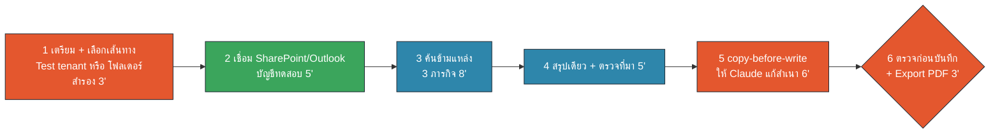

<!-- type: section -->
# M3 · Microsoft 365 Connectors อย่างปลอดภัย

ให้ Claude ค้น SharePoint + Outlook แทนเรา · อ่านได้เต็มที่ · เขียนอย่างมีวินัย

11:15–12:00 · 45 นาที (บรรยาย + Demo 15 · Workshop 30)

???
[0:00] เปิดด้วยคำถาม: "เช้าวันจันทร์ ใครต้องไล่อ่านอีเมล + เปิด Tracker + เปิด Excel 3 ไฟล์ เพื่อทำสรุปสถานะโครงการบ้าง?" ให้ยกมือ
M2 เราทำงานกับไฟล์ในเครื่อง M3 ขยับไปที่ข้อมูลที่อยู่บน M365 ของบริษัท
Requirement ที่ครอบคลุม: 1 (M365 First), 3 (Connectors), 4 (หลายแหล่ง/หลายรูปแบบ), 5 (HITL ก่อน write), 7 (ข้อจำกัด)

---

# 45 นาทีนี้เราจะได้อะไร

- เข้าใจ **AI → Connect → Data → Execute**
- ใช้เฉพาะ Connector ที่ IT เปิด: **SharePoint + Outlook**
- แยก **Read** กับ **Write** และรู้ว่า write เสี่ยงตรงไหน
- ใช้ **copy-before-write** ทุกครั้งที่ให้ Claude แก้ไฟล์
- ค้นอีเมล + ไฟล์ + List แล้วได้ **สรุปเดียว** พร้อมที่มา
- รู้ข้อจำกัดของ Connector และทางเลี่ยง

???
[0:30] อ่านเร็ว ๆ บอกว่าครึ่งหลังทุกคนจะได้ลงมือกับ "กล่องจดหมายทดสอบ" และ "SharePoint ทดสอบ" ที่มีข้อมูลสมมติ
ถ้า IT ยังไม่ได้เตรียม test tenant มีเส้นทางสำรองเป็นโฟลเดอร์ Sample Pack ในเครื่อง ได้ฝึกเหมือนกัน

---

# AI → Connect → Data → Execute

🟧 คน (HITL) · 🟦 AI · 🟩 Data/Connector

???
[1:00] ชี้ทีละกล่อง
- AI: Claude วางแผนว่าต้องค้นอะไร จากไหน
- Connect: ผ่าน Connector ที่ IT อนุมัติเท่านั้น Claude เห็น **เท่าที่บัญชีเราเห็น** (delegated permissions) ไม่มากกว่านั้น
- Data: อีเมล ไฟล์ Word/Excel/PDF ใน SharePoint
- Execute: สรุป ร่าง หรือ "เสนอ" การแก้ไข
- จุดสุดท้ายคือเราตรวจ ก่อนนำไปใช้หรือบันทึก (Human-in-the-Loop)
ประโยคจำ: "Connector คือท่อ ไม่ใช่ใบอนุญาตให้ทำอะไรก็ได้"

---

# Connector ที่ใช้ได้ในบ้านปู

| Connector | สถานะ | ใช้ทำอะไรในหลักสูตร |
|---|---|---|
| **SharePoint** (Microsoft 365) | ✅ IT เปิดให้ | ค้นและอ่านไฟล์ Word · Excel · PDF · CSV |
| **Outlook** (Microsoft 365) | ✅ IT เปิดให้ | ค้นอีเมลอัปเดต ขออนุมัติ สรุปประชุม |
| Google Drive | ⛔ **ไม่อนุญาต** | ไม่ใช้ ไม่สาธิต ไม่ต่อเอง |
| Connector อื่น / บัญชีส่วนตัว | ⛔ ไม่อนุญาต | ถาม IT/Hi-I ก่อนเสมอ |

> เห็น Connector อื่นในเมนู ≠ อนุญาตให้ใช้ · ใช้บัญชีบริษัทเท่านั้น

???
[2:00] ย้ำชัด ๆ: Google Drive ไม่อนุญาตในบ้านปู ไม่ว่าจะเป็นบัญชีส่วนตัวหรืออะไรก็ตาม
Microsoft 365 connector ของ Claude ครอบคลุม Teams ด้วย แต่ในหลักสูตรนี้ใช้เฉพาะ SharePoint และ Outlook ตามที่ IT ยืนยัน (ถ้า IT เปิด Teams ในอนาคต หลักเดียวกันใช้ได้)
บัญชี Microsoft ส่วนตัว (@outlook.com, @hotmail.com) เชื่อมไม่ได้อยู่แล้ว ต้องเป็น tenant ของบริษัท
ที่มา: Claude Help Center "Set up the Microsoft 365 connector" (SOURCES #1)

---

# เปิดใช้อย่างไร: 3 คน 3 ขั้น

| ใคร | ทำอะไร | เราต้องรู้อะไร |
|---|---|---|
| Claude Owner (Hi-I/IT) | เพิ่ม Connector ใน Organization settings | เปิดให้ทั้งทีม หรือไม่เปิด |
| Entra Global Admin (IT) | ให้ consent ครั้งเดียว · เลือกสิทธิ์ | ปิดบางส่วนได้ เช่น ปิด Mail |
| **ผู้ใช้ (เรา)** | Customize → Connectors → Connect · login บัญชีบริษัท | Claude เห็นเท่าที่เราเห็น |

- ยังไม่มีปุ่ม Connect? **ไม่ต้องหาทางเลี่ยง** แจ้ง IT
- Write tools (ส่งเมล · แก้ไฟล์) เป็นตัวเลือกแยกที่ admin ต้องเปิดเพิ่ม

???
[3:00] ให้คนเข้าใจว่าทำไมบางคนเห็น บางคนไม่เห็น: ขึ้นกับการตั้งค่าขององค์กร
สำคัญ: Connector ใช้ delegated permissions ไฟล์ที่เราไม่มีสิทธิ์เปิด Claude ก็เปิดไม่ได้ แต่ไฟล์ที่เราเปิดได้ "ทั้งหมด" Claude ก็ค้นได้ทั้งหมด (ตั้ง allowlist เฉพาะ site ไม่ได้) จึงต้องระวังคำถามที่กว้างเกินไป
Write tools: admin ต้อง re-consent และเปิดแยก ค่าเริ่มต้นเป็น read-only (SOURCES #1)
คำถามเปิดให้ IT: Banpu เปิด write tools หรือไม่ (ดู README)

---

# Read vs Write: ความเสี่ยงไม่เท่ากัน

🟧 คน (HITL) · 🟦 AI · 🟩 Data/Connector

| Read (ค่าเริ่มต้น) | Write (ต้องเปิดเพิ่ม / ทำผ่าน Cowork) |
|---|---|
| ค้น อ่าน สรุป · ต้นทางไม่เปลี่ยน | แก้ไฟล์ ส่งเมล นัดประชุม · **เปลี่ยนทันที** |
| พลาด = ได้คำตอบผิด → ตรวจแล้วแก้ | พลาด = ทับงานคนอื่น ส่งผิดคน |

???
[4:00] Read: เลวร้ายสุดคือได้สรุปผิด ซึ่งเราตรวจได้ก่อนใช้
Write: เปลี่ยนของจริงทันที และ Help Center ไม่ได้ระบุขั้นยืนยันก่อนแก้ไฟล์หรือส่งอีเมล (มีแค่ Teams ที่ถามก่อนส่ง) → เราต้องสร้างจุดอนุมัติเอง: Plan → Approve → Execute
อีกเส้นทางที่ "เขียน" คือ Cowork แก้ไฟล์ในโฟลเดอร์ที่ sync กับ SharePoint/OneDrive: เซฟปุ๊บ ขึ้น SharePoint ปั๊บ
กฎของหลักสูตร: งาน write ทุกงานต้องมีคนอนุมัติ และทำกับ "สำเนา" ก่อน

---
<!-- type: story -->
# ต.ค. 2020: ผู้ป่วยโควิด 15,841 รายหายจากรายงาน เพราะไฟล์ Excel

- Public Health England รับผลตรวจจากแล็บเป็นไฟล์ CSV แล้วนำเข้า Excel
- ไฟล์ Excel แบบเก่า (.xls) รับข้อมูลได้จำกัด → แถวที่เกินถูก **ตัดทิ้งเงียบ ๆ**
- 25 ก.ย.–2 ต.ค. 2020 ผู้ป่วย 15,841 รายไม่อยู่ในรายงานรายวัน
- การติดตามผู้สัมผัสล่าช้าหลายวัน กว่าจะมีคนสังเกตว่าตัวเลขไม่ตรง

> บทเรียน: ข้อมูลหายได้ระหว่างย้ายจากระบบหนึ่งไปอีกระบบ โดยไม่มี error → **นับต้นทาง vs ผลลัพธ์ทุกครั้ง**

???
[5:00] เล่า 1 นาที เรื่องนี้ไม่เกี่ยวกับ AI แต่เป็นบทเรียนเดียวกับ Connector: เครื่องมือ "ทำงานสำเร็จ" แต่ได้ข้อมูลไม่ครบ และไม่มีใครรู้
รายงานข่าวบางแห่งอธิบายสาเหตุต่างกันเล็กน้อย (row limit ของ .xls / ขนาดไฟล์) PHE เรียกว่าปัญหา "file size" — ใช้คำว่า "ไฟล์รับข้อมูลได้จำกัด" ก็พอ
ที่มา: The Register 5 Oct 2020, Computer Weekly (SOURCES #4, #5)
เชื่อมต่อ: Connector ก็คืนผลค้นหาเป็นชุด ๆ ไม่ใช่ทุกฉบับ → ขอให้ Claude บอก "รายการที่มาที่ใช้" และเทียบจำนวนกับต้นทางเสมอ (M3-P04 ข้อ 3)

---

# Excel ที่หลายคนแก้พร้อมกัน: พังได้อย่างไร

🟧 คน (HITL) · 🟦 AI · 🟩 Data/Connector

- AI อ่าน "ภาพถ่าย" ของไฟล์ ณ เวลาหนึ่ง แล้วเขียนกลับทั้งไฟล์
- งานคนอื่นระหว่างนั้นหาย · สูตรกลายเป็นค่าคงที่ · แท็บคนอื่นถูกแตะ

???
[6:00] อธิบายแบบภาษาคน: Excel บน SharePoint รองรับ co-authoring เมื่อคนแก้ผ่าน Excel แต่ถ้าเครื่องมือใดดาวน์โหลดไปแก้ทั้งไฟล์แล้วอัปโหลดทับ ระบบจะเห็นเป็น "ไฟล์เวอร์ชันใหม่ทั้งไฟล์" ไม่ใช่การแก้ทีละเซลล์
ความเสี่ยงที่พบบ่อย: (1) ทับงานคนอื่น (2) สูตรถูกแทนด้วยตัวเลข (3) dropdown/format หาย (4) แก้แท็บที่ไม่ใช่ของเรา
ข่าวดี: SharePoint มี Version history ย้อนได้ (SOURCES #3) แต่ต้องมีคนรู้ตัวก่อน

---

# copy-before-write (ทำสำเนาก่อนให้ Claude แก้)

🟧 คน (HITL) · 🟦 AI · 🟩 Data/Connector

???
[7:00] นี่คือกฎหลักของโมดูล ใช้ชื่อ "copy-before-write" ให้ตรงกันทั้งหลักสูตร
6 ขั้น: ทำสำเนา (ตั้งชื่อ _COPY_ชื่อ_วันที่) → Claude เสนอแผน → เราอนุมัติ → Claude แก้สำเนาและทำ "ตารางสิ่งที่เปลี่ยน" → เราตรวจ diff สูตร แท็บคนอื่น → เจ้าของไฟล์นำค่าที่ถูกไปใส่ต้นฉบับเอง
ทำไมไม่ให้ Claude ทับต้นฉบับเลยหลังตรวจ? เพราะระหว่างที่เราตรวจ คนอื่นอาจแก้ต้นฉบับไปแล้ว
Workshop หน้า 5–6 จะฝึกขั้นนี้จริง

---

# หลายแหล่ง หลายรูปแบบ → สรุปเดียว

🟧 คน (HITL) · 🟦 AI · 🟩 Data/Connector

???
[8:30] นี่คือ use case ที่คุ้มที่สุดของ Connector: งาน "ไล่หา" ที่กินเวลาเช้าวันจันทร์
สูตร prompt: คำถาม + ช่วงเวลา + แหล่งที่อนุญาต + รูปแบบผลลัพธ์ + "อ้างที่มาทุกข้อ" + "บอกจุดที่แหล่งข้อมูลขัดกัน"
SharePoint List: Connector อ่านไฟล์ในคลังเอกสาร จึงให้ Export List เป็น CSV ไว้ใน SharePoint (ดูข้อจำกัดอีกสไลด์)
คุณค่าที่แท้จริงคือ "จุดที่ขัดกัน" เช่น Tracker บอก On track แต่อีเมลบอกว่าของส่งไม่ครบ

---

# Demo · สรุปสถานะโครงการจาก 3 แหล่ง (ข้อมูลสมมติ)

1. Outlook ทดสอบ: อีเมล 20 ฉบับ ย้อนหลัง 4 สัปดาห์
2. SharePoint ทดสอบ: Project_Tracker.csv · Issue_Log.csv · Shared_Capex_Tracker_2569.xlsx
3. Prompt `M3-P02` → สรุป 1 หน้า: ความเสี่ยง 3 เรื่อง · คำขออนุมัติที่ค้าง
4. ชี้ผลลัพธ์: PRJ-101 "On track" ใน Tracker แต่อีเมลบอกของไม่ครบ
5. ตรวจ: คลิกที่มา 2 ข้อ เทียบตัวเลขกับต้นทาง

???
[9:30] Demo สด 2 นาที (ทำล่วงหน้าใน dry-run แล้วเก็บผลไว้เป็น fallback)
- เปิด Claude Desktop → ตรวจว่าเปิด Connector Microsoft 365 แล้ว
- วาง M3-P02 (ใน prompts.md) ให้ห้องเห็นว่า Claude ค้นอะไรบ้าง (tool calls)
- ไฮไลต์ 3 สิ่งที่ควรเห็น: (1) PRJ-101 ขัดกันระหว่าง Tracker กับอีเมล (2) PRJ-105 ขออนุมัติงบเพิ่ม 3.8 ล้านบาท ค้างถึง 31 ต.ค. (3) PRJ-104 Delayed รอใบอนุญาต
- ถ้า Claude ไม่เจอบางอย่าง ให้ถามต่อแบบเจาะจง (M3-P03) แล้วบอกห้องว่า "นี่คือเหตุผลที่ต้องตรวจ"
- ถ้าไม่มี test tenant: ใช้โฟลเดอร์ pack/ ใน Cowork แทน (อีเมลเป็นไฟล์ .eml)

---
<!-- type: story -->
# Demo · "เช้าวันศุกร์ที่ Capex Tracker หายครึ่งไฟล์" (เรื่องสมมติ)

- 09:00 PM Site D ขอให้ AI "อัปเดต Forecast ใน Capex Tracker ให้หน่อย"
- 09:05–09:20 Finance ยืนยันตัวเลข Spent ของ Site E ในไฟล์เดียวกัน
- 09:20 AI เซฟไฟล์ทั้งไฟล์ทับ → งาน Finance หาย · Summary เป็นตัวเลขตาย
- 14:00 ผู้บริหารเห็นยอดรวมผิด · ใช้ Version history ย้อนคืน 2 ชั่วโมง
- **ทำซ้ำแบบถูก:** สำเนา → แผน → อนุมัติ → ตาราง diff → เจ้าของไฟล์ใส่ค่าเอง

???
[11:30] เรื่องนี้แต่งขึ้นจากรูปแบบความผิดพลาดที่พบบ่อย ไม่ใช่เหตุการณ์จริงของบ้านปู
Demo 1.5 นาที: เปิด Shared_Capex_Tracker_2569.xlsx (ข้อมูลสมมติ) ใน Cowork ชี้แท็บ อ่านก่อน, Summary (สูตร), Change_Log
แล้วทำแบบถูก: ใช้ M3-P05 ทำสำเนา + M3-P06 ให้ Claude เสนอแผนก่อนแก้ แสดงตารางสิ่งที่เปลี่ยน
ถามห้อง: "จุดไหนในเรื่องนี้ที่ถ้ามีคนตรวจ จะไม่เกิด?" (คำตอบ: ก่อนเซฟ และการทำงานกับสำเนา)
วิธีกู้: SharePoint → ไฟล์ → Version history → Restore (SOURCES #3)

---

# ข้อจำกัดของ Connector และทางเลี่ยง

| ข้อจำกัด | ทางเลี่ยง |
|---|---|
| SharePoint List ไม่ได้ระบุว่าค้นได้ | Export List เป็น CSV/Excel ไว้ในคลังเอกสาร |
| จำกัด site ไม่ได้ · ค้นทุกที่ที่เราเข้าได้ | ระบุ site/โฟลเดอร์/ชื่อไฟล์ใน prompt |
| ค้นอาจไม่ครบ · ไฟล์ใหญ่อาจอ่านไม่หมด | ถามเจาะจง ขอรายการที่มา แบ่งช่วงเวลา |
| ไฟล์เข้ารหัส/บางชนิด (OneNote) เปิดไม่ได้ | ใช้ไฟล์ Word/Excel/PDF/CSV แทน |
| Write tools ส่งไฟล์แนบไม่ได้ · ไม่มีขั้นยืนยันในตัว | ให้ร่างไว้ คนส่งเอง · ใช้ลิงก์ SharePoint |

???
[13:00] ข้อมูลจาก Claude Help Center ณ 30 ต.ค. 2026 (SOURCES #1, #2) ตรวจซ้ำสัปดาห์ที่สอน
"ค้นอาจไม่ครบ" เป็นข้อสังเกตจากการใช้งาน ไม่ใช่ตัวเลขทางการ: Connector คืนผลค้นหาเป็นชุด ๆ ไม่ใช่ทุกฉบับ จึงต้องขอให้ Claude "บอกรายการที่มาที่ใช้" แล้วเราดูว่ามีอะไรขาดไหม
Requirement 7: ข้อจำกัดจริง + workaround
ความปลอดภัย: Claude เห็นทุกอย่างที่เราเห็น ถามกว้าง ๆ อาจดึงข้อมูล 🔴 มาโดยไม่ตั้งใจ → ระบุขอบเขตเสมอ (ทบทวน Data Traffic Light จาก M1)

---

# Workshop 30 นาที: ค้นข้ามแหล่ง + แก้อย่างปลอดภัย

🟧 คน (HITL) · 🟦 AI · 🟩 Data/Connector

- **เส้นทาง A:** บัญชีทดสอบ + SharePoint/Outlook ทดสอบ
- **เส้นทาง B (สำรอง):** โฟลเดอร์ `M3_SamplePack` ในเครื่อง + Cowork
- เปิด Artifact **Connector Mission** ตามไปทีละด่าน แล้ว Export PDF ตอนจบ

???
[14:00] แจก workshop.md และลิงก์ Artifact connector-mission.html
เช็กเร็ว: ใครเห็น Microsoft 365 ใน Connectors แล้วยกมือ → ใครไม่เห็น ไปเส้นทาง B ทันที อย่าเสียเวลาเกิน 2 นาทีกับการ login
ห้ามใช้ข้อมูลจริงจากงาน ใช้แค่ Sample Pack ทดสอบ

---

# สรุป M3: 5 กฎก่อนกด Enter

1. Connector ที่ใช้ได้: **SharePoint + Outlook** เท่านั้น (ไม่ใช่ Google Drive)
2. ระบุขอบเขต: site · โฟลเดอร์ · ช่วงเวลา · แหล่งที่อนุญาต
3. ขอ **ที่มาทุกข้อ** และ **จุดที่ข้อมูลขัดกัน**
4. **copy-before-write** · ไม่ให้ AI ทับไฟล์ที่แชร์
5. งาน write ทุกงาน: Plan → Approve → Execute + ตรวจก่อนบันทึก

→ บ่าย M4: เอาสรุปหลายแหล่งไปทำ Document Factory

???
[14:45] ปิดด้วยกฎ 5 ข้อ ให้ทุกคนถ่ายรูปหรือดูใน PDF จาก Artifact
ถ้ามีเวลาเหลือ ถาม: "งานไหนของคุณที่ใช้ Read อย่างเดียวก็คุ้มแล้ว?"
เชื่อมต่อ: M4 ใช้หลัก Multiple Sources → Process → Report ต่อ และ M6 จะตั้งให้ทำอัตโนมัติทุกสัปดาห์ (ยังต้องมีคนตรวจก่อนส่ง)
