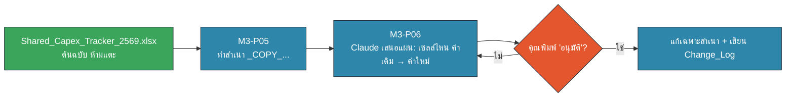

# M3 Workshop · ค้นข้ามแหล่ง + แก้อย่างปลอดภัย (30 นาที · 11:30–12:00)

ข้อมูลทั้งหมดเป็นข้อมูลสมมติจาก Sample Pack M3 · Connector ที่ใช้ได้: **SharePoint + Outlook** เท่านั้น (ไม่ใช้ Google Drive) · เปิด Artifact **Connector Mission** (`artifacts/connector-mission.html`) ไว้คู่กัน แล้วติ๊กตามทีละด่าน

🟧 คน (HITL) · 🟦 AI · 🟩 Data/Connector — ทุกหน้ามี ✅ จุดที่ **คุณ** ต้องตรวจก่อนไปต่อ

## หน้า 1 · เตรียม + เลือกเส้นทาง (3 นาที · 11:30–11:33)

**เป้าหมาย:** รู้ว่าวันนี้คุณทำเส้นทางไหน และพร้อมก่อนเริ่มจับเวลา

| | เส้นทาง A · Test tenant | เส้นทาง B · โฟลเดอร์สำรอง |
|---|---|---|
| ใช้เมื่อ | IT เตรียมบัญชีทดสอบ + site `M3-Training` + mailbox ทดสอบแล้ว | ไม่เห็น Microsoft 365 ใน Connectors หรือ login ไม่ผ่านภายใน 2 นาที |
| ข้อมูล | อีเมล 20 ฉบับใน mailbox ทดสอบ · Project Tracker, Issue Log, Shared_Capex_Tracker_2569.xlsx บน site | โฟลเดอร์ `M3_SamplePack/` (outlook/*.eml + sharepoint/*) ในเครื่อง เปิดผ่าน Cowork |
| Prompt เริ่ม | M3-P01 | M3-P08 |

**ขั้นตอน**
1. เปิด Claude Desktop → Settings → Connectors ดูว่ามี **Microsoft 365** หรือไม่
2. ยกมือถ้า **ไม่เห็น** → ไปเส้นทาง B ทันที (อย่าเสียเวลาแก้ login เกิน 2 นาที)
3. เส้นทาง B: แตกไฟล์ `M3_SamplePack.zip` ไว้ที่ Desktop แล้วให้ Cowork เข้าถึง **เฉพาะ** โฟลเดอร์นี้

✅ **Checkpoint:** ใช้บัญชีทดสอบ / โฟลเดอร์ Sample Pack เท่านั้น — ไม่เปิดไฟล์งานจริง ไม่เปิดกล่องจดหมายจริง (ทบทวน Data Traffic Light จาก M1)

## หน้า 2 · เชื่อม SharePoint/Outlook แบบอ่านอย่างเดียว (5 นาที · 11:33–11:38)

**เป้าหมาย:** ยืนยันว่า Claude "เห็น" อะไร ก่อนจะถามอะไรจริงจัง

**เส้นทาง A** — วาง prompt นี้ (M3-P01)
```text
ใช้ Microsoft 365 connector แบบอ่านอย่างเดียว ห้ามแก้ไข ห้ามส่ง ห้ามสร้างอะไร
1) ค้นอีเมลใน Outlook ที่หัวเรื่องขึ้นต้นด้วย [PRJ- ในช่วง 30 วันที่ผ่านมา บอกจำนวนและ 3 หัวเรื่องล่าสุด
2) ค้นไฟล์ใน SharePoint site "M3-Training" ที่ชื่อมีคำว่า Tracker หรือ Issue บอกชื่อไฟล์และวันที่แก้ไขล่าสุด
ถ้าค้นไม่เจอ ให้บอกตรง ๆ ว่าไม่เจอ อย่าเดา
```

**เส้นทาง B** — วาง M3-P08 (ใน `prompts.md`) ให้ Cowork นับจำนวนอีเมล โครงการ และ issue ที่ยัง Open

**ดูอะไรระหว่างรอ:** Claude เรียกเครื่องมืออะไรบ้าง (search mail / search SharePoint) — นี่คือขั้น **Connect → Data** ใน AI → Connect → Data → Execute

✅ **Checkpoint:**
- จำนวนที่ Claude บอก ตรงกับคำใบ้ของวิทยากรไหม (อีเมลหัวเรื่อง `[PRJ-` มีหลายฉบับ, Issue Log 56 แถว)
- ถ้า Claude บอกว่าเจอไฟล์ **นอก** site `M3-Training` → จดไว้: นี่คือเหตุผลที่ต้องระบุขอบเขตทุกครั้ง (Connector ค้นได้ทุกที่ที่บัญชีเราเข้าถึง)

## หน้า 3 · ค้นข้ามแหล่ง: 3 ภารกิจ (8 นาที · 11:38–11:46)

**เป้าหมาย:** ฝึกถามเจาะจง + ขอที่มา แล้ว **เทียบเอง** ว่าแหล่งข้อมูลขัดกันไหม

ใช้ prompt แม่แบบ M3-P03 แล้วเปลี่ยนเฉพาะคำถาม
```text
อ่านอย่างเดียว ใช้เฉพาะ Outlook และ SharePoint site "M3-Training"
คำถาม: [วางคำถามของภารกิจ]
ตอบสั้น ๆ แล้วแนบที่มาทุกข้อ (หัวเรื่องอีเมล+วันที่ หรือ ชื่อไฟล์+แท็บ/แถว)
ถ้าสองแหล่งให้ตัวเลขไม่ตรงกัน ให้แสดงทั้งสองค่า อย่าเลือกเอง
```

| ภารกิจ | คำถาม (วางในวงเล็บเหลี่ยม) | แหล่งที่ควรถูกอ้าง |
|---|---|---|
| 🎯 1 · เงินค้างอนุมัติ | "PRJ-105 ขออนุมัติงบเพิ่มเท่าไร ทำไม ต้องตอบภายในวันไหน และงบใน Capex Tracker ตอนนี้เท่าไร" | อีเมล `[PRJ-105] ขออนุมัติงบเพิ่ม…` + Capex Tracker แท็บ Site D |
| 🎯 2 · สถานะที่ไม่ตรงกัน | "PRJ-101 สถานะใน Project Tracker คืออะไร และอีเมลหรือ Issue Log บอกอะไรที่ต่างออกไป" | Project Tracker + อีเมล `[PRJ-101] อัปเดตสัปดาห์ 43…` + Issue Log |
| 🎯 3 · โครงการล่าช้า | "PRJ-104 ล่าช้าเพราะอะไร ใครติดตาม และมีการพูดถึงในประชุมไหนบ้าง" | Project Tracker + อีเมล `[PRJ-104]…` + สรุปประชุม Project Review |

ทำให้ได้อย่างน้อย 2 ภารกิจ (ภารกิจ 3 เป็นโบนัส) แล้วกรอกคำตอบใน Artifact เพื่อเก็บแต้ม

✅ **Checkpoint:** เปิดที่มาอย่างน้อย **1 แหล่งต่อภารกิจ** ด้วยตัวเอง (คลิกลิงก์/เปิดไฟล์) แล้วเทียบตัวเลข — ถ้า Claude ไม่อ้างที่มา ให้ถามซ้ำ ไม่ใช่เชื่อเลย

## หน้า 4 · สรุปเดียวจาก 3 แหล่ง + ตรวจที่มา (5 นาที · 11:46–11:51)

**เป้าหมาย:** รวม Outlook + SharePoint List + Excel เป็นสรุปสถานะ 1 หน้า แล้วให้ Claude ตรวจตัวเองก่อนเราตรวจ

**ขั้น 1** — วาง M3-P02 (สรุปสถานะโครงการ 1 หน้า: ตารางโครงการเสี่ยง · ความเสี่ยงสูงสุด 3 เรื่อง · คำขออนุมัติที่ค้าง · จุดที่แหล่งข้อมูลขัดกัน)

**ขั้น 2** — วาง M3-P04 ทันทีหลังได้สรุป
```text
ทบทวนสรุปที่คุณเพิ่งทำ:
1) ข้อไหนที่อ้างที่มาไม่ได้ชัด ให้ทำเครื่องหมาย ⚠️
2) ตัวเลขทุกตัว (งบ วงเงิน %) มาจากแหล่งไหน แสดงเป็นตาราง ตัวเลข | แหล่ง | ตรงกันทุกแหล่งไหม
3) มีอีเมลหรือไฟล์ในขอบเขตที่คุณไม่ได้อ่านไหม บอกตรง ๆ
ห้ามแก้สรุปเอง ให้ฉันตัดสินใจ
```

**สิ่งที่สรุปที่ดีควรมี (เช็กเอง)**
- PRJ-105 ขอเพิ่ม 3.8 ล้านบาท (95.0 → 98.8) ต้องตอบภายใน 31 ต.ค. แต่ Capex Tracker ยังเป็น 95
- PRJ-101 "On track" ใน Tracker แต่อีเมล + Issue Log บอกของส่งไม่ครบ อาจเลื่อน
- PRJ-104 Delayed รอใบอนุญาต
- คำขออนุมัติอื่นที่ค้าง (เช่น จ้างที่ปรึกษา BESS, OT ทีมติดตั้งสายพาน)

✅ **Checkpoint:** นับจำนวนแหล่งที่ Claude บอกว่าใช้ เทียบกับที่ควรมี (3 ประเภท) — จำบทเรียนเรื่อง 15,841 เคสที่หายเงียบ ๆ: **นับต้นทาง vs ผลลัพธ์**

## หน้า 5 · copy-before-write: ให้ Claude แก้ "สำเนา" (6 นาที · 11:51–11:57)

**เป้าหมาย:** อัปเดต Forecast ของ PRJ-105 ตามอีเมลขออนุมัติ โดยไม่แตะไฟล์ที่ทั้งทีมใช้ร่วมกัน


🟧 คน (HITL) · 🟦 AI · 🟩 Data/Connector

**ขั้นตอน** (ทำใน Cowork ทั้งเส้นทาง A และ B — เส้นทาง A ให้ดาวน์โหลดไฟล์จาก site ทดสอบมาไว้ในโฟลเดอร์ทำงานก่อน)
1. วาง **M3-P05** → Claude ทำสำเนา `_COPY_Shared_Capex_Tracker_2569_[ชื่อเล่น]_[YYYYMMDD].xlsx` แล้ว **หยุดรอ**
2. วาง **M3-P06** → Claude เสนอแผน: แท็บ Site D แถว PRJ-105 · Forecast_MTHB 95 → 98.8 · Note "รออนุมัติงบเพิ่ม 3.8 ลบ. (อีเมล 26 ต.ค.)"
3. อ่านแผน ถ้ามีการแตะแท็บอื่น/สูตร/format → ตอบว่า "ไม่อนุมัติ แก้แผน" ถ้าถูกต้อง → พิมพ์ **อนุมัติ**

✅ **Checkpoint (ก่อนพิมพ์ "อนุมัติ"):**
- แผนแก้ **เฉพาะไฟล์ `_COPY_`** และเฉพาะแท็บ Site D + 1 แถวใน Change_Log
- ไม่มีการเปลี่ยนสูตร ไม่ลบแถว/คอลัมน์ ไม่แตะแท็บของไซต์อื่น (ที่ประชุมสั่งไว้ว่า **ห้ามแก้แท็บของไซต์อื่น**)

## หน้า 6 · ตรวจก่อนบันทึก + ปิดงาน (3 นาที · 11:57–12:00)

**เป้าหมาย:** พิสูจน์ด้วยหลักฐานว่าสำเนาพร้อมให้ **เจ้าของไฟล์** นำไปใช้ — ไม่ใช่ Claude เขียนทับต้นฉบับ

**ขั้น 1** — วาง **M3-P07** ให้ Claude เทียบต้นฉบับกับสำเนาแบบอ่านอย่างเดียว: ทุกเซลล์ที่ต่าง · สูตรที่กลายเป็นตัวเลข · การเปลี่ยนในแท็บอื่น · dropdown คอลัมน์ Status

**ขั้น 2** — ตัดสินใจเอง

| ผล M3-P07 | ทำอะไรต่อ |
|---|---|
| ต่างเฉพาะ Site D!F2, Site D!J2 + Change_Log 1 แถว · สูตรครบ | ✅ "พร้อมให้เจ้าของไฟล์นำไปใส่ต้นฉบับ" — ส่งลิงก์สำเนาให้คุณกัญญา (สมมติ) ตรวจเอง |
| มีสูตรกลายเป็นตัวเลข หรือแท็บอื่นเปลี่ยน | ❌ ทิ้งสำเนา เริ่มจาก M3-P05 ใหม่ |
| ต้นฉบับบน SharePoint ถูกแก้ไปแล้วโดยไม่ตั้งใจ | ใช้ **Version history → Restore** (SOURCES #3) แล้วแจ้งเจ้าของไฟล์ทันที |

**ขั้น 3 (ถ้ามีเวลา / ทำต่อหลังเรียน)** — M3-P09 ร่างอีเมลสรุปถึง `pm-team@example.com` **แสดงในแชตเท่านั้น ห้ามส่ง** ใส่ลิงก์ SharePoint แทนแนบไฟล์

**ปิดงาน:** ใน Artifact Connector Mission กด **⬇ Export PDF** เก็บผลภารกิจ + 5 กฎก่อนกด Enter

✅ **Checkpoint สุดท้าย:**
- [ ] ต้นฉบับไม่ถูกแก้ (วันที่แก้ไขล่าสุดไม่เปลี่ยน)
- [ ] สรุปทุกข้ออ้างที่มาได้ และเราเปิดดูเองอย่างน้อย 3 แหล่ง
- [ ] ไม่มีอะไรถูกส่งออกไปจาก Outlook
