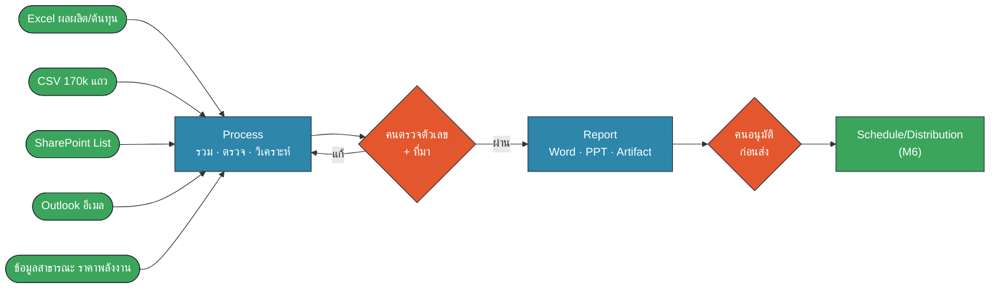
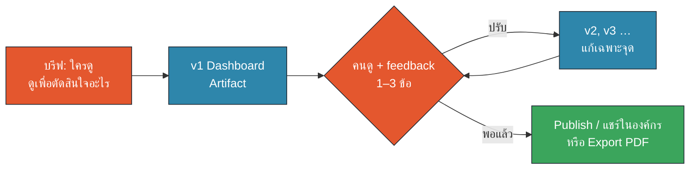
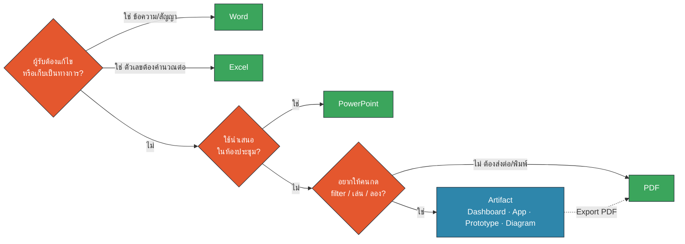
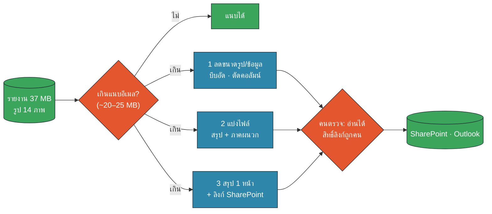
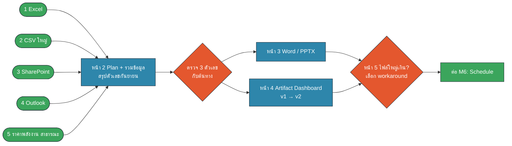

<!-- type: section -->
# M4 · Document Factory & Artifact as Output Layer

รวมหลายแหล่ง → รายงานเดียว · เลือกรูปแบบ output ให้ถูกงาน · รู้ทางออกเมื่อไฟล์ใหญ่เกิน

13:00–13:40 · 40 นาที (บรรยาย 15 · Workshop 25)

???
[0:00] เปิดบ่ายด้วยพลังงานสูง ถามห้อง: "ใครต้องทำรายงานประจำเดือนบ้าง? ใช้เวลากี่ชั่วโมง?" ให้ยกมือ 1/2/4/8+ ชั่วโมง
เชื่อมกับเช้า: M2 = ไฟล์ในเครื่อง, M3 = SharePoint/Outlook ตอนนี้เอาทั้งหมดมารวมเป็น "รายงานจริง 1 ฉบับ"
Requirement: 1 (M365 First), 4 (Multiple Sources), 6 (Document Factory), 7 (ข้อจำกัด + workaround), 11 (Artifact as Output Layer)

---

# 40 นาทีนี้เราจะได้อะไร

- เห็นสายพาน **Document Factory**: Multiple Sources → Process → Report
- รวม **5 แหล่ง** (ภายใน + สาธารณะ) เป็น Monthly Operations Report
- ใช้ **Artifact** เป็น output layer: Dashboard · App · Prototype · Diagram
- เลือกได้ว่าเมื่อไรใช้ **Word / Excel / PDF / PPT** แทน
- แก้ปัญหา **รายงานใหญ่เกินแนบอีเมล** ได้ 3 วิธี

???
[0:45] อ่านเร็ว ผลงานที่ได้กลับบ้าน: ไฟล์ Word/PPTX 1 ฉบับ + Artifact Dashboard 1 ตัว + วิธีส่งรายงานใหญ่
บอกล่วงหน้า: รายงานที่ทำวันนี้จะถูกตั้งเป็นงานอัตโนมัติ (Schedule/Distribution) ใน M6 บ่ายสองโมงกว่า

---
<!-- type: story -->
# ตุลาคม 2025: รายงานราคา A$440,000 ที่มี "อ้างอิงปลอม"

- Deloitte Australia ส่งรายงานทบทวนระบบให้กระทรวงแรงงานออสเตรเลีย
- นักวิจัยพบอ้างอิงที่ไม่มีอยู่จริงราว 20 รายการ + คำพูดศาลที่แต่งขึ้น
- ฉบับแก้ไขยอมรับว่าใช้ generative AI ช่วยเขียน
- Deloitte ต้องคืนเงินงวดสุดท้ายของสัญญา

> บทเรียน: โรงงานเอกสารเร็วได้ แต่ **ต้องมีคนตรวจตัวเลขและที่มา** ก่อนส่ง

???
[1:30] เล่า 1 นาที ประเด็นไม่ใช่ "AI ไม่ดี" แต่คือ "ไม่มีจุดตรวจก่อนส่งของออกจากโรงงาน"
ข้อเท็จจริง: รายงานมูลค่า A$440,000 ให้ Department of Employment and Workplace Relations เผยแพร่ ก.ค. 2025 นักวิจัย Chris Rudge (Univ. of Sydney) พบอ้างอิงปลอม ต.ค. 2025 Deloitte ตกลงคืนเงินงวดสุดท้าย (AP News, 7 Oct 2025, ดู SOURCES.md #1)
คำถามห้อง: "รายงานประจำเดือนของเรา ถ้าตัวเลขผิด 1 ตัว ใครเดือดร้อน?"
เชื่อมต่อ: วันนี้ทุก Report มี 2 จุดตรวจ (เพชรสีส้ม) ตรวจตัวเลข + อนุมัติก่อนส่ง

---

# Document Factory: สายพานผลิตรายงาน


🟧 คน (HITL) · 🟦 AI · 🟩 Data/Connector

???
[2:30] ชี้ซ้ายไปขวา: วัตถุดิบ (5 แหล่ง) → เครื่องจักร (Claude/Cowork) → QC (คน) → สินค้า (รายงาน) → QC อีกรอบ → ขนส่ง (M6)
ใช้คำให้ตรงทั้งหลักสูตร: "Document Factory: Multiple Sources → Process → Report → Schedule/Distribution"
ประโยคจำ: "โรงงานที่ดี ไม่ใช่โรงงานที่เร็วที่สุด แต่เป็นโรงงานที่ของเสียไม่หลุดออกไปถึงลูกค้า"

---

# 5 แหล่งของ Monthly Operations Report (ก.ย. 2569 · ข้อมูลสมมติ)

| # | แหล่ง | รูปแบบ | ได้มาทาง | กับดัก |
|---|---|---|---|---|
| 1 | ผลผลิต/ต้นทุน 6 ไซต์ | Excel | โฟลเดอร์ / SharePoint | ล้านบาท vs บาท/หน่วย |
| 2 | Shift log รถขน | CSV ~172,000 แถว | โฟลเดอร์ | ใหญ่ อ่านทีละแถวไม่ได้ |
| 3 | Project Tracker · Issue Log | SharePoint List | Connector (M3) | สถานะไม่ตรงอีเมล |
| 4 | อัปเดตโครงการ | Outlook 20 ฉบับ | Connector (M3) | ข่าวล่าสุดอยู่ในอีเมล |
| 5 | ราคาถ่านหิน/น้ำมัน/LNG | CSV สาธารณะ | เว็บ (IMF via FRED) | ต้องอ้างที่มา + วันที่ |

???
[3:30] 4 แหล่งแรกเป็นข้อมูลภายใน (สมมติ) แหล่งที่ 5 เป็นข้อมูลจริงสาธารณะ: ราคาถ่านหินออสเตรเลีย Brent และ LNG เอเชีย รายเดือน ถึง ก.ย. 2026 (SOURCES.md #2)
Requirement 1 + 4: M365 First (SharePoint/Outlook) + หลายรูปแบบ ภายใน + ภายนอก
ชี้กับดัก: แต่ละแหล่งมี "นิยาม" ต่างกัน เช่น shift log นับดิน+ถ่านหินที่ขนทั้งหมด ไม่ใช่ปริมาณขาย ต้องเขียนนิยามไว้ในรายงาน

---

# Process: สั่งงานรายงานด้วย Input → Process → Output

```text
Input:   5 แหล่ง (บอกชื่อไฟล์/ลิสต์/โฟลเดอร์อีเมลให้ชัด)
Process: สรุปเดือน ก.ย. 2569 เทียบ Budget และเดือนก่อน
         CSV ใหญ่ → เขียนสคริปต์สรุป ห้ามอ่านทีละแถว
         ทุกตัวเลขต้องบอกว่ามาจากไฟล์ไหน/แถวไหน
Output:  ตารางสรุป + 3 ประเด็นเด่น + 3 ความเสี่ยง
         หยุดรอให้ฉันตรวจก่อนทำเป็นเอกสาร
```

- กติกา **ตรวจ 3 ตัวเลข**: สุ่ม 3 ค่าแล้วเปิดไฟล์ต้นทางเทียบ

???
[5:00] ทวน Prompt framework จาก M2 (Input → Process → Output) และ Plan → Approve → Execute
จุดสำคัญ 2 ข้อ: (1) ไฟล์ใหญ่ให้ Cowork เขียนสคริปต์ ประหยัด usage และแม่นกว่า (2) บังคับให้แนบ "ที่มา" ทุกตัวเลข จะตรวจได้เร็ว
Prompt เต็ม = M4-P02 ใน prompts.md
กติกาตรวจ 3 ตัวเลข: ตัวที่ใหญ่สุด ตัวที่แย่สุด และตัวสุ่ม 1 ตัว ถ้าผิดแม้ตัวเดียว ให้ตรวจทั้งหมด

---
<!-- type: section -->
# Artifact = Output Layer
จากตารางในแชต → สิ่งที่คนเปิดดู กด และตัดสินใจได้

???
[6:00] Section 2 ใช้ ~5 นาที Requirement 11
Artifact คือ "ชั้นแสดงผล" ที่วางบนข้อมูลที่ Process แล้ว ไม่ใช่ที่เก็บข้อมูลหลัก

---

# Artifact ทำอะไรได้บ้าง: 4 แบบในงานจริง

| แบบ | ตัวอย่างในงานเรา | เหมาะเมื่อ |
|---|---|---|
| **Dashboard** | Monthly Ops 6 ไซต์ กด filter ได้ | ผู้บริหารอยากเห็นภาพรวมเร็ว |
| **App** | เครื่องคิดต้นทุน/หน่วย, checklist ตรวจไซต์ | งานซ้ำที่ต้องกรอก/คำนวณ |
| **Prototype** | หน้าจอ "รายงานแบบใหม่" 3 สไตล์ให้โหวต | ยังไม่แน่ใจว่าผู้ใช้อยากได้แบบไหน |
| **Diagram** | flow อนุมัติงบ, Document Factory | อธิบายขั้นตอนให้คนนอกทีม |

แชร์ได้ **เฉพาะในองค์กร** (Team plan) · ต้องการกระดาษ → **Export PDF**

???
[6:30] โชว์ Artifact ตัวอย่าง: artifacts/monthly-ops-dashboard.html (เปิดในเบราว์เซอร์หรือ Artifact ที่แชร์ไว้)
ข้อเท็จจริง Team plan: Artifact แชร์ได้ภายในองค์กร คนเปิดต้อง login บัญชี Team ไม่สามารถ publish สาธารณะ (support.claude.com 9547008, SOURCES #4)
Artifact ที่เรียก AI ในตัว จะใช้ usage ของคนที่เปิด ให้ใช้เมื่อจำเป็น (เชื่อม M1 เรื่อง usage)
Prototype Gallery จาก M2 คือตัวอย่างของแบบ Prototype

---

# Iterate หลายเวอร์ชัน: v1 → v2 → v3


🟧 คน (HITL) · 🟦 AI · 🟩 Data/Connector

- สั่งแก้ **ทีละ 1–3 เรื่อง** · บอกว่า "อย่าเปลี่ยนส่วนอื่น"
- ย้อนกลับเวอร์ชันเก่าได้ · ตั้งชื่อเวอร์ชันให้จำง่าย

???
[8:00] เทคนิค iterate: feedback ที่ดีคือ "เฉพาะเจาะจง + เหตุผล" เช่น "ย้ายกราฟราคาพลังงานไปล่างสุด เพราะผู้บริหารดูไซต์ก่อน" ไม่ใช่ "ทำให้สวยขึ้น"
Artifact เก็บเวอร์ชันให้ กดสลับดูเวอร์ชันก่อนหน้าได้ (ใน Chat) ถ้าทำใน Cowork ให้บันทึกเป็นไฟล์ dashboard_v1.html, _v2.html (copy-before-write)
ใช้ Prototype first (M2) ได้: ขอ 3 layout ก่อน แล้วเลือก 1 → M4-P05

---

# เมื่อไรควรใช้ Word / Excel / PDF / PPT แทน Artifact

| ต้องการ | เลือก | เพราะ |
|---|---|---|
| เอกสารทางการ แก้ต่อ/track changes | **Word** | ฝ่ายอื่นแก้ต่อได้ เก็บเข้าระบบเอกสาร |
| ตัวเลขที่ต้องคำนวณต่อ ตรวจสูตร | **Excel** | ผู้รับ audit สูตรเองได้ |
| นำเสนอในห้องประชุม | **PowerPoint** | ตาม template บริษัท เล่าทีละหน้า |
| ส่งต่อ/เก็บถาวร/พิมพ์ ห้ามแก้ | **PDF** | หน้าตาเหมือนกันทุกเครื่อง |
| ให้คนกด filter ลอง สำรวจเอง | **Artifact** | โต้ตอบได้ iterate เร็ว |

???
[9:00] Claude สร้าง/แก้ไฟล์ Word, Excel, PowerPoint, PDF ได้โดยตรง (ฟีเจอร์ create/edit files, ก.ย. 2025, SOURCES #5) ใน Cowork ไฟล์จะถูกบันทึกลงโฟลเดอร์
กฎง่าย: "ถ้าผู้รับต้อง **แก้ หรือ เก็บเป็นหลักฐาน** = ไฟล์ Office/PDF · ถ้าผู้รับต้อง **สำรวจ** = Artifact"
บ่อยครั้งทำทั้งคู่: Word สำหรับส่งทางการ + Artifact ให้ผู้บริหารกดดู (นี่คือ workshop วันนี้)

---

# Quick quiz: งานนี้ควรออกมาเป็นอะไร?


🟧 คน (HITL) · 🟦 AI · 🟩 Data/Connector

???
[10:00] ให้ห้องเปิด Artifact "Output Picker" (artifacts/output-picker.html) เล่น 8 สถานการณ์ 90 วินาที หรือถามปากเปล่า 3 ข้อ:
1) บันทึกข้อตกลงกับ supplier ให้ฝ่ายกฎหมายแก้ต่อ → Word
2) ผู้จัดการอยากดูผลผลิตทุกไซต์และกดเลือกไซต์เอง → Artifact Dashboard
3) แผนงบประมาณที่ Finance ต้องตรวจสูตร → Excel
ย้ำ: Artifact ไม่ได้มาแทน Office แต่เพิ่ม "ชั้นที่โต้ตอบได้"

---

# ข้อจำกัดจริง: เมื่อรายงานใหญ่เกินไป

| เจออะไร | ทำไมเกิด | สังเกตได้จาก |
|---|---|---|
| แนบอีเมลไม่ได้ | รูปหน้างานความละเอียดสูงหลายสิบภาพ | Outlook แจ้งไฟล์เกินขนาด |
| บันทึก/อัปโหลดเข้า Claude ไม่ได้ | ไฟล์เกินขนาดต่อไฟล์ | อัปโหลดล้มเหลว |
| Claude ตอบไม่ครบ | ข้อมูลยาวเกิน context | ตัวเลขบางไซต์หาย |
| usage หมดเร็ว | ให้อ่านทั้งไฟล์ซ้ำ ๆ | แจ้งเตือน limit |

ตัวอย่างใน workshop: `Monthly_Ops_Report_2569-09_FULL.docx` = **~37 MB**

???
[11:00] Requirement 7: ใช้ไฟล์จริงขนาดจริงใน data/out/ (สร้างด้วย gen_m4_data.py) รายงาน Word ~37 MB มีรูปสังเคราะห์ 14 ภาพ
ขนาดสูงสุดของไฟล์แนบขึ้นกับการตั้งค่า Exchange/Outlook ขององค์กร (ค่าที่พบบ่อย 20–35 MB) ให้ถาม IT บ้านปูก่อนสอน อย่าจำตัวเลขจากที่อื่น
ขีดจำกัดการอัปโหลดของ Claude เปลี่ยนตามแผนและเวลา: ดู support.claude.com บทความ "Upload files to Claude" (SOURCES #6) และทดสอบใน dry-run
M2 สอนการ "อ่าน" ไฟล์ใหญ่ M4 เน้นการ "ส่งออก" รายงานใหญ่

---

# 3 Workaround: ลดขนาด · แบ่งไฟล์ · สรุป + ลิงก์


🟧 คน (HITL) · 🟦 AI · 🟩 Data/Connector

???
[12:00] วิธีที่แนะนำที่สุดในองค์กร M365: **สรุป 1 หน้าในเนื้ออีเมล + ลิงก์ SharePoint** ไฟล์อยู่ที่เดียว สิทธิ์คุมได้ ไม่มีสำเนากระจาย
ลดขนาดรูป: ให้ Cowork เขียนสคริปต์ย่อรูปเป็นกว้าง 1280 px + JPEG คุณภาพ ~80 ปกติลดได้ >80%
แบ่งไฟล์: เนื้อหาหลัก + ภาคผนวกรูป/ข้อมูลดิบ
จุดตรวจของคน: เปิดอ่านได้จริงไหม และลิงก์แชร์ให้ "เฉพาะคนในองค์กรที่เกี่ยวข้อง" ไม่ใช่ "Anyone with the link"
copy-before-write: ย่อรูปบนสำเนาเสมอ ต้นฉบับเก็บไว้

---

# Workshop 25 นาที: Monthly Operations Report


🟧 คน (HITL) · 🟦 AI · 🟩 Data/Connector — เปิด `workshop.md` + `prompts.md` (M4-P01…P08)

???
[13:00] เวลา: หน้า 1 เตรียม 3 นาที · หน้า 2 รวมข้อมูล 7 · หน้า 3 Word/PPTX 5 · หน้า 4 Artifact 6 · หน้า 5 ไฟล์ใหญ่ 4
ใครช้า: ข้ามหน้า 3 ไปทำหน้า 4 ก่อน (Artifact สนุกกว่า) แล้วทำ Word ตอน M6 ได้
ไม่มี Connector? ใช้สำเนา CSV/.eml ของ M3 ในโฟลเดอร์ input/ แทน (เขียนไว้ในหน้า 1)
Artifact ตัวอย่างสำหรับเทียบ: artifacts/monthly-ops-dashboard.html (เฉลย ห้ามแจกก่อนจบหน้า 4)
เดินดูห้อง: เช็กว่าทุกคน "หยุดตรวจ" ที่เพชรสีส้ม ไม่ใช่กดผ่าน

---

# สรุป M4: 5 กฎของโรงงานเอกสาร

1. ระบุ **5 แหล่ง + นิยาม** ตัวเลขให้ชัดตั้งแต่ Input
2. ไฟล์ใหญ่ → ให้ Claude **เขียนสคริปต์สรุป** ไม่อ่านทีละแถว
3. **ตรวจ 3 ตัวเลข** กับต้นทางทุกครั้ง + ทุกตัวเลขมีที่มา
4. ผู้รับต้อง **แก้/เก็บ** = Office/PDF · ต้อง **สำรวจ** = Artifact
5. ใหญ่เกินแนบ → **สรุป 1 หน้า + ลิงก์ SharePoint**

ต่อไป M6: ตั้งรายงานนี้เป็น **Scheduled task** พร้อมจุดอนุมัติก่อนส่ง

???
[38:00 ของโมดูล · หลัง workshop] ใช้ 2 นาทีปิด ให้ 2–3 คนโชว์ Dashboard ของตัวเอง (Show & Share)
ถาม: "ประเด็นไหนใน Dashboard ที่ผู้บริหารต้องตัดสินใจ?" คำตอบที่คาด: Site D ผลิตต่ำกว่างบ ~17% จาก overhaul Unit 2, Site C ต้นทุน/หน่วยสูงกว่างบ ~16%, ราคาถ่านหิน/Brent ขึ้นแรงเดือน ก.ย.
เชื่อม M5: ขั้นตอนรายงานนี้ทำซ้ำทุกเดือน → แพ็กเป็น Skill ได้ · M6: ตั้งเวลาให้รันเอง แต่คนยังอนุมัติก่อนส่งเสมอ
