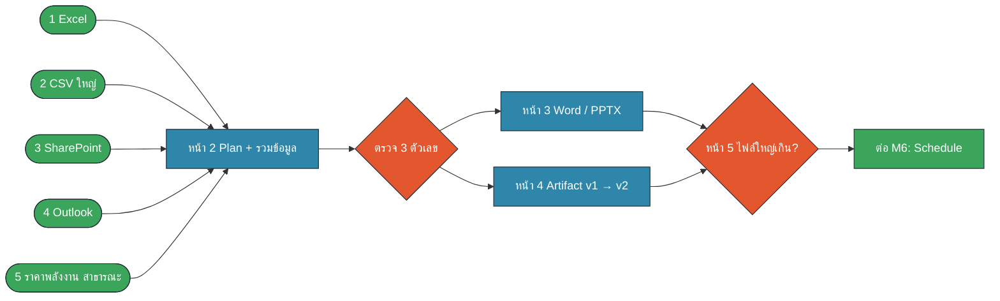
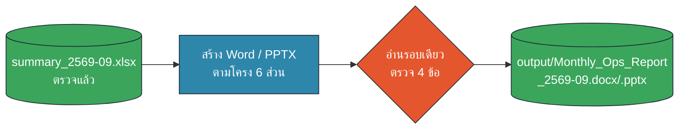
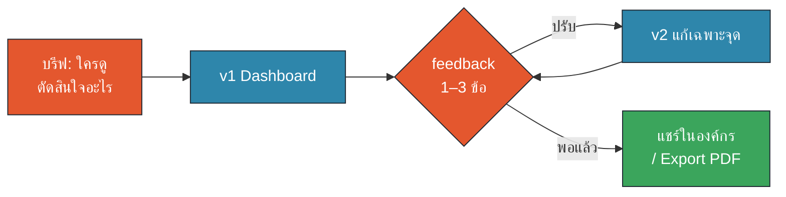
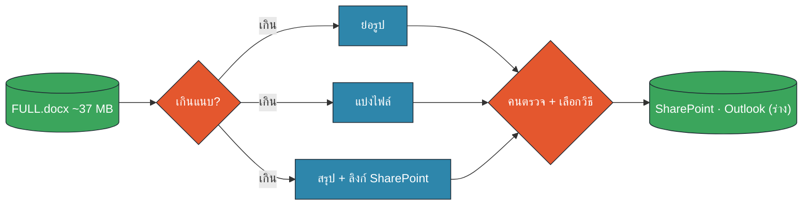

# M4 Workshop · Monthly Operations Report จาก 5 แหล่ง (25 นาที)

ข้อมูลภายในทั้งหมดเป็นข้อมูลจำลอง (ไซต์สมมติ คนสมมติ อีเมล @example.com) · ราคาพลังงานเป็นข้อมูลสาธารณะจริง (IMF via FRED)
Prompt เต็มอยู่ใน `prompts.md` · Artifact ช่วยเล่น: **Output Picker** · เฉลยให้เทียบหลังจบหน้า 4: **Monthly Ops Dashboard**
สีในแผนภาพ: 🟧 คน (HITL) · 🟦 AI · 🟩 Data/Connector

## หน้า 1 · เตรียมโฟลเดอร์ + ตรวจ 5 แหล่ง (3 นาที · 13:15–13:18)

**เป้าหมาย:** Cowork เห็นเฉพาะสำเนาข้อมูลของ M4 และยืนยันว่าเข้าถึง 5 แหล่งได้ครบ

1. ดาวน์โหลด **M4 pack** จาก SharePoint ของห้องอบรม แล้ว **คัดลอก** ไปที่ `Documents/Claude-Workshop/M4/input/` (copy-before-write)

| # | ไฟล์ / แหล่ง | ขนาด |
|---|---|---|
| 1 | `ops_monthly_2566-2569.xlsx` (6 ไซต์ ม.ค. 2566–ก.ย. 2569) | 25 KB · 270 แถว |
| 2 | `shift_log_2568-2569.csv` (3 เหมือง × 30 รถ × 3 กะ) | ~11 MB · ~172,000 แถว |
| 3 | SharePoint List `Project_Tracker`, `Issue_Log` (สำรอง: `m3_sharepoint/*.csv`) | 12 โครงการ · 56 issue |
| 4 | อีเมล `[PRJ-…]` ใน Outlook (สำรอง: `m3_outlook/*.eml`) | 20 ฉบับ |
| 5 | `energy_prices_public_2023-2026.csv` (IMF via FRED) | 4 KB · 45 เดือน |
| + | `Monthly_Ops_Report_2569-09_FULL.docx` (ใช้หน้า 5) | ~37 MB |

2. สร้างโฟลเดอร์ว่าง `output/` · เปิด Cowork → เลือกโฟลเดอร์ `Documents/Claude-Workshop/M4` เท่านั้น
3. Copy **M4-P01** (อ่านอย่างเดียว)

✅ **Checkpoint (คนตรวจ):** ตารางของ Claude มีครบ 5 แหล่ง · CSV ถูก "ดูแค่หัว + 5 แถว" ไม่ใช่อ่านทั้งไฟล์ · ถ้า Connector ไม่ขึ้น ใช้ไฟล์สำรองใน `input/` ได้เลย ไม่ต้องรอ

## หน้า 2 · Plan → รวม 5 แหล่ง → ตรวจ 3 ตัวเลข (7 นาที · 13:18–13:25)

**เป้าหมาย:** ได้ `output/summary_2569-09.xlsx` ที่ทุกตัวเลขมีที่มา และคนตรวจแล้ว

**ขั้น 1 · วางแผน (2 นาที)**: copy **M4-P02** → Claude ทวนเป้าหมาย 3 บรรทัด + เสนอแผน

✅ **Checkpoint:** แผนต้องมี (ก) สคริปต์สรุป CSV ไม่อ่านทีละแถว (ข) เขียนเฉพาะใน `output/` (ค) ถามเรื่องนิยาม
- Claude ถามว่า tonnes ใน shift log = อะไร? ตอบ: "ดิน + ถ่านหินที่รถขนทั้งหมด ไม่ใช่ปริมาณขาย ใช้ปริมาณจาก Excel เป็นตัวเลขหลัก"
- ถ้าแผนดีแล้ว พิมพ์ "อนุมัติ"

**ขั้น 2 · Process (3 นาที)**: copy **M4-P03** → Claude รันสคริปต์ + สรุป

**ขั้น 3 · ตรวจ 3 ตัวเลข (2 นาที)**: copy **M4-P04** แล้วเปิดไฟล์ต้นทางเทียบเอง

| ตัวเลขที่ตรวจ | ควรได้ประมาณ | เปิดดูที่ |
|---|---|---|
| ปริมาณ Site D ก.ย. vs Budget | **−17%** (overhaul Unit 2) | Excel ชีต `data` · period 2026-09 · D |
| ต้นทุนต่อหน่วย Site C vs Budget | **สูงกว่า ~16%** (รถขุด EX-07) | Excel · period 2026-09 · C |
| ราคาถ่านหินออสเตรเลีย ก.ย. 2026 | **153.84 USD/t** (+9.5% จาก ส.ค.) | CSV ราคาพลังงาน แถว 2026-09 |

✅ **Checkpoint:** ตรงทั้ง 3 ตัว → ไปหน้า 3 · ผิดแม้ 1 ตัว → ให้ Claude อธิบายสูตรก่อน แล้วสั่งตรวจทุกตัว
💡 จำเรื่อง Deloitte (สไลด์ 3): ของเสียหลุดออกจากโรงงานเพราะไม่มีใครเปิดต้นทางเทียบ

## หน้า 3 · Report แบบ Office: Word หรือ PowerPoint (5 นาที · 13:25–13:30)

**เป้าหมาย:** รายงานทางการ 1 ไฟล์ที่ส่งต่อ/แก้ต่อได้ (เลือก Word **หรือ** PPTX อย่างเดียวพอ)

**ทำไมต้องมีแบบ Office ด้วย:** ผู้รับต้องแก้ต่อ เก็บเข้าระบบเอกสาร หรือนำเสนอในห้องประชุมตาม template บริษัท

**ขั้นตอน:** copy **M4-P05** แล้วเลือก `docx` หรือ `pptx` ในวงเล็บ

✅ **Checkpoint (เปิดไฟล์จริงใน Word/PowerPoint):**
- [ ] Executive summary พูดถึง Site D และ Site C ก่อนเรื่องอื่น
- [ ] ตัวเลขในตารางตรงกับ `summary_2569-09.xlsx` (สุ่ม 1 แถว)
- [ ] ส่วนราคาพลังงานมีแหล่ง "IMF via FRED" และเดือนของข้อมูล
- [ ] มี footer "ข้อมูลสมมติเพื่อการอบรม" และไม่มีตัวเลขที่ไม่อยู่ใน summary

**ถ้าไม่ผ่าน:** สั่งแก้เฉพาะจุด เช่น "แก้หน้า 2: ต้นทุนต่อหน่วย Site C ใช้ค่าจากชีต sites แถว C เท่านั้น อย่าแก้ส่วนอื่น"

⏩ **ช้ากว่าเวลา?** ข้ามไปหน้า 4 ก่อน แล้วกลับมาทำหน้านี้ใน M6 (รายงานนี้จะถูกตั้งเป็น Scheduled task)

## หน้า 4 · Report แบบ Artifact: Dashboard v1 → v2 (6 นาที · 13:30–13:36)

**เป้าหมาย:** Dashboard ที่ผู้บริหารกดเลือกไซต์ได้ และรู้ภายใน 10 วินาทีว่าไซต์ไหนมีปัญหา

**ขั้น 1 · v1 (3 นาที):** copy **M4-P06** (ถ้ามีเวลาใช้ทางเลือก Prototype first: 3 layout แล้วเลือก 1)

**ขั้น 2 · ทดลองเป็นผู้บริหาร (1 นาที):** กดเลือก Site D → เห็นสาเหตุไหม? กด Export PDF → พิมพ์ครบทุกส่วนไหม?

**ขั้น 3 · v2 (2 นาที):** เขียน feedback ของคุณเอง 1–3 ข้อลงใน **M4-P07** (เฉพาะเจาะจง + เหตุผล)

| feedback ที่ไม่ช่วย | feedback ที่ดี |
|---|---|
| "ทำให้สวยขึ้น" | "เรียงไซต์จากแย่สุดไปดีสุด เพราะผู้บริหารดูปัญหาก่อน" |
| "เพิ่มข้อมูล" | "ใต้ Site D ใส่สาเหตุจากอีเมล PRJ-105 ให้รู้ว่าเป็นแผน overhaul" |

✅ **Checkpoint:** v1 และ v2 อยู่ใน `output/` ทั้งคู่ (ไม่เขียนทับ) · ตัวเลขใน Dashboard = ตัวเลขที่ตรวจแล้วในหน้า 2 · มีกล่องที่มาของข้อมูล · ปุ่ม Export PDF ใช้ได้
🔍 เทียบกับเฉลย **Monthly Ops Dashboard** (ผู้สอนแชร์ลิงก์หลังจบขั้นนี้) · แชร์ Artifact ได้เฉพาะคนในองค์กร (Team plan)

## หน้า 5 · รายงานใหญ่เกินแนบอีเมล + เลือก output (4 นาที · 13:36–13:40)

**เป้าหมาย:** ส่งรายงาน ~37 MB ให้ผู้บริหารได้ โดยไม่แนบไฟล์ใหญ่ และไม่กระจายสำเนา

**ขั้น 1 (3 นาที):** copy **M4-P08** → Claude ทำ 3 workaround บนสำเนา + ร่างอีเมล (ยังไม่ส่ง)

| วิธี | ผลที่ควรได้โดยประมาณ | เหมาะเมื่อ |
|---|---|---|
| ย่อรูป 1280 px JPEG 80 | ~37 MB → **~6–7 MB** | ต้องแนบไฟล์จริง ๆ |
| แบ่งไฟล์ หลัก + ภาคผนวก | ไฟล์หลักเล็กมาก ภาคผนวกยังใหญ่ | ผู้รับต้องการเฉพาะเนื้อหา |
| สรุป 5 บรรทัด + ลิงก์ SharePoint | อีเมลไม่มีไฟล์แนบ | **แนะนำ** ไฟล์อยู่ที่เดียว คุมสิทธิ์ได้ |

✅ **Checkpoint (คนตรวจ):** ต้นฉบับ FULL.docx ไม่ถูกแก้ · ไฟล์ย่อเปิดได้และรูปยังอ่านออก · ร่างอีเมลยัง **ไม่ถูกส่ง** · ลิงก์แชร์ = เฉพาะคนในองค์กรที่เกี่ยวข้อง ไม่ใช่ "Anyone with the link"

**ขั้น 2 (1 นาที) · ทบทวน:** เปิด **Output Picker** Artifact เล่น 8 สถานการณ์ "ควรออกเป็น Word / Excel / PDF / PPT หรือ Artifact?" แล้ว Export PDF ผลคะแนนเก็บไว้

➡️ ต่อ M5–M6: ขั้นตอนทั้งหมดนี้ทำซ้ำทุกเดือน → แพ็กเป็น Skill (M5) และตั้งเป็น Scheduled task ที่หยุดรออนุมัติก่อนส่ง (M6)
