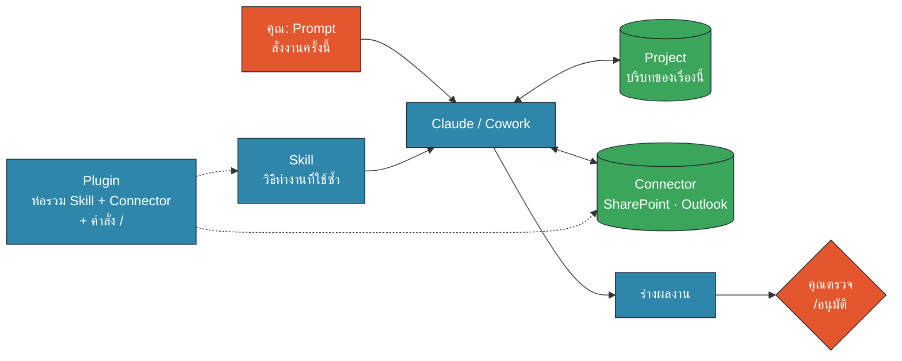
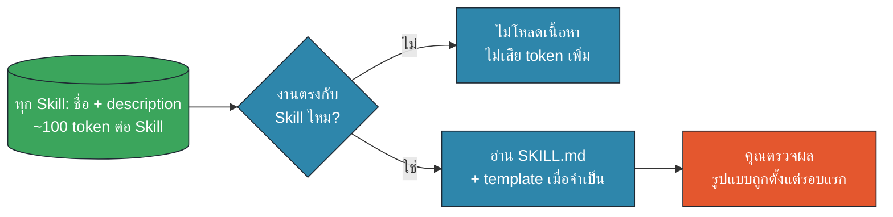
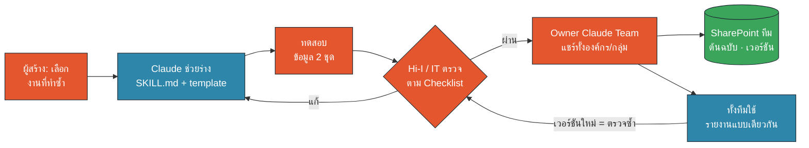
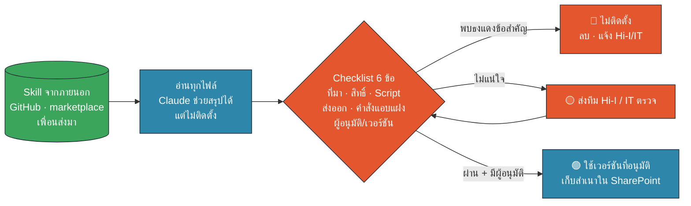
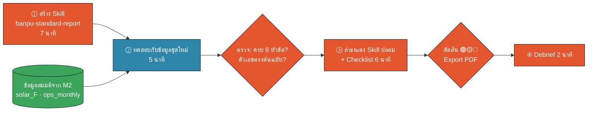

<!-- type: section -->
# M5 · Skills & Plugins

สอน Claude "วิธีทำงานแบบทีมเรา" ครั้งเดียว ใช้ได้ทั้งทีม · ตรวจ Skill จากภายนอกก่อนติดตั้ง

13:40–14:10 · 30 นาที (บรรยาย 10 · Workshop 20)

???
[0:00] โมดูลหลังพักเที่ยง ต่อจาก M4 Document Factory: เมื่อเช้าเราสั่งงานด้วย prompt ยาว ๆ ทุกครั้ง บ่ายนี้จะ "เก็บวิธีทำงาน" เป็น Skill
Requirement: 8 (Chat vs Skill vs Project…, Hands-on เต็มของ M1), 9 (Third-party Skill Security, Hands-on), 13 (usage efficiency)
ผลลัพธ์ที่ผู้เรียนได้กลับไป: Skill รายงานมาตรฐาน 1 ตัว + PDF ผลตรวจ Skill จากภายนอก 1 ฉบับ

---
<!-- type: story -->
# ก.พ. 2026: Skill ปลอม 341 ตัว ในร้าน Skill สาธารณะ

- ClawHub = ร้านแจก Skill ฟรีของ AI agent ชื่อ OpenClaw (ไม่ใช่ Claude)
- Koi Security ตรวจ 2,857 Skill พบ **341 ตัวที่เป็นมัลแวร์**
- หน้าตาเหมือนเครื่องมือยอดนิยม แต่ให้ติดตั้ง "prerequisite" ก่อน
- ผลคือโปรแกรมขโมยรหัสผ่าน และส่ง credential ออกไปภายนอก
- ใครก็อัปโหลดได้: แค่มีบัญชี GitHub อายุ 1 สัปดาห์

> Skill คือไฟล์ข้อความธรรมดา จึงแชร์ง่าย และปลอมง่ายพอ ๆ กัน

???
[0:30] เล่า 1 นาที เป็นเคสจริงจากข่าว The Hacker News, ก.พ. 2026 (SOURCES #1) และ eSecurity Planet (SOURCES #2)
ย้ำว่าเป็น agent คนละตัวกับ Claude แต่ใช้แนวคิด "Skill = โฟลเดอร์ + SKILL.md" เหมือนกัน ความเสี่ยงจึงเป็นแบบเดียวกัน
เชื่อมกับ M1: เช้านี้เราเห็นเคส Cato Networks (นักวิจัยทดลอง) ตอนนี้คือของจริงในวงกว้าง
คำถามชวนคิด: "ถ้าเพื่อนส่ง Skill ที่ทำรายงานสวยมากมาให้ทาง LINE จะติดตั้งเลยไหม?" เก็บคำตอบไว้ เดี๋ยวได้ตรวจกันจริงใน workshop

---

# Skill คืออะไร: โฟลเดอร์ที่สอน "วิธีทำงาน"

```text
banpu-standard-report/
├── SKILL.md              ← ชื่อ + description + ขั้นตอน โทน รูปแบบตัวเลข
├── templates/report-template.md   ← โครง 6 หัวข้อ
└── examples/example-report-site-b.md ← ตัวอย่างผลลัพธ์ที่ดี
```

- Claude **เลือกใช้เอง** เมื่องานตรงกับ description
- เขียนเป็นภาษาคน ไม่ต้องเขียนโปรแกรม
- บาง Skill มี script ด้วย → ต้องตรวจเหมือนติดตั้งโปรแกรม

???
[2:00] เปิดโฟลเดอร์จริงใน materials/m5/skill-example/ ให้ดู 20 วินาที ชี้ frontmatter 2 บรรทัด name และ description: "description คือป้ายหน้าร้าน Claude อ่านป้ายนี้ก่อนตัดสินใจว่าจะเปิด Skill ไหม"
ใน Claude: Settings → Capabilities → Skills (บางเวอร์ชัน Customize → Skills) อัปโหลดเป็น ZIP ต้องเปิด Code execution ก่อน (SOURCES #4)
Claude มี Skill สำเร็จรูปของ Anthropic อยู่แล้ว เช่น สร้าง Word/Excel/PowerPoint/PDF ที่เราใช้ใน M4 ก็มาจาก Skill

---

# Prompt · Project · Skill · Connector · Plugin

| | คืออะไร | ใช้เมื่อ | ตัวอย่าง |
|---|---|---|---|
| **Prompt** | คำสั่งงานครั้งนี้ | งานเดียวจบ | "สรุปไฟล์นี้" |
| **Project** | ห้องเก็บบริบทของเรื่องหนึ่ง | คุยเรื่องเดิมต่อเนื่อง | โครงการปิดเหมืองสมมติ |
| **Skill** | วิธีทำงานที่ใช้ซ้ำได้ทุกเรื่อง | งานรูปแบบเดิมซ้ำ ๆ | รายงานมาตรฐาน |
| **Connector** | ท่อเชื่อมข้อมูล | ต้องอ่าน/เขียนระบบอื่น | SharePoint · Outlook |
| **Plugin** | กล่องรวม Skill + Connector + คำสั่ง / | ชุดเครื่องมือของบทบาทงาน | ชุดงานการเงินสมมติ |

???
[3:30] ทวนจาก M1 สั้น ๆ แล้วเพิ่ม 2 ตัวใหม่: Connector (M3) และ Plugin
ประโยคจำ: Project = "เรื่องอะไร" · Skill = "ทำอย่างไร" · Connector = "ข้อมูลอยู่ไหน" · Plugin = "แพ็กรวมทั้งหมดให้ทีม"
Plugin ใน Cowork รวม Skill, Connector, slash command และ sub-agent เป็นชุดเดียว (SOURCES #5, #6) ติดตั้งได้เฉพาะที่ admin อนุญาต Plugin ที่มี Connector อื่นนอกจาก SharePoint/Outlook ไม่อยู่ในขอบเขตของบริษัท
เคล็ดลับ: ใช้ร่วมกันได้ เช่น Project "รายงานประจำเดือน" + Skill รายงานมาตรฐาน + Connector SharePoint

---
# ทำงานร่วมกันอย่างไร


🟧 คน (HITL) · 🟦 AI · 🟩 Data/Connector

???
[5:00] ชี้ทีละกล่อง: เราพิมพ์ Prompt (สีส้ม) → Claude ดึงบริบทจาก Project, วิธีทำจาก Skill, ข้อมูลผ่าน Connector → ได้ร่าง → เราตรวจ
เส้นประจาก Plugin = Plugin ไม่ได้ทำงานเอง แต่ "ติดตั้ง Skill และ Connector ให้ทีละชุด"
ถามห้อง 1 คำถาม: "งานไหนของคุณที่สั่งด้วยประโยคเดิม ๆ ทุกเดือน?" ให้ผู้เรียนจดไว้ 1 งาน = Skill ตัวแรกของเขาหลังอบรม

---

# Skill ช่วยประหยัด usage ได้อย่างไร


🟧 คน (HITL) · 🟦 AI · 🟩 Data/Connector

- ไม่ต้องวางคำสั่ง + ตัวอย่างยาว ๆ ซ้ำทุกแชต
- ได้รูปแบบถูกตั้งแต่รอบแรก = **รอบแก้น้อยลง**

???
[6:00] กลไกนี้ Anthropic เรียกว่า progressive disclosure: ตอนเริ่มแชต Claude เห็นแค่ชื่อ + description ของทุก Skill (ประมาณ 100 token ต่อ Skill) จะอ่าน SKILL.md (แนะนำไม่เกิน ~5,000 token) และไฟล์อื่นเมื่องานตรงเท่านั้น (SOURCES #3, #10)
พูดตรง ๆ: Skill ไม่ได้ทำให้ฟรี เมื่อใช้ Skill ก็ยังอ่าน SKILL.md แต่ที่ประหยัดจริงคือ (1) ไม่ต้อง paste คำสั่ง/ตัวอย่างยาวซ้ำ (2) รอบแก้ "ขอหัวข้อแบบนี้ ไม่ใช่แบบนั้น" หายไป (3) งานรูปแบบชัดใช้ model เบากว่าได้
เชื่อม requirement 13 และ M8 (เคล็ดลับ usage): แชตใหม่ + Skill ดีกว่าแชตยาวที่สะสมคำสั่ง

---

# แชร์ Skill ในทีม: ทำครั้งเดียว ใช้ทั้งทีม


🟧 คน (HITL) · 🟦 AI · 🟩 Data/Connector

???
[7:00] Claude Team/Enterprise: Owner ขององค์กรเพิ่ม Skill ให้ทุกคน (organization skill) หรือผู้ใช้แชร์ Skill ให้เพื่อน/กลุ่มได้ ถ้า admin เปิดให้ (SOURCES #7, #8) เมนูและสิทธิ์อาจต่างไปตามการตั้งค่าของบ้านปู ดู Open question ใน README
หลักของเรา: Skill ที่แชร์ทั้งทีมต้องผ่านทีม Hi-I / IT เหมือนกัน แม้จะสร้างเอง เพราะคนสร้างอาจใส่ข้อมูล 🟡🔴 ในตัวอย่างโดยไม่ตั้งใจ
เก็บต้นฉบับ + เวอร์ชัน + ชื่อผู้อนุมัติใน SharePoint ของทีม
แก้ Skill = เวอร์ชันใหม่ = ตรวจซ้ำ

---

# ก่อนติดตั้ง Skill จากภายนอก: Checklist 6 ข้อ


🟧 คน (HITL) · 🟦 AI · 🟩 Data/Connector

???
[8:00] ต่อยอดจาก 4 คำถามใน M1 (ที่มา · สิทธิ์ · Script · ส่งออก) เพิ่มอีก 2: คำสั่งแอบแฝง (prompt injection ใน comment/ไฟล์อ้างอิง) และผู้อนุมัติ/เวอร์ชันตายตัว
Anthropic แนะนำให้ใช้ Skill จากแหล่งที่เชื่อถือได้เท่านั้น และ audit ทุกไฟล์ก่อนใช้: ดู script, URL ภายนอก, คำสั่งที่ไม่ตรงกับจุดประสงค์ของ Skill (SOURCES #9)
Claude ช่วย "อ่านและสรุปความเสี่ยง" ได้ (prompt M5-P05) แต่ห้ามให้ติดตั้งหรือรัน script ระหว่างตรวจ และคนเป็นผู้ตัดสินใจ
ผู้อนุมัติในบ้านปู: เสนอทีม Hi-I / IT (ต้องยืนยันกับคุณเก๊ ดู README)

---
# Workshop 20 นาที: สร้าง · ทดสอบ · ตรวจ


🟧 คน (HITL) · 🟦 AI · 🟩 Data/Connector

เปิด `workshop.md` · Prompt `M5-P01`–`M5-P06` · Artifact: Skill Security Checklist

???
[9:00] บรีฟ 1 นาที แล้วปล่อยลงมือ (13:50) แจก 3 อย่าง: ZIP banpu-standard-report, ลิงก์ Artifact skill-security-checklist, โฟลเดอร์ข้อมูลสมมติจาก M2 (solar_F_2023_2025.xlsx, ops_monthly_clean.csv)
ถ้าบัญชีใดอัปโหลด Skill ไม่ได้ (Code execution/Skills ถูกปิด) ใช้ทางสำรองใน workshop หน้า 1: วาง SKILL.md เป็น Project instructions แทน ได้ผลใกล้เคียงสำหรับการฝึก
จับเวลา: ① 13:50–13:57 · ② 13:57–14:02 · ③ 14:02–14:08 · ④ 14:08–14:10
ระหว่างเดิน: มองหาคนที่ Claude ทำรายงานไม่ครบ 6 หัวข้อ = ตัวอย่างดีสำหรับ debrief ว่า description/ขั้นตอนเขียนไม่ชัด

---

# สรุป M5: 3 อย่างที่กลับไปทำได้เลย

1. เลือกงานซ้ำ 1 งาน → ให้ Claude สัมภาษณ์แล้วร่าง Skill
2. ทดสอบกับข้อมูล 2 ชุด แล้วส่งทีม Hi-I / IT ตรวจก่อนแชร์
3. Skill จากภายนอก: **Checklist 6 ข้อ · ไม่แน่ใจ = ไม่ติดตั้ง**

> Skill ที่ดี = เขียนสั้น ชัด ไม่มีความลับ ไม่ต้องรันโค้ดถ้าไม่จำเป็น

ต่อไป M6: ให้ Skill และ Document Factory ทำงานเองตามเวลา

???
[14:08 · นาทีที่ 28] Debrief ใช้ workshop หน้า 4: ถาม 2 คำถาม (1) ธงแดงที่หายากที่สุดคืออะไร (มักเป็น F16 comment ซ่อน หรือ F04 description กว้าง) (2) Skill รายงานของเราได้ผลกับข้อมูลโซลาร์ไหม ต้องแก้อะไร
ย้ำ Export PDF จาก Artifact = หลักฐานการตรวจ ส่งให้ผู้อนุมัติได้
Bridge M6: Skill + Scheduled task = รายงานรูปแบบเดิม ส่งตรงเวลา โดยมีคนตรวจก่อนส่งจริง
