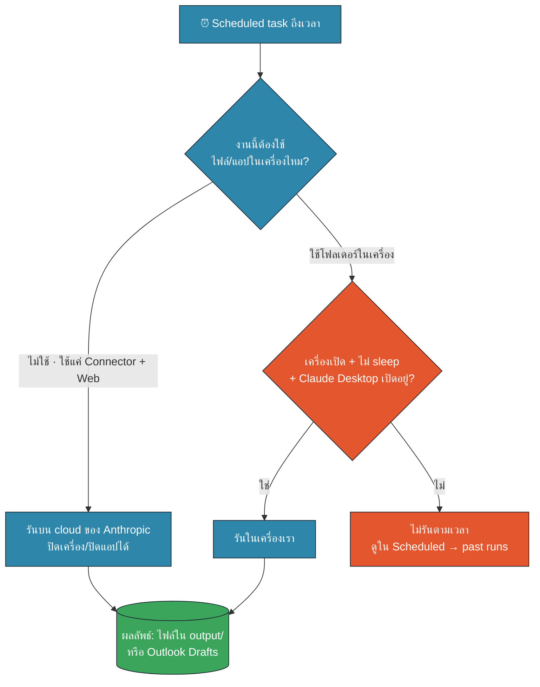
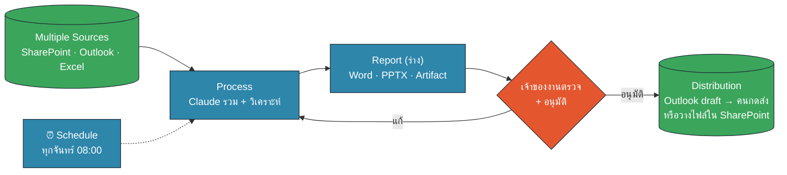
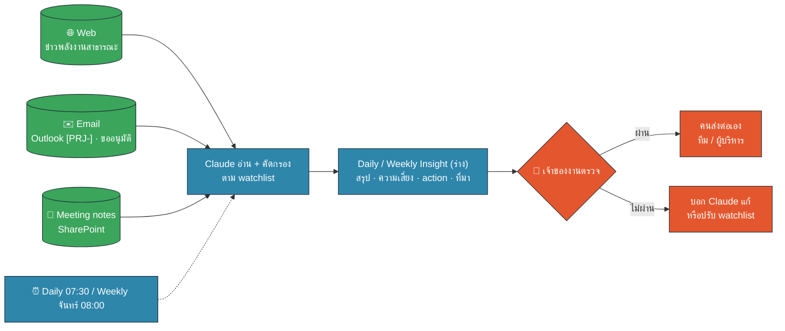
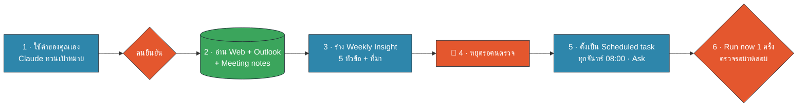
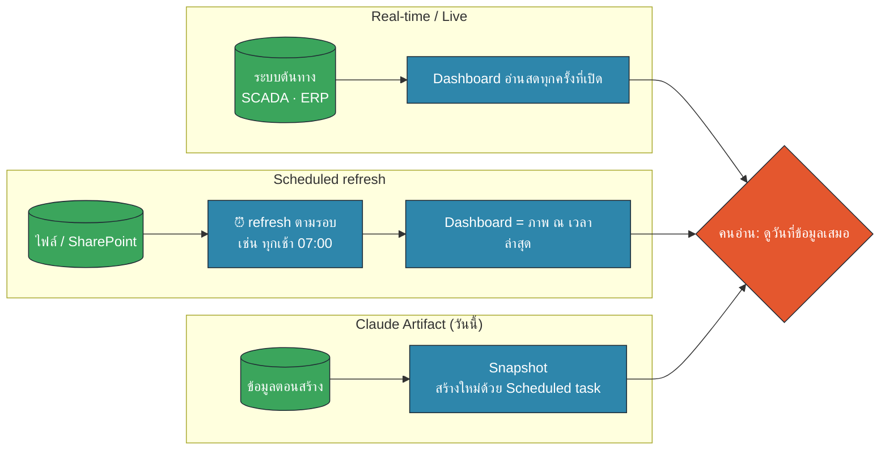
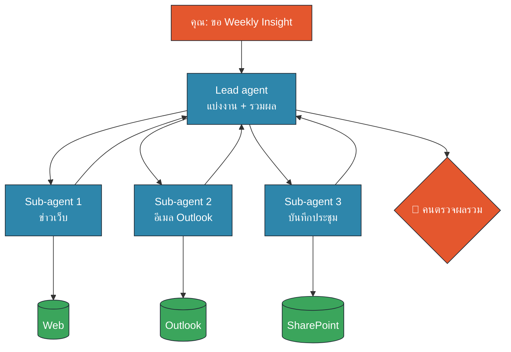
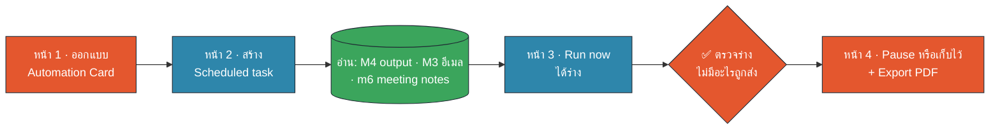

<!-- type: section -->
# M6 · Automation

ให้ Claude ทำงานซ้ำตามเวลา · แต่ **คนยังเป็นเจ้าของงานและกดส่งเอง**

14:10–14:45 · 35 นาที (บรรยาย 15 · Workshop 20)

???
[0:00] เปิดโมดูล 30 วินาที ต่อจาก M4 (รายงาน) และ M5 (Skill): "เช้านี้เราสั่ง Claude ทีละครั้ง ตอนนี้จะให้มันทำเองทุกสัปดาห์"
Requirement: 5 (HITL, Hands-on), 6 (Document Factory → Schedule/Distribution, Hands-on + Demo), 10 (Automatic Monitoring, Demo + Hands-on), 15 Dashboard refresh (Awareness), 16 Sub-agent/Multi-agent (Awareness)
ผลลัพธ์ที่ผู้เรียนได้กลับไป: Scheduled task 1 งานที่รันทดสอบแล้ว + Automation Card (PDF) ที่ระบุเจ้าของงานและจุดตรวจ

---
<!-- type: story -->
# ก.พ. 2024: แชตบอตตอบลูกค้าเอง บริษัทต้องรับผิด

- ลูกค้า Air Canada ถามแชตบอตเรื่องส่วนลดตั๋วกรณีญาติเสียชีวิต
- แชตบอตตอบ **ผิดนโยบาย**: "ซื้อก่อน แล้วขอเงินคืนย้อนหลังได้ภายใน 90 วัน"
- สายการบินปฏิเสธคืนเงิน และอ้างว่าแชตบอต "รับผิดชอบคำตอบของตัวเอง"
- 14 ก.พ. 2024 ศาลแพ่งระดับรัฐ BC ตัดสินให้บริษัทรับผิด จ่าย C$812
- ต้นเหตุ: ข้อความอัตโนมัติถึงคนนอก **ไม่มีคนตรวจ** ก่อนส่ง

> งานอัตโนมัติยิ่งทำงานตอนเราไม่อยู่ ยิ่งต้องออกแบบ "จุดหยุด" ไว้ก่อน — สิ่งที่ส่งออกไป บริษัทคือผู้รับผิดชอบ

???
[0:30] เล่า 1 นาที เคสจริง Moffatt v. Air Canada (BC Civil Resolution Tribunal, 14 Feb 2024) ที่มา: Global News, Daily Hive (SOURCES #5, #6)
ประเด็น: ไม่ใช่ว่า AI ตอบผิดได้ (รู้อยู่แล้ว) แต่คือ "ข้อความที่ระบบอัตโนมัติส่งถึงคนนอก = คำพูดของบริษัท" อ้างว่า AI พูดเองไม่ได้
ไม่ได้บอกว่า Claude จะทำแบบนี้ แต่บอกว่า "คำสั่งในแชตไม่ใช่รั้ว" รั้วจริงคือ (1) สิทธิ์ที่ให้ (2) จุดหยุดรอคน (3) เจ้าของงานที่ชัด
ถามห้อง: "ถ้า Claude ร่างอีเมลถึงผู้บริหารทุกจันทร์ 8 โมง ใครควรกดส่ง?" → คำตอบที่เราจะใช้ทั้งโมดูล: เจ้าของงาน ไม่ใช่ AI

---

# Scheduled task ใน Cowork คืออะไร

- Prompt ที่ **บันทึกไว้ + ตั้งรอบ** ให้ Claude ทำเองตามเวลา
- รอบ: ทุกชั่วโมง · ทุกวัน · ทุกสัปดาห์ · วันทำการ · กดรันเอง
- สร้างได้ 2 ทาง: **Scheduled → New task** หรือพิมพ์ `/schedule` ในแชต Cowork
- ใช้ Connector, Skill, Plugin ได้เหมือนงานปกติ
- ตั้ง **Approval mode** ได้: ให้ถามก่อนทุกครั้ง (เราใช้แบบนี้)
- ดูประวัติ · แก้ · Pause · **Run now** เพื่อทดสอบได้ทุกเมื่อ

???
[1:45] เปิดหน้า Scheduled ใน Claude Desktop ให้ดูของจริง 20 วินาที (SOURCES #1, #2)
หน้าต่าง "Set up manually" มีช่อง: ชื่องาน · prompt · approval mode · ความถี่ · model (ไม่บังคับ) · โฟลเดอร์ (ไม่บังคับ)
"Create with Claude" = ให้ Claude สัมภาษณ์เราแล้วเขียน task ให้ (เหมือน Interview pattern ของ M2)
มีบน Pro, Max, Team, Enterprise ทุกแผนที่จ่ายเงิน แต่ admin ของ Team ปิด Cowork หรือบังคับ approval ได้
⚠ เมนูเปลี่ยนบ่อย ตรวจหน้าจอจริงสัปดาห์ที่สอนอีกรอบ

---

# เงื่อนไข: งานจะรันจริงตอนไหน?

🟧 คน (HITL) · 🟦 AI · 🟩 Data/Connector

???
[2:45] ประเด็นที่คนเข้าใจผิดบ่อยที่สุด อ้างอิง Help Center ของ Anthropic (SOURCES #1, #4, เข้าถึง 30 ต.ค. 2026):
- "Scheduled tasks run remotely … even when your computer is asleep or the Claude Desktop app is closed"
- แต่ "If a scheduled task requires local files or apps, it will only run locally" → ต้องเปิดเครื่อง ไม่ sleep และเปิด Claude Desktop ไว้
- Help Center ยังไม่บอกชัดว่ารอบที่พลาดตอนปิดเครื่องจะรันชดเชยหรือไม่ → สอนให้ "เช็ก past runs ทุกเช้าวันจันทร์" ดีที่สุด
คำแนะนำในห้อง: งานที่ใช้ SharePoint/Outlook เป็นหลัก = ไม่ต้องเปิดเครื่องทิ้งไว้ · งานที่ใช้โฟลเดอร์ใน Documents = เปิดเครื่อง + ปิด sleep ช่วงเวลานั้น
⚠ พฤติกรรมนี้เพิ่งเปลี่ยน ให้ตรวจหน้า Help Center อีกครั้งสัปดาห์ที่สอน (open question ใน README)

---

# ต่อ Document Factory ให้ครบวงจร

🟧 คน (HITL) · 🟦 AI · 🟩 Data/Connector

Multiple Sources → Process → Report → **Schedule/Distribution**

???
[4:00] ทวน M4: เราทำ 3 กล่องแรกเสร็จแล้ว (Monthly Ops Report) วันนี้เติมกล่องสุดท้าย
Schedule = เส้นประ เพราะ "นาฬิกา" แค่ปลุกให้เริ่ม Process ไม่ได้ข้ามการตรวจ
Distribution ในองค์กรเรามี 2 แบบที่ปลอดภัย: (1) Claude สร้าง **draft** ใน Outlook แล้วคนกดส่งเอง (2) Claude วางไฟล์ใน output/ แล้วคน upload/แชร์ใน SharePoint เอง
ห้าม: ให้ task ส่งอีเมลออกนอกองค์กรเอง หรือเขียนทับไฟล์ต้นทางบน SharePoint (ทวน copy-before-write จาก M2/M3)
ตัวอย่างในบริษัท: อีเมล m3-016 ของคุณชัยวัฒน์ "รายงานสถานะโครงการ ส่งทุกจันทร์ก่อน 10:00 หนึ่งหน้า" → เป็นงานแรกที่เหมาะจะตั้งเวลา

---

# Automatic Monitoring: Web + Email + Meeting → Insight

🟧 คน (HITL) · 🟦 AI · 🟩 Data/Connector

???
[5:00] นี่คือ requirement 10 ภายนอก (Web) + ภายใน (Email, Meeting) → Insight รายวัน/รายสัปดาห์
watchlist = รายการ "เฝ้าดูอะไร" เขียนไว้ใน task เช่น คำค้นข่าว, หัวเรื่องอีเมล [PRJ-, โฟลเดอร์ Meeting Notes (ตัวอย่างใน data/pack/watchlist.md)
Daily เหมาะกับเรื่องเร็ว (ข่าวตลาด อีเมลขออนุมัติ) · Weekly เหมาะกับภาพรวม (สถานะโครงการ action items)
จุดสำคัญ: Insight ต้องมี **ที่มาทุกข้อ** (ลิงก์ข่าว, หัวเรื่องอีเมล+วันที่, ชื่อไฟล์ประชุม) เพราะคนตรวจต้องเปิดดูได้ใน 1 คลิก
Web search/fetch ของ Cowork ไม่อยู่ใต้การตั้งค่า network egress (SOURCES #2) → อย่าใส่ข้อมูลภายในลงในคำค้นเว็บ

---

# Human-in-the-Loop ในงานอัตโนมัติ: 4 กฎ

1. **ร่างแล้วรอ**: เขียนลง `output/` หรือ Outlook **Drafts** เท่านั้น
2. **ไม่ส่งออกเอง**: อีเมล / โพสต์ / แชร์ภายนอก ต้องมีคนกดส่ง
3. **เจ้าของงานชัด 1 คน**: ชื่ออยู่บนหัวรายงาน ตรวจตามรอบ
4. **ไม่แน่ใจ = หยุด**: ข้อมูลขัดกันให้จดไว้ ไม่เดา ไม่แก้ต้นทาง

| Approval mode | Claude ทำอะไร | ใช้ในงานนี้? |
|---|---|---|
| Manual (ถามก่อน) | หยุดขออนุมัติก่อนใช้ Connector/เขียนไฟล์ | ✅ ช่วงทดลอง |
| Auto (มักเป็นค่าเริ่มต้น!) | Claude ตรวจความปลอดภัยเองแล้วทำต่อ | ⚠ เมื่อผ่านทดลอง 4 รอบ |
| Skip | ไม่ถาม ไม่มีอะไรตรวจ | ❌ ห้าม |

???
[6:00] กฎ 4 ข้อนี้มาจาก proposal ของบ้านปู (หัวข้อ Automation): "ร่างและรอตรวจ ไม่ส่งอีเมลหรือเผยแพร่เองโดยไม่มีคนอนุมัติ และกำหนดเจ้าของงานที่ชัดเจน"
Approval modes ตาม Help Center "Use Claude Cowork safely" (SOURCES #2, #3): Manual = ถามก่อน · Auto = Claude ตรวจแต่ละ action เอง (เช่น data exfiltration, prompt injection) แล้วบล็อกสิ่งที่ไม่ปลอดภัย ไม่ถามเรา · Skip = ไม่ถามและไม่มีอะไรตรวจ
⚠ เอกสาร Anthropic ระบุว่า "Automatically approve" เป็นค่าเริ่มต้นในบางหน้าจอ (SOURCES #3) และ admin ตั้งค่าเริ่มต้นได้ → ใน workshop ให้ตรวจและเปลี่ยนเป็น Manual เองทุกครั้ง (ยืนยันค่าเริ่มต้นจริงใน dry-run)
ชื่อปุ่มในแอปอาจต่างจากตาราง ให้ดูความหมาย ไม่ใช่ชื่อ
admin ของ Team ปิด "Automatically approve" ได้ และบังคับ approval สำหรับ connector ที่เขียนได้ → คำถามเปิดให้ IT ของบ้านปู
การลบไฟล์ถาวร Claude ต้องขออนุญาตเสมอ แต่เราไม่ควรให้ task มีสิทธิ์ถึงขั้นนั้นตั้งแต่แรก
เชื่อม Plan → Approve → Execute: งานตั้งเวลาก็ยังเป็น 3 ขั้นนี้ แค่ขั้น Plan/Execute AI ทำตอนเราไม่อยู่ ขั้น Approve ยังเป็นของคน

---

# เขียน Scheduled task ให้ปลอดภัย: 6 ช่อง

| ช่อง | ตัวอย่าง: รายงานสถานะโครงการรายสัปดาห์ |
|---|---|
| ⏰ **เมื่อไร** | ทุกวันจันทร์ 08:00 (ก่อนส่งผู้บริหาร 10:00) |
| 🟩 **Input** | Outlook `[PRJ-` 7 วัน · SharePoint Project Tracker · Meeting notes |
| 🟦 **Process** | สรุป 1 หน้า · ความเสี่ยงสูงสุด 3 เรื่อง · ทุกข้อมีที่มา |
| 🟦 **Output** | ไฟล์ `output/weekly_YYYY-MM-DD.docx` + Outlook **draft** |
| 🟧 **Checkpoint** | หยุดก่อนส่ง · ข้อมูลขัดกันให้แยกหัวข้อ |
| 🟧 **Owner** | คุณวิไลวรรณ (Project Control) ตรวจภายใน 09:30 |

???
[7:30] นี่คือ Input → Process → Output ของ M2 + เพิ่ม 3 ช่องที่งานอัตโนมัติต้องมี: เมื่อไร · Checkpoint · Owner
prompt เต็มอยู่ใน prompts.md M6-P03 และ Artifact "Automation Card" จะประกอบ prompt จาก 6 ช่องนี้ให้อัตโนมัติ
เคล็ดลับ: ใส่ชื่อไฟล์ output พร้อมวันที่ทุกครั้ง จะได้ไม่เขียนทับรอบก่อน (copy-before-write ฉบับงานอัตโนมัติ)
เรื่อง usage (req 13): ทุก step ใช้ token ถ้าตั้ง hourly กับงานใหญ่จะชน weekly limit ของ Team plan เร็ว → เลือกรอบที่ช้าที่สุดที่ยังทันใช้งาน

---

# Demo: Weekly Energy & Ops Insight

🟧 คน (HITL) · 🟦 AI · 🟩 Data/Connector

???
[8:30] สาธิตสด 2.5 นาที ตาม README "Demo script" ใช้ M6-P01 (ร่างครั้งแรกในแชต) แล้ว M6-P02 (แปลงเป็น scheduled task)
แหล่ง: Web (ข่าวพลังงานสาธารณะ 7 วัน) · Outlook กล่องทดสอบ (อีเมล M3 20 ฉบับ) · โฟลเดอร์ meeting_notes ของ M6 (6 ไฟล์)
ไฮไลต์ที่ต้องชี้ให้ห้องเห็น: (1) Claude ทวนเป้าหมายก่อน (2) ร่างมีที่มาทุกข้อ (3) ท้ายร่างมี 🛑 "หยุดรอคนตรวจ" และไม่ได้ส่งอีเมล (4) ตอนตั้ง task เลือก approval แบบถามก่อน
สำรอง: ถ้าเน็ต/connector มีปัญหา ใช้ news_fallback.md + .eml ในเครื่อง หรือเปิดผลลัพธ์ตัวอย่าง data/weekly_insight_example.md ในสไลด์ถัดไป

---

# ผลลัพธ์: ร่างที่ "หยุดรอคน"

**สถานะ: 🟧 ร่าง · รอคนตรวจ** · เจ้าของ: คุณวิไลวรรณ · แหล่งที่อ่านได้ 3/3

| หัวข้อ | ตัวอย่างในร่าง (ข้อมูลสมมติ) |
|---|---|
| สรุป 3 บรรทัด | PRJ-101 เสี่ยงเลื่อน · PRJ-105 งบเพิ่ม 3.8 ล้าน ค้างอนุมัติ · LNG ขยับขึ้น |
| ความเสี่ยง 3 เรื่อง | พร้อมที่มา: อีเมล + วันที่ · ชื่อไฟล์ประชุม |
| ข่าวภายนอก ≤ 5 | ทุกข่าวมีลิงก์ · "ผลต่อเรา" = ข้อสังเกตที่ต้องตรวจ |
| Action 7 วันข้างหน้า | ใคร · อะไร · เมื่อไร |
| ไม่แน่ใจ / ขัดกัน | Tracker บอก On track แต่อีเมลบอกเสี่ยง → **ไม่แก้เอง** |

> 🛑 ยังไม่ได้ส่งอีเมล ยังไม่ได้แก้ไฟล์ใด ๆ · ตรวจ 3 ตัวเลขก่อนอนุมัติ

???
[11:00] ถ้าสาธิตสดได้ ให้ชี้บนจอจริงแทนสไลด์นี้ ถ้าไม่ได้ เปิด data/weekly_insight_example.md
ชี้หัวข้อ 5 "ไม่แน่ใจ/ขัดกัน" = หัวใจของ HITL: AI เห็นความขัดแย้ง (PRJ-101 Tracker = On track แต่อีเมล m3-001 + ประชุม PM สัปดาห์ 44 บอกเสี่ยง) แต่ไม่ตัดสินใจแทนเจ้าของโครงการ
ตัวเลขให้ตรวจ: 40 ชิ้น (m3-001) · 3.8 ล้าน (m3-002) · 2.1 ล้าน (ประชุม Finance check 22 ต.ค.)
ข่าวที่ "ผลต่อเรา" เป็นการตีความของ AI ต้องให้คนในทีมกลยุทธ์ยืนยัน

---

# Awareness: Dashboard "สด" จริงไหม?

🟧 คน (HITL) · 🟦 AI · 🟩 Data/Connector

???
[12:00] Requirement 15 (Awareness) 1 นาที: "Dashboard ที่ทำใน M4 refresh เองไหม?" → ไม่ เป็น snapshot ณ เวลาที่สร้าง (M1 แตะไว้แล้ว)
3 แบบ: Real-time = อ่านต้นทางทุกครั้ง (เช่น Power BI DirectQuery, ระบบควบคุมโรงงาน) · Scheduled refresh = ดึงข้อมูลใหม่ตามรอบ (เช่น Power BI import model ตั้ง refresh ได้หลายครั้งต่อวันตาม license, SOURCES #7) · Artifact ในคอร์สนี้ = snapshot
ถ้าอยากได้ dashboard ใหม่ทุกจันทร์ → ใช้ Scheduled task สั่ง "สร้าง dashboard ใหม่จากข้อมูลล่าสุด" = scheduled refresh แบบง่าย
คำถามที่ควรถามก่อนขอ real-time: "ตัดสินใจเร็วแค่ไหน?" ส่วนใหญ่รายงานผู้บริหาร = รายวัน/รายสัปดาห์ก็พอ และถูกกว่า
กฎสำหรับคนอ่าน: ทุก dashboard ต้องมี "ข้อมูล ณ วันที่ …" มุมบน

---
<!-- type: story -->
# Awareness: Sub-agent / Multi-agent

🟧 คน (HITL) · 🟦 AI · 🟩 Data/Connector · เคสจริง: Anthropic Research ดีขึ้น 90% แต่ใช้ token ~15 เท่า

???
[13:00] Requirement 16 (Awareness เท่านั้น ไม่มี hands-on) 1 นาที
เคสจริง: Anthropic เขียนเล่าระบบ Research ของ Claude (มิ.ย. 2025, SOURCES #8): lead agent วางแผนแล้วแตกงานให้ sub-agent หลายตัวค้นขนานกัน ผลประเมินภายในดีกว่า agent เดี่ยว 90.2% แต่ใช้ token มากกว่าแชตปกติประมาณ 15 เท่า และไม่เหมาะกับงานที่ทุกส่วนต้องรู้บริบทเดียวกันตลอด
แปลเป็นภาษางาน: เหมือนหัวหน้าทีมแบ่งงานให้ลูกทีม 3 คน แล้วรวมรายงาน ได้เร็วและกว้างขึ้น แต่ "ค่าแรง" (usage) สูงขึ้นมาก
ใน Cowork: Claude อาจแตก sub-agent เองในงานใหญ่ และ Plugin บางตัวมี sub-agent มาด้วย (M5) เราไม่ต้องตั้งเอง
ข้อควรจำ: ไม่ว่ากี่ agent จุดตรวจของคนยังอยู่ที่ "ผลรวม" ก่อนส่งต่อ · งานเล็กใช้ agent เดียวพอ ประหยัด weekly limit

---

# Quick quiz: ตั้งเวลาได้ไหม · ต้องหยุดตรงไหน?

| งาน | ตั้งเป็น Scheduled task? | 🛑 จุดหยุดรอคน |
|---|---|---|
| A · สรุปอีเมล `[PRJ-` ทุกเช้า 07:30 | ? | ? |
| B · ส่งรายงานสถานะให้ผู้บริหารทุกจันทร์ **อัตโนมัติ** | ? | ? |
| C · อัปเดตสถานะใน Project Tracker ตามอีเมลทุกวัน | ? | ? |
| D · ข่าวราคาถ่านหิน + LNG ทุกวันศุกร์ | ? | ? |

ยกมือ: 🟢 ได้เลย · 🟡 ได้ ถ้าเปลี่ยนเป็น "ร่าง" · 🔴 ไม่ควร

???
[14:00] 30 วินาที ยกมือทีละข้อ แล้วเฉลยสั้น ๆ
A 🟢 ได้ (อ่านอย่างเดียว ร่างสรุป) จุดหยุด: เจ้าของอ่านก่อนส่งต่อ
B 🟡 ได้เฉพาะ "ร่าง" ใน Outlook Drafts → เจ้าของกดส่งเอง (ตามกฎข้อ 2)
C 🔴 ไม่ควรให้ task เขียน Tracker เอง: เสนอการเปลี่ยนแปลงเป็นรายการ แล้ว PM อนุมัติและแก้เอง (copy-before-write, M3)
D 🟢 ได้ ต้องมีลิงก์ทุกข่าว คนตรวจการตีความ "ผลต่อเรา"
เฉลยเดียวกันอยู่ในแท็บ "Quiz" ของ Artifact Automation Card

---

# Workshop 20 นาที: Scheduled task แรกของคุณ

🟧 คน (HITL) · 🟦 AI · 🟩 Data/Connector

เปิด Artifact **Automation Card** · โฟลเดอร์ `Documents/Claude-Workshop/M6/` · prompt M6-P03–P06

???
[14:30] บรีฟ 30 วินาที แล้วเริ่มจับเวลา 14:25
งานแนะนำ (เลือก 1): (ก) รายงานสถานะโครงการรายสัปดาห์จาก M3/M4 (ข) Weekly Energy & Ops Insight แบบที่เพิ่งสาธิต (ค) งานของตัวเอง ถ้าใช้ข้อมูล 🟢 เท่านั้น
ทุกคนต้องจบด้วย: task 1 ตัว ตั้ง approval แบบถามก่อน · Run now 1 ครั้ง · Automation Card PDF
ใครเสร็จเร็ว: ลองแท็บ Quiz ใน Artifact หรือเพิ่ม task Daily inbox brief
ข้อควรระวังในห้อง: ถ้ามีหลายคน Run now พร้อมกันอาจช้า ให้เตรียม data/weekly_insight_example.md เป็นตัวอย่างผลลัพธ์

---

# สรุป M6: 5 กฎของงานอัตโนมัติ

1. ⏰ **ตั้งเวลาได้ แต่ไม่ตั้ง "การส่ง"**: AI ร่าง · คนส่ง
2. 🟧 **เจ้าของงาน 1 คน** ชื่ออยู่บนหัวรายงานทุกฉบับ
3. 🟩 **อ่านอย่างเดียว** จากต้นทาง · เขียนเฉพาะ `output/` หรือ Drafts
4. 💻 งานที่ใช้ไฟล์ในเครื่อง → **เปิดเครื่อง + เปิดแอป** · เช็ก past runs
5. 🔁 **ทดลอง 4 รอบ** ก่อนลดการถาม · ทบทวนทุกเดือน

ต่อไป M7 Capstone: เอา use case จริงของคุณมาออกแบบเต็มวงจร

???
[Workshop 19:00 · 14:44] Debrief 1 นาทีปิดท้าย workshop (หน้า 4) ถาม 2 คน: "task ของคุณหยุดรอคนตรงไหน? ใครเป็นเจ้าของ?"
ย้ำกฎ 5: ทดลอง 4 รอบด้วย approval แบบถามก่อน ถ้าผ่านครบค่อยพิจารณา Auto และอย่าใช้ Skip
หลังอบรม: Pause task ที่สร้างในห้อง ถ้ายังไม่ได้รับอนุญาตให้ใช้กับข้อมูลจริง (ตามนโยบาย IT/Hi-I)
Bridge M7: Automation Card ที่ได้วันนี้คือครึ่งหนึ่งของ Capstone canvas (data · connector · output · checkpoint)
