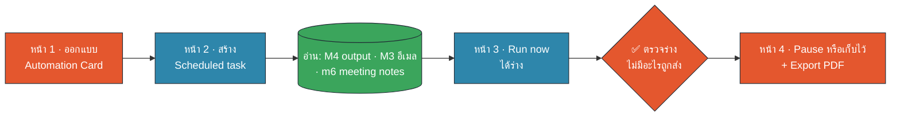

# M6 Workshop · Scheduled task แรกของคุณ (20 นาที · 4 หน้า)

ข้อมูลทั้งหมดเป็นข้อมูลสมมติ · Connector: **SharePoint + Outlook** เท่านั้น · Prompt ทั้งหมดอยู่ใน `prompts.md`

## หน้า 1 · เตรียมโฟลเดอร์ + ออกแบบ Automation Card (5 นาที · 14:25–14:30)


🟧 คน (HITL) · 🟦 AI · 🟩 Data/Connector

**เป้าหมาย:** เลือกงาน 1 งาน แล้วกรอก 6 ช่องให้ครบก่อนแตะ Claude

**ขั้นตอน**
1. (2 นาที) ดาวน์โหลด **M6 pack** จาก SharePoint ของห้องอบรม แล้ว **คัดลอก** ไปที่ `Documents/Claude-Workshop/M6/` (copy-before-write) ในโฟลเดอร์มี `input/` (อีเมล M3 · Project Tracker · meeting notes 6 ไฟล์ · watchlist) และ `output/` ว่าง
   - ถ้ามีรายงานจาก M4 ให้คัดลอกไฟล์ไปไว้ที่ `input/m4_report/`
2. (3 นาที) เปิด Artifact **Automation Card** แล้วเลือกงาน 1 งาน:

| งาน | เหมาะกับใคร | Prompt |
|---|---|---|
| (ก) รายงานสถานะโครงการรายสัปดาห์ | ทุกคน (แนะนำ) | M6-P03 |
| (ข) Weekly Energy & Ops Insight (แบบที่สาธิต) | คนที่ติดตามข่าวตลาด | M6-P04 |
| (ค) งานซ้ำของคุณเอง · ใช้ข้อมูล 🟢 เท่านั้น | คนที่มีงานในใจแล้ว | M6-P05 |

3. กรอก 6 ช่องใน Artifact: ⏰ เมื่อไร · 🟩 Input · 🟦 Process · 🟦 Output · 🟧 Checkpoint · 🟧 Owner

**เลือกเส้นทาง**
- **เส้นทาง A · Connector** (มีบัญชี test tenant จาก M3): อ่าน Outlook + SharePoint · task รันบน cloud ได้แม้ปิดเครื่อง
- **เส้นทาง B · โฟลเดอร์ในเครื่อง** (ทุกคนทำได้): อ่าน `input/` · task รันได้เฉพาะตอน **เครื่องเปิด + ไม่ sleep + Claude Desktop เปิดอยู่**

✅ **Checkpoint (คนตรวจ):** Artifact ขึ้นป้าย "พร้อมตั้งเวลา" ครบ 6/6 และช่อง Owner เป็นชื่อคนจริง 1 คน (ไม่ใช่ "ทีม") · ช่อง Output เขียนเฉพาะ `output/` หรือ Outlook **Drafts**

## หน้า 2 · สร้าง Scheduled task แบบ "ถามก่อน" (6 นาที · 14:30–14:36)

**เป้าหมาย:** มี task 1 ตัวในหน้า Scheduled ที่ตั้ง approval เป็น **Manual** และจะไม่ส่งอะไรออกไปเอง

**วิธีที่ 1 · Set up manually (แนะนำ)**
1. Claude Desktop → แถบซ้าย **Scheduled** → **New task** → **Set up manually**
2. กรอก: ชื่องาน · Prompt (กด **Copy prompt** ใน Automation Card หรือคัดลอก M6-P03/P04 จาก `prompts.md`) · ความถี่ **Weekly · จันทร์ 08:00** · โฟลเดอร์ `Documents/Claude-Workshop/M6` (เส้นทาง B)
3. **Approval mode = Manual** ⚠ ค่าเริ่มต้นมักเป็น Auto ตรวจแล้วเปลี่ยนเอง
4. กด Save/Schedule

**วิธีที่ 2 · ให้ Claude สัมภาษณ์** (งาน ค)
- **New task → Create with Claude** หรือพิมพ์ `/schedule` ในแชต Cowork แล้ววาง M6-P05
- Claude ถามทีละข้อ แล้วสรุปตาราง 6 ช่อง → **อ่านก่อนกดยืนยัน**

Prompt ย่อสำหรับงาน (ก) · เส้นทาง B (ฉบับเต็มดู M6-P03):

```text
งาน: ร่าง "รายงานสถานะโครงการรายสัปดาห์" 1 หน้า ภาษาไทย ให้ [ชื่อเจ้าของงาน] ตรวจก่อน 09:30
Input (อ่านอย่างเดียว): input/m3_outlook/*.eml · input/m3_sharepoint/*.csv · input/meeting_notes/*.md · input/m4_report/ (ถ้ามี)
Process: โครงการ At risk/Delayed · ความเสี่ยงสูงสุด 3 เรื่อง · คำขออนุมัติที่ค้าง · จุดที่ข้อมูลขัดกัน (แสดงทั้งสองค่า ห้ามเลือกเอง)
Output: output/weekly_status_[YYYY-MM-DD].docx (ห้ามเขียนทับไฟล์เดิม)
Checkpoint: บรรทัดแรก "สถานะ: ร่าง · รอ [ชื่อเจ้าของงาน] ตรวจ" · ทุกข้อมีที่มา · ห้ามส่งอีเมล ห้ามแก้ไฟล์ใน input/
จบด้วย "🛑 หยุดรอคนตรวจ" และสรุปว่าเขียนไฟล์อะไรไปบ้าง
```

✅ **Checkpoint (คนตรวจ):** ในหน้า Scheduled เห็น task ของคุณ · ความถี่ถูกต้อง · approval = Manual · prompt มีคำว่า "ร่าง", "ห้ามส่ง", ชื่อเจ้าของงาน
💡 ติดขัด: ไม่เห็นเมนู Scheduled → แจ้งผู้ช่วยสอน (admin อาจยังไม่เปิด Cowork) แล้วทำต่อในแชต Cowork ด้วย M6-P03 แบบรันครั้งเดียว

## หน้า 3 · Run now 1 รอบ แล้วตรวจร่าง (6 นาที · 14:36–14:42)

**เป้าหมาย:** รันทดสอบ 1 รอบ ได้ "ร่าง" ใน `output/` (หรือ Outlook Drafts) และพิสูจน์ว่าไม่มีอะไรถูกส่งหรือถูกแก้

**ขั้นตอน**
1. (1 นาที) ในหน้า Scheduled คลิก task ของคุณ → **Run now** (ไม่ต้องรอถึงวันจันทร์)
2. (2 นาที) ระหว่างรัน Claude จะ **หยุดขออนุมัติ** (เพราะตั้ง Manual) → อ่านว่าจะทำอะไร
   - อ่าน `input/` · เขียน `output/` · สร้าง Draft → ✅ อนุมัติ
   - ส่งอีเมล · แก้/ลบไฟล์ใน `input/` · แก้ไฟล์บน SharePoint → ❌ ปฏิเสธ แล้วจดไว้ในการ์ด
3. (3 นาที) เปิดร่างที่ได้ แล้ววาง M6-P06 ในแชตเดียวกันเพื่อให้ Claude ช่วยตรวจ:

```text
ตรวจร่างที่เพิ่งสร้างด้วย checklist นี้ ตอบเป็นตาราง ✅/❌ + หลักฐาน:
1. บรรทัดแรกบอกว่าเป็นร่างและชื่อเจ้าของงาน
2. ทุกข้อมีที่มาที่เปิดตรวจได้
3. ตัวเลขสำคัญ 3 ตัว: ระบุค่าในร่าง และค่าที่ต้นทาง ตรงกันไหม
4. มีหัวข้อ "ไม่แน่ใจ/ขัดกัน" และไม่ได้เลือกค่าเอง
5. ไม่มีอีเมลถูกส่ง ไม่มีไฟล์ต้นทางถูกแก้ (บอกรายการไฟล์ที่เขียนทั้งหมด)
6. ไม่มีข้อมูล 🔴 (ข้อมูลส่วนบุคคล ข้อมูลลับ)
ห้ามแก้ร่างเอง ถ้ามี ❌ ให้เสนอวิธีแก้ prompt ของ task แทน
```

**ตรวจเองด้วยตา (คนตัดสิน ไม่ใช่ AI)** · ข้อมูลสมมติชุดนี้มีจุดให้จับ:

| ตรวจอะไร | ค่าที่ควรเห็นในร่าง | ที่มา |
|---|---|---|
| PRJ-101 สายพาน CV-03 | Tracker = On track **แต่** อีเมล/ประชุมบอกเสี่ยง → ต้องอยู่ในหัวข้อ "ขัดกัน" | Project_Tracker.csv · m3-001 · ประชุม PM 27 ต.ค. |
| ลูกกลิ้งที่ยังขาด | 40 ชิ้น | อีเมล m3-001 |
| PRJ-105 งบเพิ่มที่ขออนุมัติ | 3.8 ล้านบาท (ตอบภายใน 31 ต.ค.) | อีเมล m3-002 |
| ส่วนต่าง Spent ใน Capex Tracker | 2.1 ล้านบาท | ประชุม Finance check 22 ต.ค. |

✅ **Checkpoint (คนตรวจ):** โฟลเดอร์ `input/` ไม่มีไฟล์ใดถูกแก้ (ดูเวลา Modified) · Outlook **Sent Items** ไม่มีอีเมลใหม่ · ร่างขึ้นต้น "สถานะ: ร่าง" และจบ "🛑 หยุดรอคนตรวจ"
💡 ร่างไม่ดี? อย่าแก้ร่างเอง ให้แก้ **prompt ของ task** (Edit) แล้ว Run now อีกครั้ง เพราะสัปดาห์หน้า task จะใช้ prompt เดิม

## หน้า 4 · ตัดสินใจ: เก็บไว้หรือ Pause + Export PDF (3 นาที · 14:42–14:45)

**เป้าหมาย:** ปิดงานให้ปลอดภัย และมี Automation Card (PDF) กลับไปใช้ต่อ

**ขั้นตอน**
1. (1 นาที) เลือก 1 ทาง แล้วติ๊กในการ์ด:
   - **Pause** ← ค่าแนะนำหลังอบรม ถ้ายังไม่ได้รับอนุญาตให้ใช้กับข้อมูลจริง (นโยบาย IT/Hi-I)
   - **เก็บไว้รันทดลอง 4 สัปดาห์** ← เฉพาะเส้นทาง A บน test tenant หรือข้อมูล 🟢 · ตั้งปฏิทินเตือน "เช็ก past runs ทุกจันทร์ 09:00"
2. (1 นาที) ใน Automation Card กด **⬇ Export PDF** → Save as PDF → เก็บไว้ที่ `Documents/Claude-Workshop/M6/output/`
3. (1 นาที) Debrief: ตอบ 2 คำถามกับคนข้าง ๆ
   - "task ของคุณ **หยุดรอคน** ตรงไหน?"
   - "ถ้าคุณลาพักร้อน ใครเป็นเจ้าของแทน?"

**กติกาก่อนลด approval จาก Manual**

| เงื่อนไข | ผ่าน? |
|---|---|
| รันครบ 4 รอบ ร่างถูกต้องทุกรอบ (ตรวจตัวเลข 3 ตัวทุกรอบ) | ☐ |
| ไม่เคยมี action ที่ต้องปฏิเสธ | ☐ |
| หัวหน้า/เจ้าของข้อมูลรับทราบว่ามี task นี้ | ☐ |
| ยังใช้ "ร่าง" เสมอ ไม่ส่งออกเอง (Auto ไม่ได้แปลว่าส่งเองได้) | ☐ |
| **Skip ห้ามใช้ทุกกรณี** | — |

✅ **Checkpoint (คนตรวจ):** มีไฟล์ `Automation-Card.pdf` · task อยู่ในสถานะ Paused หรือมีนัดตรวจ past runs ในปฏิทิน · ตอบได้ว่าใครเป็นเจ้าของ

➡ ต่อ M7 Capstone: Automation Card นี้คือครึ่งหนึ่งของ Capstone canvas (data · connector · output · checkpoint)
