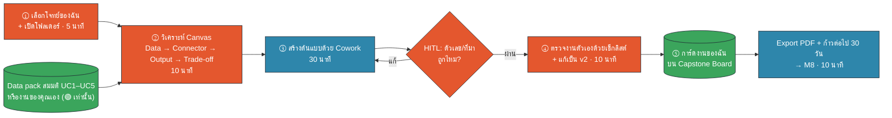
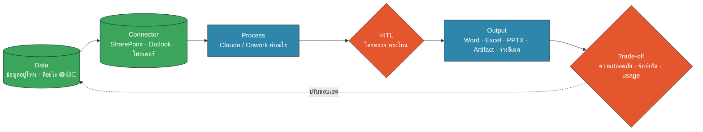
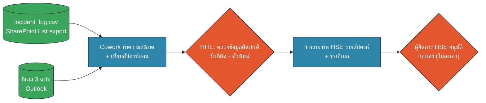
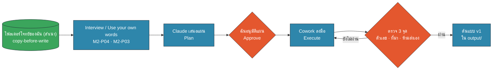
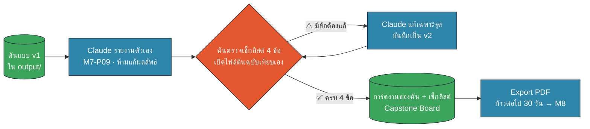

<!-- type: section -->
# M7 · Capstone: Use Case จริงของเรา

เอาทุกอย่างตั้งแต่เช้ามาประกอบเป็นงานจริง 1 ชิ้น ของคุณเอง ทำคนเดียว

15:00–16:15 · 75 นาที (บรรยาย 10 · Workshop 65)

???
[0:00] หลังเบรกบ่าย พลังงานห้องเริ่มตก บอกตรง ๆ ว่า 65 นาทีต่อจากนี้ "เราทำ ไม่ใช่ฟัง" บรรยายแค่ 10 นาที
Requirement 14 (Capstone: data, connector, output, trade-off · Hands-on) และประยุกต์ requirement 1–7
งานเดี่ยว: ไม่แบ่งกลุ่ม ไม่มีการขึ้นพูดหน้าห้อง · ทุกคนตรวจงานตัวเองด้วยเช็กลิสต์
ผลลัพธ์ของแต่ละคน: ต้นแบบ 1 ชิ้นใน output/ + การ์ดงานของฉันบน Capstone Board + PDF (การ์ด + เช็กลิสต์ตรวจงานตัวเอง + ก้าวต่อไป 30 วัน) → M8 แผน 30 วัน

---
<!-- type: story -->
# Novo Nordisk: เอกสารที่เคยใช้ 10+ สัปดาห์ เหลือ 10 นาที

- ทีมเล็ก **11 คน** เริ่มจากงานเดียวที่เจ็บที่สุด: เขียนรายงานผลการศึกษาทางคลินิก
- เดิมผู้เขียน 1 คนทำได้เฉลี่ย **2.3 ฉบับต่อปี**
- ใช้ Claude ร่าง → เวลาเขียนลดลง 90% · รอบรีวิว**ลดลงครึ่งหนึ่ง**
- แต่ร่างทุกฉบับ "ส่งถึงมือคนเพื่อตรวจและอนุมัติ"

> "เราโยนข้อมูลใส่ LLM แล้วหวังว่าจะออกมาดีไม่ได้" — ทีม Novo Nordisk

???
[0:45] เคสจริงจาก Anthropic customer story (SOURCES #1) เล่า 1 นาที
ประเด็นที่อยากให้ติดหัว 3 ข้อ: (1) เริ่มจาก use case เดียวที่ชัด ไม่ใช่ "เอา AI มาใช้ทั้งองค์กร" (2) ทีมเล็กก็สร้างได้ (3) คนยังเป็นผู้อนุมัติ = Human-in-the-Loop ตรงกับที่เราพูดมาทั้งวัน
ตัวเลข 10+ สัปดาห์ → 10 นาที เป็นของงานร่างเอกสาร ไม่ใช่การอนุมัติ ย้ำอย่าเข้าใจผิดว่า "ไม่ต้องตรวจแล้ว"
ถามห้อง: "งานไหนของทีมคุณที่กินเวลาเป็นสัปดาห์ แต่รูปแบบซ้ำเดิมทุกครั้ง?" นั่นคือผู้สมัคร capstone

---

# 65 นาทีจากนี้: ทำ → ตรวจ → เก็บผลงาน

🟧 คน (HITL) · 🟦 AI · 🟩 Data/Connector

???
[2:00] เดินตาม diagram: ส้ม = คนคิดและตัดสินใจเอง · น้ำเงิน = ให้ Cowork/Claude ทำ · เขียว = Data/ที่เก็บผลงาน
ย้ำลูปกลับในช่วงสร้างต้นแบบ: ตัวเลขหรือที่มาไม่ผ่าน → กลับไปแก้ที่ ③
เวลาจริงบนนาฬิกา: 15:10 เลือกโจทย์ · 15:15 Canvas · 15:25 สร้าง (Plan → Approve 5 · ลงมือ + ตรวจแบบ HITL 25) · 15:55 เช็กลิสต์ + v2 · 16:05 การ์ด + Export PDF → M8
ทุกคนทำของตัวเอง ไม่ต้องรอใคร · วิทยากรประกาศเวลาทุกต้นช่วง และเดินวนช่วยรายคน

---

# กรอบคิด Use Case: Data → Connector → Output → Trade-off

🟧 คน (HITL) · 🟦 AI · 🟩 Data/Connector

???
[3:00] นี่คือ requirement 14 ทั้งข้อในภาพเดียว ทุกคนต้องตอบครบ 4 ช่อง (+ จุด HITL) ก่อนลงมือ
Data: ข้อมูลอยู่ที่ไหน ใครเป็นเจ้าของ สีอะไรตาม Data Traffic Light (M1) · Connector: SharePoint / Outlook (M3) หรือโฟลเดอร์ใน Cowork (M2) — ไม่มี Google Drive
Output: เลือกตามคนอ่าน (Output Picker ของ M4) · Trade-off: ดูสไลด์ถัดไป
เส้นประกลับไปที่ Data: บ่อยครั้งทางแก้ Trade-off คือ "ลดขอบเขตข้อมูล" เช่น ใช้แค่ตารางสรุป ไม่ใช้ข้อมูลรายบุคคล

---

# Trade-off: 3 คำถามก่อนบอกว่า "ใช้ได้จริง"

| มุม | ถามตัวเอง | ทางแก้ที่เรียนแล้ว |
|---|---|---|
| 🛡️ **ความปลอดภัย** | ข้อมูลสีอะไร? ใครเห็นผลลัพธ์? | 🟡 anonymize · 🔴 ไม่ใส่ Claude (M1) |
| ⚠️ **ข้อจำกัด** | ไฟล์ใหญ่/เยอะเกินไหม? ต้องเปิดเครื่องไหม? | แบ่งไฟล์ · สรุปก่อน (M2, M4, M6) |
| 🔋 **Usage** | ทำบ่อยแค่ไหน? ใช้ model อะไร? | Skill · แชตใหม่ · model เบา (M5, M8) |
| ✋ **HITL** | ใครอนุมัติก่อนส่ง/บันทึก? | Plan → Approve → Execute · copy-before-write |

???
[4:30] งานที่ใช้ได้จริงไม่ใช่งานที่ demo สวยที่สุด แต่เป็นงานที่เจ้าของบอกได้ว่า "อะไรยังไม่ควรให้ Claude ทำ"
ตัวอย่าง trade-off ที่ดี: "รายงาน incident ใช้ชื่อพนักงานไม่ได้ (🔴/🟡) เราจึงตัดคอลัมน์ชื่อก่อนส่งเข้า Cowork"
ตัวอย่าง usage: งานรายสัปดาห์ที่สั่งด้วย prompt ยาวทุกครั้ง → ทำเป็น Skill (M5) แล้วตั้ง Scheduled task (M6) แต่ Scheduled task ต้องเปิดเครื่องไว้
เช็กลิสต์ตรวจงานตัวเองข้อ 3 (ไม่มีข้อมูล 🟡/🔴 · ไม่มีอะไรถูกส่ง) และข้อ 4 (ใช้ได้จริง) ใช้คำตอบจากตารางนี้โดยตรง

---

# เมนูโจทย์: 5 use case (ข้อมูลสมมติ) หรืองานของคุณเอง

| # | Use case | Data | Connector | Output |
|---|---|---|---|---|
| UC1 | สรุปสัญญาจัดซื้อ | สัญญา .docx 3 ฉบับ + register | SharePoint | Excel + ปฏิทินแจ้งยกเลิก |
| UC2 | รายงาน Incident รายสัปดาห์ | log 150+ แถว + อีเมล 3 ฉบับ | SharePoint · Outlook | รายงาน + ร่างอีเมล |
| UC3 | รวมข้อมูล ESG 4 Site | xlsx/csv คนละหน่วย | SharePoint | ตารางรวม + Dashboard |
| UC4 | ประชุม → Action tracker | บันทึก .md .txt .vtt + tracker | SharePoint · Outlook | Tracker + ร่างอีเมลติดตาม |
| UC5 | Energy market brief | ราคา + ข่าว + มุมมองทีม | โฟลเดอร์ / เว็บสาธารณะ | Brief 1 หน้า |

**ใช้งานของคุณเอง:** ได้ แต่ใช้ข้อมูล 🟢 หรือข้อมูลจำลองเท่านั้น (M7-P02)

???
[5:30] ทั้ง 5 โจทย์ปรับจากรูปแบบงานที่ทีม Hi-I ส่งมา (ฉบับนี้เป็นตัวแทนจนกว่าจะได้ use case จริง — ดู README open question) ข้อมูลทุกไฟล์เป็นข้อมูลสมมติ อยู่ใน ZIP M7_uc1…uc5
แต่ละโจทย์มีกับดักที่ตั้งใจใส่ไว้ให้ HITL จับ เช่น UC2 มีวันที่ 2026-13-02 และ "near miss" ตัวพิมพ์เล็ก · UC3 Site G ขาดเดือน ต.ค. และ Site F มีแค่รายไตรมาส · UC4 งานไม่มีวันกำหนด — ไม่ต้องบอกผู้เรียนล่วงหน้า
ใช้งานของคุณเอง: Canvas เดียวกัน แต่สร้างข้อมูลจำลองก่อน (ให้ Claude สร้างไฟล์ตัวอย่างจากหัวคอลัมน์จริง ไม่ใช้ค่าจริง — prompt M7-P02) · โฟลเดอร์ capstone_<ชื่อคุณ>
โจทย์ซ้ำกันได้ ไม่จำกัดจำนวนคนต่อโจทย์ · ลังเลเกิน 2 นาที → ชวนเลือก UC4 · แกลเลอรีบนบอร์ด (แท็บ ②) ดูได้ ไม่บังคับ

---

# ตัวอย่างเต็ม 1 โจทย์: UC2 รายงาน Incident รายสัปดาห์

🟧 คน (HITL) · 🟦 AI · 🟩 Data/Connector

- Data ส่วนใหญ่ 🟢 สมมติ · ชื่อพนักงานในงานจริง = 🟡 ต้องตัดก่อน
- Trade-off: ร่างอีเมลเท่านั้น **ไม่ส่งเอง** · ไม่ต้องใช้ model ใหญ่

???
[6:30] ทำให้ดูว่า "Canvas ที่ครบ" หน้าตาเป็นอย่างไร ใช้เวลา 1 นาที ไม่ต้อง demo จริง
ไล่ 4 ช่อง: Data = incident_log.csv (เหมือน export จาก SharePoint List) + อีเมล Outlook 3 ฉบับ · Connector = SharePoint/Outlook ในวันจริง หรือโฟลเดอร์ ZIP ถ้าไม่มี test tenant (เส้นทาง B ของ M3)
Output = รายงานสัปดาห์ล่าสุดเทียบสัปดาห์ก่อน + ร่างอีเมลถึงผู้จัดการ HSE · HITL 2 จุด: ตรวจข้อมูลผิดปกติก่อนวิเคราะห์ และผู้จัดการอนุมัติก่อนส่ง
Trade-off: อีเมล 01 มีประโยคพูดถึงพนักงานที่บาดเจ็บ ในงานจริงต้อง anonymize (🟡) · ข้อมูลไม่ใหญ่ ใช้ model เบาได้ (M8)

---

# สร้างต้นแบบด้วย Cowork: สูตรเดิมจากเมื่อเช้า

🟧 คน (HITL) · 🟦 AI · 🟩 Data/Connector

???
[7:30] ไม่มีอะไรใหม่ เป็นการประกอบของที่เรียนมา: copy-before-write (M3), Interview/Use your own words (M2-P04, M2-P03), Plan → Approve → Execute (M2-P02)
ไม่ต้องสร้างให้สมบูรณ์ เป้าหมายคือ "ต้นแบบ v1 ที่ทำงานได้ 1 รอบ" กับข้อมูลสมมติ
ตรวจ 3 จุดระหว่างสร้าง: สุ่มตัวเลข 2 ค่าเทียบไฟล์ต้นฉบับ · ทุกข้อสรุปบอกที่มาได้ · ไม่มีอะไรถูกส่งออกหรือบันทึกทับเอง
15:25–15:55 (Plan → Approve 5 · ลงมือ + ตรวจแบบ HITL 25) · 15:40 ทุกคนต้องมีไฟล์ใน output/ ถ้ายังไม่มี → ลดขอบเขต
ถ้า usage ใกล้เต็ม: หยุดรันซ้ำ · ลดขอบเขตเหลือ 1 Site/1 สัญญา · แชตใหม่ + สรุปสั้น ๆ (M1/M8)

---

# ตรวจงานตัวเอง + เก็บผลงาน

🟧 คน (HITL) · 🟦 AI · 🟩 Data/Connector

**เช็กลิสต์ตรวจงานตัวเอง (✅ / ⚠️ + จะแก้อะไร):** ① ตัวเลข/ข้อเท็จจริง 2 ค่าตรงกับต้นฉบับ (เปิดไฟล์เทียบเอง) ② ทุกข้อสรุปบอกที่มาได้ ③ ไม่มีข้อมูล 🟡/🔴 หรือข้อมูลจริงของบริษัท · ไม่มีอะไรถูกส่ง/บันทึกลงระบบ ④ ใช้ได้จริง: ใครใช้ · ประหยัดเวลาเท่าไร · ก้าวต่อไปใน 30 วัน

???
[8:30] ④ 15:55–16:05 เช็กลิสต์ + แก้เป็น v2 (workshop หน้า 12 · M7-P09) · ⑤ 16:05–16:15 การ์ด + Export PDF + ก้าวต่อไป 30 วัน (หน้า 13 · M7-P10)
ไม่มีใครขึ้นพูดหน้าห้อง ไม่มีใครให้คะแนน ทุกคนตรวจงานของตัวเอง · ต้องเปิดไฟล์ต้นฉบับเทียบเองอย่างน้อย 2 ค่า ไม่เชื่อตาราง P09 อย่างเดียว (แบบ M4-P04)
Capstone Board 3 แท็บ: ① การ์ดงานของฉัน · ② แกลเลอรี (ไม่บังคับ) · ③ เช็กลิสต์ตรวจงานตัวเอง · PDF = การ์ด + เช็กลิสต์ + ก้าวต่อไป 30 วัน = ข้อมูลตั้งต้นของ M8

---

# กติกา 4 ข้อ แล้วเริ่มเลย

1. **ข้อมูลสมมติ หรือ 🟢 เท่านั้น** · ห้ามเปิดไฟล์งานจริงของบริษัท
2. **Connector: SharePoint / Outlook** หรือโฟลเดอร์สำเนา · ไม่ใช้ Google Drive
3. **ไม่มีอะไรถูกส่ง/บันทึกทับโดยไม่มีคนอนุมัติ**
4. **ทำคนเดียว ตรวจงานตัวเองก่อนเก็บ** · ติดขัดเกิน 3 นาที → ยกมือ

เปิด: `workshop.md` · `prompts.md` (M7-P01…P10) · Capstone Board `artifacts/show-share-board.html`

???
[9:30] อ่านกติกาเร็ว ๆ แล้วขึ้นตารางเวลา 5 ช่วงบนจอใหญ่ (workshop หน้า 1) · ประกาศเวลาทุกต้นช่วง
ข้อ 3 สำคัญที่สุดในวันนี้: UC2 และ UC4 มีร่างอีเมล ต้องเป็น draft เท่านั้น
ข้อ 4: วิทยากรและผู้ช่วยเดินวน ช่วยรายคน ตามตาราง "จุดที่มักติด" ใน workshop หน้า 6 · ถ้าห้องมีผู้ช่วย 1 คน แบ่งกันดูคนละครึ่งห้อง
ทุกคนมีโจทย์อยู่แล้วใน ZIP ของ repo (banpu-claude-course-master/materials/m7/data/uc1…uc5_*) · สำรอง: USB ที่มี ZIP เดียวกัน
