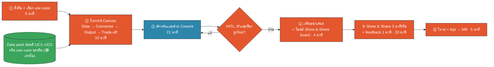
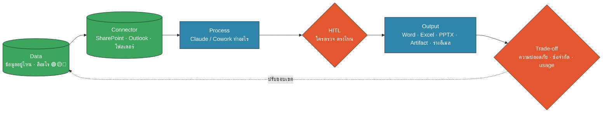
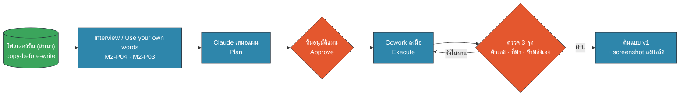
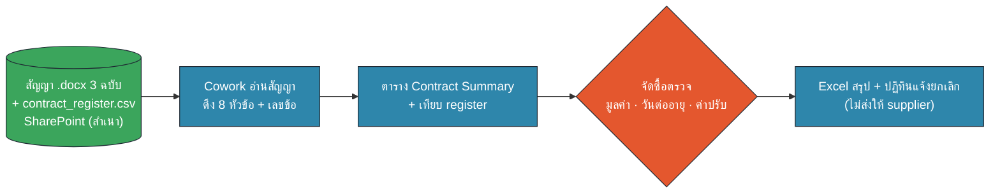
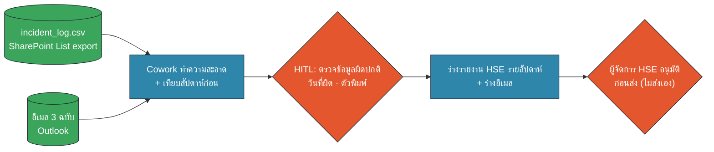
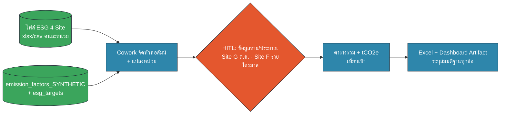
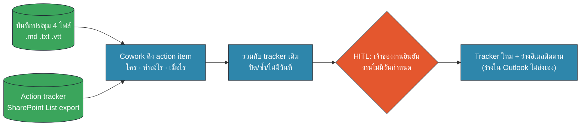
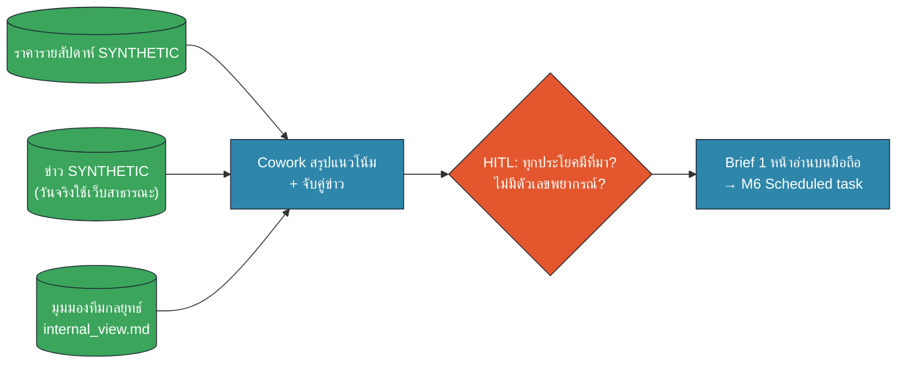
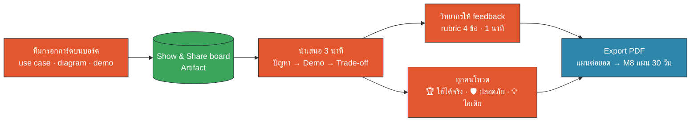

# M7 Workshop · Capstone: Use Case จริงของเรา (65 นาที · 15:10–16:15)

ข้อมูลทุกไฟล์เป็นข้อมูลสมมติ · Data pack: `data/out/M7_uc1…uc5.zip` (แต่ละ ZIP มี `BRIEF.md`) · Prompt: `prompts.md` (M7-P01…P10) · บอร์ด: `artifacts/show-share-board.html` · ทีมละ 6–8 คน (คลาส 30–40 คน = 5 ทีม)

## หน้า 1 · ภาพรวม 65 นาที และบทบาทในทีม (อ่าน 1 นาที · 15:10)


🟧 คน (HITL) · 🟦 AI · 🟩 Data/Connector

| เวลา | ช่วง | ผลลัพธ์ที่ต้องมี | หน้า |
|---|---|---|---|
| 15:10–15:15 | ① ตั้งทีม + เลือกโจทย์ | ชื่อทีม · โจทย์ · บทบาทครบ | 2 |
| 15:15–15:25 | ② Canvas + Trade-off | Canvas 4 ช่อง + diagram | 3–4 |
| 15:25–15:46 | ③ สร้างต้นแบบด้วย Cowork | ต้นแบบ v1 ผ่าน HITL | 5–11 |
| 15:46–15:50 | ④ เตรียมนำเสนอ | การ์ดบนบอร์ด + บท 3 นาที | 12 |
| 15:50–16:10 | ⑤ Show & Share | 5 ทีม × (3 นาที + feedback 1) | 13 |
| 16:10–16:15 | ⑥ โหวต + สรุป | PDF บอร์ด → M8 | 13 |

**บทบาท (เลือกใน 1 นาที คนละ 1 บท):**
- 🧭 **เจ้าของโจทย์** อธิบายว่าใครเจ็บ และ "เสร็จ" หน้าตาเป็นอย่างไร
- 🟦 **ผู้ขับ Cowork** คนเดียวที่พิมพ์ในเครื่อง (ประหยัด usage ทั้งทีม)
- 🟧 **ผู้ตรวจ HITL** เปิดไฟล์ต้นฉบับเทียบตัวเลข มีสิทธิ์ "ไม่อนุมัติ"
- ⏱️ **ผู้คุมเวลา** ดูนาฬิกา เตือนทุก 5 นาที
- 🎤 **ผู้นำเสนอ** กรอกการ์ดบนบอร์ด และพูด 3 นาที
- 🔍 **นักวิเคราะห์** (คนที่ 6–8) ตรวจ Trade-off และหาจุดที่ข้อมูลจะเป็น 🟡/🔴 ในงานจริง

✅ **Checkpoint:** ทุกคนในทีมรู้บทของตัวเอง และรู้ว่าจะเปิดหน้าไหนต่อ
🧑‍🏫 **วิทยากร:** เปิดบอร์ดแท็บ Timer บนจอใหญ่ ตั้ง 5:00 แล้วกดเริ่ม

## หน้า 2 · ① ตั้งทีม + เลือกโจทย์ (5 นาที · 15:10–15:15)

**เป้าหมาย:** ทีมได้โจทย์ 1 เรื่องที่ทำได้จริงใน 21 นาที และได้ data pack ในเครื่องผู้ขับ Cowork

**เมนูโจทย์** (รายละเอียดใน `BRIEF.md` ของแต่ละ ZIP และหน้า 7–11)

| โจทย์ | เหมาะกับ | ความยาก | ใช้ทักษะจาก |
|---|---|---|---|
| UC1 สรุปสัญญาจัดซื้อ | จัดซื้อ · กฎหมาย · Admin | ⭐⭐ | M2 · M4 |
| UC2 รายงาน Incident รายสัปดาห์ | HSE · Ops · Site | ⭐⭐ | M3 · M4 · M6 |
| UC3 รวมข้อมูล ESG 4 Site | ESG · Data · การเงิน | ⭐⭐⭐ | M2 Workshop B · M4 |
| UC4 ประชุม → Action tracker | PMO · ผู้จัดการทุกสาย | ⭐ | M3 · M6 |
| UC5 Energy market brief | กลยุทธ์ · Trading · ผู้บริหาร | ⭐⭐ | M4 · M6 |
| BYO โจทย์ของทีม | ทีมที่มีงานจริงชัด | ⭐⭐⭐ | ทั้งหมด |

**ขั้นตอน**
1. นับ 1–5 วนทั้งห้อง หรือนั่งตามทีมที่ Hi-I จัด · ตั้งชื่อทีมสั้น ๆ (1 นาที)
2. โหวตเลือกโจทย์ในทีม: ใครมีงานคล้ายโจทย์ไหนมากที่สุด เลือกอันนั้น (2 นาที)
3. ผู้ขับ Cowork ดาวน์โหลด ZIP จากลิงก์ SharePoint ของคลาส แตกไฟล์ใส่โฟลเดอร์ใหม่ `capstone_<ทีม>` (นี่คือ**สำเนา**) (2 นาที)

**BYO (โจทย์ของทีมเอง):** ได้ ถ้าตอบ "ใช่" ทั้ง 3 ข้อ: ① อธิบายได้โดยไม่ต้องเปิดไฟล์จริง ② สร้างข้อมูลจำลองได้ใน 5 นาทีด้วย `M7-P02` ③ ข้อมูลจริงในอนาคตอยู่บน SharePoint/Outlook ไม่ใช่ระบบอื่น · ถ้าไม่ครบ เลือก UC ที่ใกล้ที่สุดแล้วเล่าโจทย์จริงตอนนำเสนอแทน

```text
(BYO) ทีมเรามีงานจริงเรื่อง {…} ไฟล์จริงมีคอลัมน์ {…} ช่วยสร้างข้อมูลจำลองเพื่อฝึก … ใส่กับดัก 2 จุด
```
(ฉบับเต็ม `M7-P02`)

✅ **Checkpoint:** โฟลเดอร์ `capstone_<ทีม>` เปิดได้ เห็น `BRIEF.md` · ไม่มีไฟล์งานจริงของบริษัทในโฟลเดอร์
🧑‍🏫 **วิทยากร:** ถ้า 3 ทีมขึ้นไปเลือกโจทย์เดียวกัน ไม่ต้องห้าม แต่ชวนทีมที่ 3 ลอง BYO หรือ UC4 (ง่ายสุด) · ติดตั้ง ZIP ไม่ได้ → USB สำรอง

## หน้า 3 · ② Use-case Canvas: Data → Connector → Output (5 นาที · 15:15–15:20)

**เป้าหมาย:** ทีมตอบครบ 4 ช่องก่อนแตะ Cowork · ใช้ Interview pattern (M2) ให้ Claude ถามเรา ไม่ใช่เราเขียนเองทั้งหมด


🟧 คน (HITL) · 🟦 AI · 🟩 Data/Connector

**ขั้นตอน**
1. ผู้ขับเปิด **Chat ใหม่** (ยังไม่ใช่ Cowork) วาง prompt แล้วให้เจ้าของโจทย์ตอบทีละคำถาม (4 นาที)

```text
เราเป็นทีมในเวิร์กช็อป Capstone เลือกโจทย์ {UC…} ข้อมูลเป็นข้อมูลสมมติทั้งหมด
ช่วยสัมภาษณ์เราทีละคำถาม (ไม่เกิน 6 ข้อ) เพื่อเติม Canvas: Data · Connector · Output · Trade-off
แล้วสรุปเป็นตาราง + Mermaid flowchart ใช้ classDef human/ai/data + เกณฑ์เสร็จ 3 ข้อ
```
(ฉบับเต็มพร้อมสี `M7-P01` · ถ้าเวลาน้อย ตอบสั้น ๆ ได้ หรือพิมพ์ "ใช้ตาม BRIEF.md")

2. ผู้นำเสนอเปิดบอร์ด แท็บ **การ์ดทีม** กรอกช่อง Data / Connector / Output ทันทีที่ได้คำตอบ (1 นาที)

**ตัวช่วยตอบ**
- Data: "ไฟล์อยู่ที่ไหนในวันจริง? ใครอัปเดต? ทุกกี่วัน?"
- Connector: วันนี้ = โฟลเดอร์ใน Cowork · วันจริง = SharePoint / Outlook (M3) · ห้ามคิดถึง Google Drive
- Output: ดู Output Picker ของ M4: คนอ่านเป็นใคร อ่านบนอะไร ต้องแก้ต่อไหม

✅ **Checkpoint:** Canvas 3 ช่องแรกมีคำตอบที่**วัดได้** (เช่น "Excel 1 ชีต 12 แถว" ไม่ใช่ "รายงานสวย ๆ") · มีเกณฑ์เสร็จ 3 ข้อ

## หน้า 4 · ② Trade-off: ความปลอดภัย · ข้อจำกัด · usage (5 นาที · 15:20–15:25)

**เป้าหมาย:** ทีมรู้ก่อนลงมือว่า "ถ้าเป็นข้อมูลจริง อะไรต้องตัด อะไรติดขัด อะไรเปลือง" และวาง HITL ไว้ตรงไหน · rubric ข้อ ③ ให้คะแนนหน้านี้

**ตอบในทีม (นักวิเคราะห์เป็นคนจด · 3 นาที)**

| มุม | คำถาม | คำตอบของทีม (เขียนสั้น) |
|---|---|---|
| 🛡️ ความปลอดภัย | ในงานจริง ข้อมูลนี้สีอะไร 🟢🟡🔴? ช่องไหนต้อง anonymize? ใครเห็น output? | |
| ⚠️ ข้อจำกัด | ไฟล์ใหญ่/หลายไฟล์แค่ไหน? ต้องเปิดเครื่องไว้ไหม? Connector เห็นไฟล์นี้ไหม? | |
| 🔋 Usage | ทำบ่อยแค่ไหน? model เบาพอไหม? ควรเป็น Skill (M5) หรือ Scheduled task (M6)? | |
| ✋ HITL | จุดตรวจ/อนุมัติอยู่ตรงไหน ใครเป็นคนกด? อะไรห้าม AI ทำเอง? | |

**ตัวอย่างคำตอบที่ดี (UC2):** "ชื่อผู้บาดเจ็บ = 🟡 ตัดก่อน · log มาจาก SharePoint List ต้องมีสิทธิ์อ่าน · ทำทุกสัปดาห์ → Skill + Scheduled task แต่เครื่องต้องเปิด · ผู้จัดการ HSE อนุมัติร่างอีเมลก่อนส่ง"
**ตัวอย่างคำตอบที่ยังไม่พอ:** "ปลอดภัยเพราะใช้ Claude Team" (Team ไม่ได้ทำให้ข้อมูล 🔴 ใส่ได้ · ดู M1)

**วาด diagram ของทีม (2 นาที):** ใช้ Mermaid ที่ได้จาก `M7-P01` หรือเลือกกล่องในบอร์ด แท็บ **การ์ดทีม → Diagram** (กล่องสี 🟧🟦🟩 อัตโนมัติ) · ต้องมีกล่องสีส้มอย่างน้อย 1 กล่อง

✅ **Checkpoint:** ทุกแถวในตารางมีคำตอบ · diagram มีจุด HITL · การ์ดบนบอร์ดมีช่อง Trade-off แล้ว
🧑‍🏫 **วิทยากร:** เดินดูช่อง 🛡️ ของทุกทีมก่อน 15:25 ทีมไหนตอบ "ไม่มีความเสี่ยง" ให้ถามว่า "ถ้าไฟล์นี้หลุดไปถึงคู่ค้า ใครเดือดร้อน?"

## หน้า 5 · ③ สร้างต้นแบบ (ก): ตั้งโฟลเดอร์ + Plan → Approve (5 นาที · 15:25–15:30)

**เป้าหมาย:** Cowork เห็นเฉพาะโฟลเดอร์สำเนา ทวนเป้าหมายถูก และเสนอแผนที่ทีมอนุมัติแล้ว


🟧 คน (HITL) · 🟦 AI · 🟩 Data/Connector

**ขั้นตอน**
1. เปิด **Cowork** · ให้สิทธิ์เฉพาะโฟลเดอร์ `capstone_<ทีม>` (สำเนา = copy-before-write) · สร้างโฟลเดอร์ย่อย `output/` (1 นาที)
2. วาง prompt (2 นาทีรวมรอผล)

```text
โฟลเดอร์ที่ให้สิทธิ์คือสำเนาของ data pack {M7_uc…} (ข้อมูลสมมติ) อ่าน BRIEF.md ก่อน
1) ทวนเป้าหมายด้วยคำพูดของคุณเอง 3 บรรทัด  2) สำรวจไฟล์แบบอ่านอย่างเดียว + สิ่งที่ดูผิดปกติ
3) เสนอแผนไม่เกิน 6 ขั้น ห้ามแก้ต้นฉบับ เขียนลง output/ เท่านั้น ห้ามส่ง/บันทึกลงระบบใด
หยุดรอให้เราพิมพ์ "อนุมัติ" ก่อนลงมือ
```
(ฉบับเต็ม `M7-P03` · อิงแพตเทิร์น `M2-P03` Use your own words + `M2-P02` Plan → Approve → Execute)

3. ทั้งทีมอ่านแผน 1 นาที · ผู้ตรวจ HITL ถาม 2 ข้อ: "ตรงกับ Canvas ไหม?" "มีขั้นไหนแก้ไฟล์ต้นฉบับหรือส่งออกไหม?" · ถ้าไม่ผ่าน พิมพ์แก้แผน ถ้าผ่าน ไปหน้า 6 + หน้าโจทย์ของทีม (หน้า 7–11)

✅ **Checkpoint:** Claude ทวนเป้าหมายถูก · แผนเขียนลง `output/` เท่านั้น · Claude **ยังไม่ได้ลงมือ** จนกว่าเราพิมพ์ "อนุมัติ"
💡 ถ้า Cowork ใช้ไม่ได้ในเครื่อง: ใช้ Chat แนบไฟล์จาก ZIP ตรง ๆ (ไฟล์ไม่เกิน 10 ไฟล์) ได้ผลใกล้เคียง

## หน้า 6 · ③ สร้างต้นแบบ (ข): ลงมือ + ตรวจแบบ HITL (16 นาที · 15:30–15:46)

**เป้าหมาย:** ได้ต้นแบบ v1 ที่ทำงานครบ 1 รอบกับข้อมูลสมมติ และผ่านการตรวจของผู้ตรวจ HITL

**จังหวะแนะนำ** (ผู้คุมเวลาประกาศ)
- 15:30 พิมพ์ "อนุมัติ" + วาง prompt ของโจทย์ (`M7-P04`…`P08` ในหน้า 7–11)
- 15:38 ต้องมีผลลัพธ์รอบแรกใน `output/` แล้ว ถ้ายังไม่มี → ลดขอบเขต (เช่น 1 Site / 1 สัญญา)
- 15:40 ผู้ตรวจ HITL วาง `M7-P09` และ**เปิดไฟล์ต้นฉบับเทียบเอง 2 ค่า**
- 15:44 แก้รอบสุดท้าย · จับภาพหน้าจอ 1–2 ภาพไว้โชว์ · 15:46 หยุดสร้าง

```text
ก่อนเราจะนำเสนองานนี้ ช่วยตรวจตัวเองเป็นตาราง: 1) ตัวเลขสำคัญ 3 ค่ามาจากไฟล์/แถวไหน คำนวณอย่างไร
2) ข้อสรุปไหนอนุมาน 3) ข้อมูลผิดปกติที่เจอ 4) มีไฟล์ต้นฉบับถูกแก้หรือมีอะไรถูกส่งออกไหม
5) ถ้าเป็นข้อมูลจริง ส่วนไหน 🟡/🔴  ห้ามแก้ผลลัพธ์ในขั้นนี้
```
(ฉบับเต็ม `M7-P09`)

**จุดที่ทีมมักติด (วิทยากร/ผู้ช่วยใช้ตอนเดินวน)**

| อาการ | ทางแก้เร็ว |
|---|---|
| Claude ลงมือก่อนอนุมัติ | หยุด (Stop) · ตรวจว่าไม่ได้แตะต้นฉบับ · พิมพ์ย้ำกติกาข้อ "รอคำว่าอนุมัติ" |
| ผลลัพธ์ยาวเกิน/หลุดโจทย์ | "ทำแค่ {1 Site/1 สัญญา} ให้ครบก่อน" (Prototype first ของ M2) |
| อ่าน .docx / .vtt ไม่ได้ | ให้ Cowork แปลงเป็น .txt ใน `output/` ก่อน หรือแนบใน Chat |
| ตัวเลขไม่ตรงกับที่นับเอง | ขอ "แสดงสูตร/โค้ดที่ใช้นับ" แล้วตรวจเงื่อนไขกรอง (เช่น ตัวพิมพ์ near miss) |
| ใกล้ชน usage limit | หยุดรันซ้ำ · คนเดียวขับ · แชตใหม่ + สรุปสั้น ๆ (M1/M8) |
| อยากส่งอีเมลจริง | ไม่ได้ในวันนี้ · ร่างเป็นไฟล์ หรือ draft ใน Outlook เท่านั้น |

✅ **Checkpoint (ผู้ตรวจ HITL เซ็นในใจ):** ตัวเลข 2 ค่าตรงกับต้นฉบับ · ทุกข้อสรุปบอกที่มาได้ · ไม่มีอะไรถูกส่ง/บันทึกทับ · ต้นแบบ v1 อยู่ใน `output/`

## หน้า 7 · โจทย์ UC1 สรุปสัญญาจัดซื้อ (ใช้ช่วง 15:30–15:46)


🟧 คน (HITL) · 🟦 AI · 🟩 Data/Connector

**Data (`M7_uc1_contract_summary.zip`):** `contracts/` สัญญา .docx 3 ฉบับ (CT-2569-014 อะไหล่สายพาน · -022 อาหารแคมป์ · -031 ล้างแผงโซลาร์) · `contract_register.csv` 12 สัญญา · `BRIEF.md`
**Connector วันจริง:** SharePoint document library ของจัดซื้อ (อ่านอย่างเดียว) · วันนี้: โฟลเดอร์สำเนา

**Prompt หลัก** (หลัง "อนุมัติ" แผนจาก P03)
```text
อ่านสัญญา .docx 3 ฉบับ ดึง: เลขสัญญา · คู่สัญญา · Site · มูลค่า · การชำระเงิน · วันเริ่ม/สิ้นสุด · ต่ออายุ · ค่าปรับ · ปรับราคา
ทุกช่องใส่ "ข้อ x" ถ้าไม่พบเขียน "ไม่พบในสัญญา" · คำนวณวันสุดท้ายที่ต้องแจ้งยกเลิก (แสดงสูตร)
เทียบ contract_register.csv · บันทึก output/contract_summary.xlsx (Summary + Mismatch) · หมายเหตุ: ไม่ใช่ความเห็นทางกฎหมาย
```
(ฉบับเต็ม `M7-P04`)

**Output ที่คาดหวัง:** Excel 3 แถว × 10+ คอลัมน์ พร้อมเลขข้อ · ชีต Mismatch (อาจว่าง = ต้องเขียนว่า "ตรงกันทุกช่อง") · สรุป 5 บรรทัด

✅ **Checkpoint (ผู้ตรวจ HITL):** เปิด .docx เทียบเอง 2 ช่อง: มูลค่า CT-2569-014 และเงื่อนไขต่ออายุ CT-2569-031
🔑 **คีย์วิทยากร:** CT-2569-014 สิ้นสุด 2570-12-31 ต่ออัตโนมัติ แจ้ง 90 วัน → แจ้งภายใน **2 ต.ค. 2570** · CT-2569-031 สิ้นสุด 2570-01-31 แจ้ง 30 วัน → **1 ม.ค. 2570** (เชื่อมกับ UC4: shortlist ผู้รับจ้างใหม่) · CT-2569-022 **ไม่ต่ออัตโนมัติ** → ไม่มีวันแจ้งยกเลิก ต้องทำบันทึกต่ออายุ · ทีมที่ "เดาวัน" ให้ CT-2569-022 = ไม่ผ่าน HITL
🚀 **เสร็จเร็ว:** ทำ Skill `contract-summary` จากขั้นตอนนี้ (M5-P06) หรือ Artifact ปฏิทินแจ้งยกเลิก 12 สัญญา
🛡️ **Trade-off ที่ควรพูด:** สัญญาจริงมีราคาและเงื่อนไขเจรจา = 🟡/🔴 → ใช้ฉบับปิดชื่อ/ราคา หรือเริ่มจาก register · ฝ่ายกฎหมายยังเป็นผู้ตีความ

## หน้า 8 · โจทย์ UC2 รายงาน Incident รายสัปดาห์ (ใช้ช่วง 15:30–15:46)


🟧 คน (HITL) · 🟦 AI · 🟩 Data/Connector

**Data (`M7_uc2_incident_weekly.zip`):** `incident_log.csv` 155 เหตุการณ์ 8 สัปดาห์ (3 ส.ค.–27 ก.ย. 2026) 4 Site · `emails/` 3 ฉบับ (.eml) · `BRIEF.md`
**Connector วันจริง:** SharePoint List (Issue/Incident Log) + Outlook · วันนี้: โฟลเดอร์สำเนา (เส้นทาง B ของ M3, `M3-P08`)

**Prompt หลัก**
```text
1) ตรวจคุณภาพข้อมูลก่อน (วันที่ผิด ตัวพิมพ์ไม่สม่ำเสมอ ค่าว่าง) แสดงเป็นตาราง แล้วหยุดถามเรา
2) สรุปสัปดาห์ล่าสุดเทียบสัปดาห์ก่อน แยก Site/ประเภท ไฮไลต์ severity ≥ 3 และงานเปิดเกิน due_date
3) ใส่ประเด็นจาก emails/ โดยไม่ใส่ชื่อบุคคล  4) output/hse_weekly.docx ≤ 2 หน้า + output/email_draft.txt (ห้ามส่ง)
```
(ฉบับเต็ม `M7-P05`)

**Output ที่คาดหวัง:** รายงาน 1–2 หน้า: ตารางสรุป · ไฮไลต์ · ประเด็นติดตาม · ร่างอีเมลถึงผู้จัดการ HSE

✅ **Checkpoint (ผู้ตรวจ HITL):** นับจำนวนเหตุ Site A สัปดาห์ล่าสุดเองใน Excel (filter วันที่ 21–27 ก.ย.) เทียบกับรายงาน
🔑 **คีย์วิทยากร:** ข้อมูลผิด 2 จุด: `INC-0061` วันที่ 2026-13-02 · `INC-0018` "near miss" ตัวพิมพ์เล็ก (ถ้าไม่แก้ near miss จะถูกนับแยก) · สัปดาห์ 21–27 ก.ย.: รวม 18 (A 10 · C 6 · F 0 · G 2) เทียบสัปดาห์ก่อน 22 (A 8 · C 13 · F 1 · G 0) · severity ≥ 3: INC-0140, 0146, 0150 · เปิดเกินกำหนด ณ 28 ก.ย. = **0 รายการ** (ทีมที่แต่งรายการขึ้นมา = ไม่ผ่าน) · อีเมล 01 อ้าง LTI ที่ Site A วันที่ 20 ก.ย. แต่ log **ไม่มี** → ต้องถามกลับ ไม่ใช่เชื่ออีเมล
🚀 **เสร็จเร็ว:** แปลงเป็น Document Factory + Scheduled task ทุกจันทร์ 08:00 (M6-P03 แบบเดียวกัน)
🛡️ **Trade-off ที่ควรพูด:** ชื่อผู้บาดเจ็บ/ผู้รายงาน = 🟡 · รายงานไปถึงผู้บริหาร → HITL ก่อนส่งเสมอ · ข้อมูลเล็ก ใช้ model เบาได้

## หน้า 9 · โจทย์ UC3 รวมข้อมูล ESG 4 Site (ใช้ช่วง 15:30–15:46)


🟧 คน (HITL) · 🟦 AI · 🟩 Data/Connector

**Data (`M7_uc3_esg_consolidation.zip`):** Site A `.xlsx` (2 ชีต, kWh/ลิตร) · Site C `.csv` (หัวอังกฤษ, MWh/ตัน) · Site F `.xlsx` (**รายไตรมาส**) · Site G `.csv` (MMBtu, หัวไทย) · `emission_factors_SYNTHETIC.csv` · `esg_targets_2568.csv` · `BRIEF.md`
**Connector วันจริง:** โฟลเดอร์ SharePoint ที่แต่ละ Site อัปโหลด · วันนี้: โฟลเดอร์สำเนา (เหมือน Workshop B ของ M2)

**Prompt หลัก**
```text
1) ทำตารางแปลงหน่วย + mapping หัวคอลัมน์ 4 Site → schema เดียว แล้วรอคำว่า "ผ่าน"
2) รวมรายเดือนปี 2568 + tCO2e จาก emission_factors_SYNTHETIC (สูตรใน Excel)
3) ห้ามเติมค่าที่หาย: Site G ต.ค. = "รอข้อมูล" · Site F คงรายไตรมาส · Site A ก.ค. = "ค่าประมาณ"
4) เทียบ esg_targets → output/esg_2568.xlsx + Dashboard Artifact 1 หน้า (Export PDF)
```
(ฉบับเต็ม `M7-P06` · Dashboard ใช้แนวเดียวกับ `M4-P06`)

**Output ที่คาดหวัง:** ตาราง mapping · Excel รวมพร้อมสูตร · Dashboard 1 หน้าที่มีกล่อง "สมมติฐานและข้อมูลที่ขาด"

✅ **Checkpoint (ผู้ตรวจ HITL):** ตรวจตารางแปลงหน่วยก่อนพิมพ์ "ผ่าน" (1 MWh = 1,000 kWh) · สุ่ม 1 เดือนของ Site C เทียบ CSV
🔑 **คีย์วิทยากร:** กับดัก 3 จุด = Site G เดือน ต.ค. ว่าง ("รอข้อมูลจาก Site") · Site F มีแค่ Q1–Q4 (ห้ามหาร 3 เป็นรายเดือนโดยไม่บอก) · Site A ชีต Water มีแถว "หมายเหตุ: ก.ค. มิเตอร์เสีย ใช้ค่าประมาณ" ซึ่งอาจถูกอ่านเป็นแถวข้อมูล · เดือนของ Site C เป็น `2025-01…12` = ปี 2568 · ค่า emission factor เป็นค่าสมมติ ห้ามพูดว่า "ค่าจริง"
🚀 **เสร็จเร็ว:** ให้ Claude เขียน "ข้อความขอข้อมูลที่ขาด" ถึง Site G (ร่างเท่านั้น) หรือทำ Prototype first 3 แบบ dashboard (M2-P05)
🛡️ **Trade-off ที่ควรพูด:** ตัวเลข ESG ไปถึงรายงานสาธารณะ → HITL 2 ชั้น (เจ้าของข้อมูล Site + ทีม ESG) · ไฟล์จริงหลายสิบไฟล์ → แบ่งรอบละ Site

## หน้า 10 · โจทย์ UC4 จากบันทึกประชุมสู่ Action tracker (ใช้ช่วง 15:30–15:46)


🟧 คน (HITL) · 🟦 AI · 🟩 Data/Connector

**Data (`M7_uc4_meeting_actions.zip`):** `meetings/` 4 ไฟล์ (7 ก.ย. .md · 14 ก.ย. .txt · 21 ก.ย. ESG sync **.vtt transcript** · 28 ก.ย. .md) · `action_tracker_sharepoint_list_export.csv` (ID 101–105) · `owners.md` (อีเมล @example.com) · `BRIEF.md`
**Connector วันจริง:** SharePoint List (tracker) + Outlook (draft) · วันนี้: โฟลเดอร์สำเนา

**Prompt หลัก**
```text
1) ดึง action item จาก 4 ไฟล์: งาน · ผู้รับผิดชอบ · กำหนดส่ง · มาจากประชุมไหน (อ้างบรรทัด/เวลา)
2) ไม่มีวันชัด = "ต้องยืนยัน" ห้ามเดา · งานที่ถูกเลื่อน/ปิดในประชุมหลัง ให้อัปเดตสถานะ
3) รวมกับ tracker เดิม (งานใหม่ต่อ ID 106) · 4) output/action_tracker_new.csv + followup_drafts.md (ร่าง 1 ฉบับ/คน) ห้ามส่ง
```
(ฉบับเต็ม `M7-P07`)

**Output ที่คาดหวัง:** tracker 13–15 แถว (5 เดิม + 8–10 ใหม่) · ร่างอีเมล 4 ฉบับ (1 ต่อเจ้าของงาน)

✅ **Checkpoint (ผู้ตรวจ HITL):** เลือก 2 งาน แล้วเปิดไฟล์ประชุมดูว่าใคร/วันไหนตรงจริง · ตรวจว่าไม่มีวันที่ที่ "แต่งขึ้น"
🔑 **คีย์วิทยากร:** ซ่อมท่อไอน้ำ Site C: กำหนด 18 ก.ย. → เลื่อน 25 ก.ย. → **ปิดแล้ว** 28 ก.ย. · เช็กเงื่อนไขปรับราคา CT-2569-014 → **ปิด** 14 ก.ย. · scheduled task ของคุณจำลอง: ไม่มีวัน → "ขอ 2 สัปดาห์" → 28 ก.ย. "จะเสนอทางเลือกสัปดาห์หน้า" = **ต้องยืนยัน** · ตัวเลข Q3 ภายใน 30 ก.ย. แต่ Site F ยังขาด → คุณตัวอย่าง ตาม (**ไม่มีวัน**) · shortlist ผู้รับจ้างล้างแผง 5 ต.ค. · ตามข้อมูล Site G ภายในศุกร์ (จาก .vtt) · ตารางแปลงหน่วย สิ้นเดือน · "แจ้ง HSE" ใน 14 ก.ย. **ไม่ระบุผู้รับผิดชอบ** · tracker เดิม ID 103 เลยกำหนด 31 ส.ค. และยัง Not started
🚀 **เสร็จเร็ว:** ทำ Artifact "กระดานงานค้าง" แยกตามคน หรือร่าง prompt เป็น Scheduled task หลังประชุมทุกจันทร์ (M6)
🛡️ **Trade-off ที่ควรพูด:** transcript จริงอาจมีเรื่องส่วนตัว/HR = 🟡/🔴 · ห้ามให้ AI แก้ SharePoint List เองโดยไม่มีคนอนุมัติ · ร่างอีเมลต้องให้เจ้าของงานยืนยันวัน

## หน้า 11 · โจทย์ UC5 Energy market brief (ใช้ช่วง 15:30–15:46)


🟧 คน (HITL) · 🟦 AI · 🟩 Data/Connector

**Data (`M7_uc5_energy_market_brief.zip`):** `prices_weekly_SYNTHETIC.csv` (8 สัปดาห์: ดัชนีถ่านหินสมมติ NEX-6000 · LNG · น้ำมันอ้างอิง · บาท/ดอลลาร์) · `news_snippets_SYNTHETIC.csv` (ข่าวสมมติ 12 ข่าว ลิงก์ news.example.com) · `internal_view.md` · `BRIEF.md`
**Connector วันจริง:** เว็บสาธารณะ (web search) + SharePoint (มุมมองภายใน) · วันนี้: โฟลเดอร์สำเนา (ห้ามค้นเว็บแทนข่าวสมมติในเวิร์กช็อป เพื่อให้ทุกทีมตรวจคำตอบเดียวกันได้)

**Prompt หลัก**
```text
1) % เปลี่ยนแปลงสัปดาห์ล่าสุด vs ก่อนหน้า และ vs 4 สัปดาห์ก่อน (ทศนิยม 1 ตำแหน่ง)
2) เลือกข่าวที่เกี่ยวกับ 3 เรื่องใน internal_view.md  3) brief 1 หน้าบนมือถือ: 3 เรื่อง + ลิงก์ · ตารางราคา · ผลต่อธุรกิจ 2 bullet
4) ห้ามพยากรณ์ราคาเป็นตัวเลข ทุกประโยคชี้ที่มา → output/market_brief.md + Artifact 1 หน้า (Export PDF)
```
(ฉบับเต็ม `M7-P08` · ต่อยอดเป็น `M6-P04` Weekly Energy & Ops Insight)

**Output ที่คาดหวัง:** brief ไม่เกิน 1.5 หน้าจอมือถือ ทุกบรรทัดมีที่มา

✅ **Checkpoint (ผู้ตรวจ HITL):** คำนวณ % ถ่านหินและ LNG เองด้วยเครื่องคิดเลข · หาประโยคที่ "พยากรณ์" แล้วลบ
🔑 **คีย์วิทยากร:** สัปดาห์ล่าสุด = 21 ก.ย. 2026 · ถ่านหิน 88.7 (−4.1% สัปดาห์ · −14.1% vs 4 สัปดาห์) · LNG 13.60 (+1.5% · +11.9%) · น้ำมัน 79.3 (−1.0% · −0.8%) · บาท 35.60 (−0.1% · +0.2%) · ข่าวที่ตรง 3 เรื่อง = coal / lng / power · ข่าว oil, fx, carbon ไม่อยู่ในความสนใจตาม internal_view (ใส่ได้เป็น "อื่น ๆ" แต่ไม่ใช่ 3 เรื่องหลัก)
🚀 **เสร็จเร็ว:** แปลงเป็น Scheduled task เช้าวันจันทร์ 07:30 (M6) พร้อมจุด HITL ก่อนส่งต่อ
🛡️ **Trade-off ที่ควรพูด:** ข่าวจากเว็บต้องตรวจที่มาและวันที่ · มุมมองภายในของทีมกลยุทธ์อาจเป็น 🟡 · ห้ามใช้เป็นคำแนะนำซื้อขาย

## หน้า 12 · ④ เตรียมนำเสนอ + โพสต์การ์ดบนบอร์ด (4 นาที · 15:46–15:50)

**เป้าหมาย:** ทุกทีมมีการ์ดครบบน Show & Share board และบทพูด 3 นาทีที่ไม่เกินเวลา

**ขั้นตอน**
1. ผู้ขับวาง prompt ในแชตเดิม (1 นาที)

```text
ช่วยเตรียมการนำเสนอ 3 นาทีของทีม {ชื่อทีม} จากงานในแชตนี้:
A) ข้อความการ์ด: ปัญหา · Data · Connector · Output · Trade-off · HITL · ผลที่วัดได้ (ระบุว่าประมาณ)
B) บทพูด 0:00–0:30 ปัญหา · 0:30–2:00 demo · 2:00–3:00 trade-off + สิ่งที่ยังไม่ควรให้ AI ทำ
C) ก้าวต่อไปใน 30 วัน 3 ข้อ
```
(ฉบับเต็ม `M7-P10`)

2. ผู้นำเสนอกรอก/วางข้อความลงบอร์ด แท็บ **การ์ดทีม** ให้ครบทุกช่อง · เลือกกล่อง diagram · ใส่ demo link หรือ note (เช่น "ไฟล์ output/hse_weekly.docx บนเครื่องผู้ขับ") (2 นาที)
3. กด **📋 คัดลอกรหัสการ์ด** แล้วส่งให้วิทยากร (แชตของคลาสใน Teams หรือยื่นเครื่องให้ดู) · วิทยากรกด **นำเข้าการ์ด** บนบอร์ดหน้าห้อง (1 นาที)
4. ซ้อมพูด 1 รอบในทีม ผู้คุมเวลาจับเวลา (1 นาที)

**โครงนำเสนอ 3 นาที**

| เวลา | พูดอะไร | เปิดอะไร |
|---|---|---|
| 0:00–0:30 | ใครเจ็บ เสียเวลาเท่าไรต่อสัปดาห์/เดือน | การ์ดบนบอร์ด |
| 0:30–2:00 | Demo: ข้อมูลเข้า → Claude ทำอะไร → ผลลัพธ์ · ชี้จุด HITL | ไฟล์ใน `output/` หรือ screenshot |
| 2:00–3:00 | Trade-off 3 มุม · สิ่งที่ "ยังไม่ควรให้ AI ทำ" · ก้าวต่อไป 30 วัน | diagram บนการ์ด |

✅ **Checkpoint:** การ์ดของทีมขึ้นบนบอร์ดหน้าห้อง · บทพูด ≤ 3 นาที · ไม่มีชื่อคนจริงหรือข้อมูลจริงบนการ์ด
💡 Demo ไม่ทำงานตอนโชว์? ใช้ screenshot ที่เก็บไว้ 15:44 · ไม่ต้องรันใหม่หน้าห้อง (ประหยัด usage และเวลา)
🧑‍🏫 **วิทยากร:** จัดลำดับนำเสนอบนบอร์ด (ลากหรือกดลูกศร) ให้โจทย์ซ้ำกันอยู่ติดกันเพื่อเทียบทางแก้

## หน้า 13 · ⑤ Show & Share + ⑥ โหวตและสรุป (25 นาที · 15:50–16:15)


🟧 คน (HITL) · 🟦 AI · 🟩 Data/Connector

**ลำดับต่อทีม (3 นาที + feedback 1 นาที × 5 ทีม = 20 นาที):** วิทยากรเปิดการ์ดทีมบนบอร์ด → แท็บ Timer 3:00 (เหลือง 0:30 · แดงหมดเวลา) → ทีมนำเสนอ → วิทยากรให้ feedback ตาม rubric 1 นาที → ทีมถัดไป

**Rubric วิทยากร (ข้อละ 1–4 · ใช้เป็นคำแนะนำ ไม่ประกาศคะแนน)**

| เกณฑ์ | 1 · เริ่มต้น | 2 · พอใช้ | 3 · ดี | 4 · พร้อมต่อยอด |
|---|---|---|---|---|
| ① ปัญหาจริง วัดผลได้ | "อยากให้เร็วขึ้น" | ระบุผู้ใช้ | ระบุเวลา/รอบที่ประหยัด | มีตัวชี้วัด + เจ้าของงาน |
| ② ต้นแบบทำงาน | มีแค่แนวคิด | ได้ผลบางส่วน | ครบ 1 รอบกับข้อมูลสมมติ | ครบ + ทำซ้ำได้ (prompt/Skill) |
| ③ Trade-off + HITL | ไม่พูดถึง | พูดกว้าง ๆ | ครบ 3 มุม + จุด HITL | จับกับดักข้อมูลได้ + บอกสิ่งที่ไม่ให้ AI ทำ |
| ④ ต่อยอด 30 วัน | ไม่มี | มีแต่ไม่ชัด | 1–3 ขั้นชัด | ระบุผู้อนุมัติ/ข้อมูลที่ต้องขอ + Skill/Scheduled task |

**feedback 1 นาที = 1 ชม + 1 ถาม + 1 แนะ** เช่น "ชอบที่จับวันที่ผิดได้ · ถ้าใช้ข้อมูลจริง ชื่อผู้บาดเจ็บจะจัดการอย่างไร? · ลองทำเป็น Skill แล้วตั้ง Scheduled task"

**⑥ โหวต + สรุป (5 นาที · 16:10–16:15)**
1. ทุกคนโหวต 3 หมวด (1 เสียงต่อหมวด ห้ามโหวตทีมตัวเอง): 🏆 ใช้ได้จริงที่สุด · 🛡️ ปลอดภัย/Trade-off ดีที่สุด · 💡 ไอเดียเจ๋งที่สุด · วิทยากรนับมือแล้วกด +1 ในแท็บ **โหวต** (2 นาที)
2. ประกาศผล + ปรบมือ (1 นาที)
3. วิทยากรกด **⬇ Export PDF** บนบอร์ด → อัปโหลดไว้ใน SharePoint ของคลาส · แต่ละทีม Export PDF การ์ดของตัวเอง (1 นาที)
4. เชื่อม M8: "ช่อง 'ก้าวต่อไป 30 วัน' บนการ์ด คือร่างแรกของแผน 30 วันที่เราจะเขียนต่อในชั่วโมงหน้า" (1 นาที)

✅ **Checkpoint:** ทุกทีมได้นำเสนอ · บอร์ดมีโหวตครบ 3 หมวด · PDF บอร์ดอยู่ใน SharePoint ของคลาส
🧑‍🏫 **วิทยากร:** ถ้ามี 6 ทีมขึ้นไป ลดเป็น 2 นาทีต่อทีม + feedback รวมท้ายสุด หรือให้ 2 ทีมที่โจทย์ซ้ำนำเสนอคู่กัน · จด use case ที่ได้โหวต 🏆 ส่งทีม Hi-I เป็นผู้สมัคร pilot หลังอบรม
