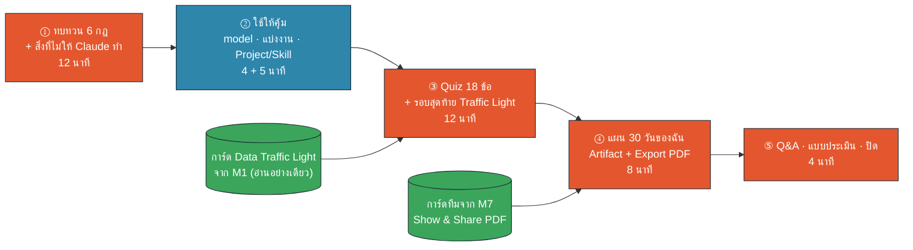
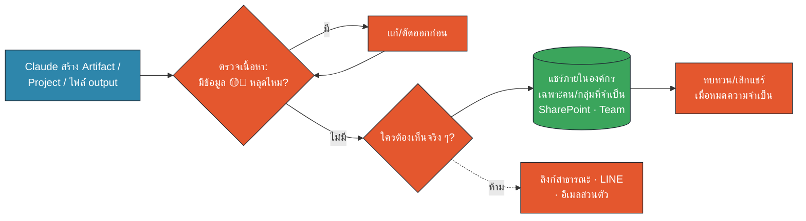
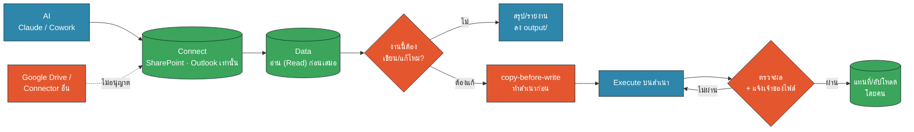
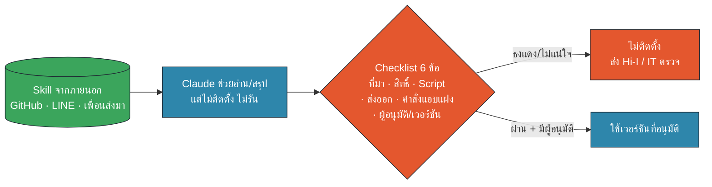
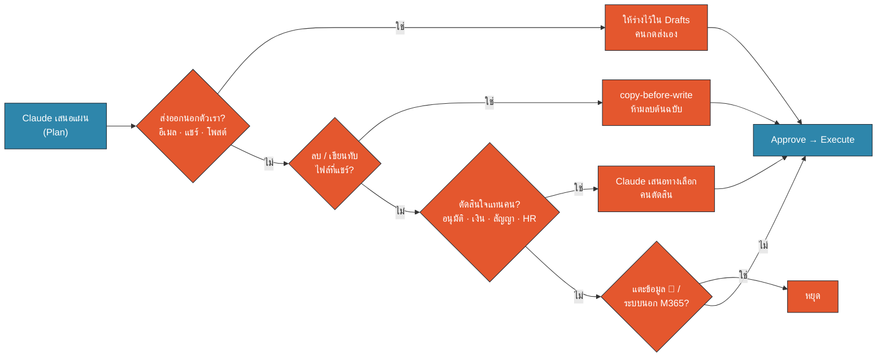
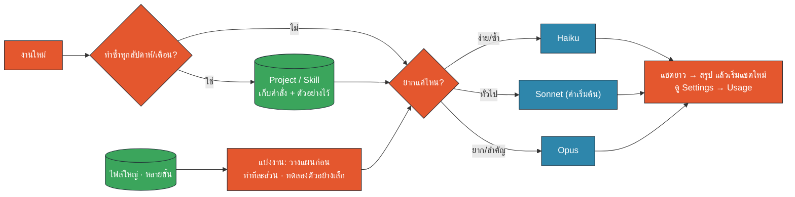
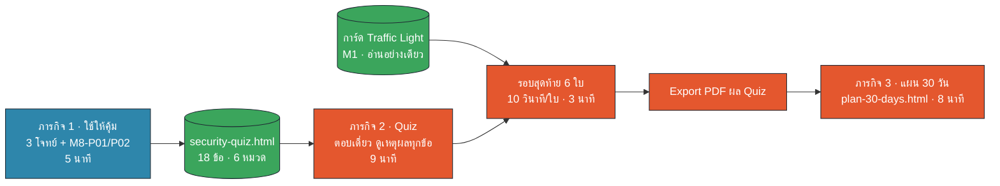
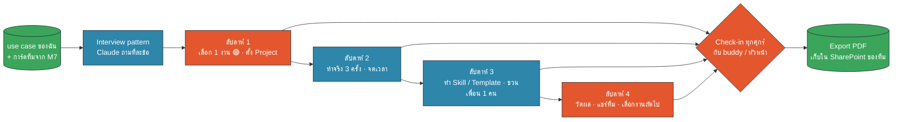

<!-- type: section -->
# M8 · Security Recap, Quiz & แผน 30 วัน

ทบทวนกฎ · ใช้ให้คุ้ม · Quiz · แผน 30 วันของฉัน · ปิดการอบรม

16:15–17:00 · 45 นาที (บรรยาย 20 · Workshop 25)

???
[0:00 · 16:15] ต่อจาก Show & Share ของ M7 ทันที ชมทีมที่ชนะโหวต 10 วินาที แล้วเข้าเรื่อง
Requirement ที่ปิดในโมดูลนี้: 2 (Security & ข้อมูลอ่อนไหว · Personal vs Team), 3 (Connector · copy-before-write), 9 (Third-party Skill · ย้ำ), 13 (ใช้ให้คุ้ม · Hands-on เบา)
ให้ทุกคนเปิด 2 ไฟล์รอไว้: `artifacts/security-quiz.html` และ `artifacts/plan-30-days.html` (หรือลิงก์ Artifact ที่ Hi-I แชร์ให้)
บอกตรง ๆ: "45 นาทีสุดท้ายนี้ สิ่งที่เราอยากให้ติดตัวกลับไปคือ กฎ 6 ข้อ และแผน 1 หน้า"

---

# 45 นาทีสุดท้าย: ทบทวน → ลอง → วางแผน

🟧 คน (HITL) · 🟦 AI · 🟩 Data/Connector

???
[0:30] เดินตาม diagram เร็ว ๆ: ส่วนใหญ่เป็นสีส้ม เพราะช่วงนี้คือ "เรา" ตัดสินใจ ไม่ใช่ Claude
ผลลัพธ์ที่แต่ละคนต้องได้ก่อน 17:00: PDF ผล Quiz 1 ไฟล์ + PDF แผน 30 วัน 1 ไฟล์
บอกว่า Quiz ไม่ได้ใช้ตัดเกรด ใช้ดูว่าเราควรทบทวนหมวดไหน (ถ้า Hi-I ต้องการเก็บคะแนน ดู Open question ใน README)

---
<!-- type: story -->
# ก.ย. 2023: ลิงก์แชร์ลิงก์เดียว เปิดข้อมูล 38TB

- ทีมวิจัย AI ของ Microsoft แชร์ไฟล์ training data บน GitHub
- ลิงก์ที่ใช้ (Azure SAS token) เปิด **ทั้ง storage account** ไม่ใช่แค่ไฟล์เดียว
- สิทธิ์ "แก้ไขได้" ไม่ใช่ "อ่านอย่างเดียว" · ลิงก์หมดอายุปี 2051
- ข้างในมี backup เครื่องพนักงาน รหัสผ่าน และข้อความ Teams 30,000+ ข้อความ
- Wiz พบและแจ้ง Microsoft ปิดภายใน 2 วัน

> ปัญหาไม่ใช่ AI ฉลาดเกินไป แต่คือ **คนแชร์กว้างเกินไป**

???
[1:30] เล่า 1.5 นาที เคสจริงจาก Wiz Research (18 ก.ย. 2023) และ Microsoft MSRC ยืนยัน (SOURCES #1, #2)
ไทม์ไลน์: ลิงก์อยู่บน GitHub ตั้งแต่ ก.ค. 2020 · Wiz แจ้ง 22 มิ.ย. 2023 · Microsoft ยกเลิก token 24 มิ.ย. 2023 · MSRC ระบุว่าไม่มีข้อมูลลูกค้าหลุด
ทำไมเลือกเคสนี้ปิดวัน: ไม่มีใคร "ตั้งใจ" ทำผิด เป็นทีมเก่งด้าน AI ด้วยซ้ำ แค่ตั้งค่าการแชร์ผิด 1 จุด
เชื่อมกับเรา: Claude Team ทำให้แชร์ Project / Artifact / ไฟล์ output ได้ง่ายมาก "แชร์ง่าย = แชร์ผิดก็ง่าย" (M1)
คำถามชวนคิด: "ลิงก์ไหนที่คุณเคยแชร์ แล้วไม่เคยกลับไปปิดเลย?"

---

# 6 กฎที่พกกลับบ้าน

1. 🔴🟡🟢 **ข้อมูลอ่อนไหวไม่ใส่ Claude** · ไม่แน่ใจให้เข้มไว้ก่อน
2. 🏢 **บัญชี Team ของบริษัทเท่านั้น** · แชร์ให้แคบที่สุด
3. 🔌 **Connector ที่อนุมัติ: SharePoint + Outlook**
4. 📄 **copy-before-write** · ไม่ให้ AI ทับไฟล์ที่แชร์
5. 🧩 **Skill จากภายนอก = โปรแกรมแปลกหน้า** · ตรวจก่อนติดตั้ง
6. 🟧 **Plan → Approve → Execute** · Claude ร่าง คนตัดสิน

???
[3:00] สไลด์นี้คือ "สรุปทั้งวัน" 6 ข้อ แต่ละข้อมีสไลด์ทบทวนสั้น ๆ ต่อจากนี้ (ข้อละ ~1 นาที)
ให้ห้องอ่านออกเสียงพร้อมกันเร็ว ๆ หรือให้ชี้ว่ากฎข้อไหนเรียนในโมดูลไหน (1–2 = M1 · 3–4 = M3 · 5 = M5 · 6 = M2/M6)
ทั้ง 6 ข้อจะกลับมาเป็นหมวดใน Quiz

---

# กฎ 1 · Data Traffic Light ก่อนวางทุกครั้ง

```mermaid
flowchart LR
    D[("ข้อมูลที่จะใช้")]:::data --> Q1{"อ่อนไหว?<br/>บุคคล · สุขภาพ · การเงินยังไม่เปิดเผย<br/>· ความลับการค้า · รหัสผ่าน"}:::human
    Q1 -- ใช่ --> R["🔴 ห้ามใส่ Claude<br/>ใช้เครื่องมือที่บริษัทกำหนด"]:::human
    Q1 -- ไม่ --> Q2{"มีชื่อคน · เบอร์<br/>· ชื่อคู่ค้า/ลูกค้า?"}:::human
    Q2 -- ใช่ --> Y["🟡 anonymize ก่อน"]:::human
    Q2 -- ไม่ --> G["🟢 ใช้ได้"]:::human
    Y --> G
    G --> A{"บัญชี Claude Team<br/>ของบริษัท?"}:::human
    A -- ใช่ --> C["Claude ทำงาน"]:::ai
    A -- บัญชีส่วนตัว --> S["หยุด"]:::human
    classDef human fill:#E4572E,color:#fff,stroke:#1F2933;
    classDef ai fill:#2E86AB,color:#fff,stroke:#1F2933;
    classDef data fill:#3BA55C,color:#fff,stroke:#1F2933;
```

🟧 คน (HITL) · 🟦 AI · 🟩 Data/Connector

???
[4:00] diagram เดียวกับ M1 แบบย่อ ทุกกล่องที่เป็นคำถามคือสีส้ม = คนตัดสิน
ย้ำ 2 จุดที่คนพลาดบ่อยในเกมเมื่อเช้า: (1) ลบชื่อแล้วข้อมูลสุขภาพก็ยัง 🔴 (2) anonymize "ก่อน" ส่ง ไม่ใช่ให้ Claude ลบให้ทีหลัง
รอบสุดท้ายของ Quiz จะใช้การ์ด 6 ใบจากเกม M1 อีกครั้ง

---

# กฎ 2 · บัญชีบริษัทเท่านั้น และแชร์ให้แคบที่สุด

🟧 คน (HITL) · 🟦 AI · 🟩 Data/Connector

- **Personal AI ห้ามใช้กับข้อมูลบริษัท** แม้ข้อมูลเป็น 🟢
- Team ≠ Enterprise: ระบบตรวจย้อนหลังน้อยกว่า วินัยอยู่ที่เรา

???
[5:00] กฎนโยบายบ้านปู 2 ข้อจาก M1 ไม่มีข้อยกเว้น: ข้อมูลอ่อนไหวไม่ใส่ Claude · ห้าม Personal AI กับข้อมูลบริษัท
เชื่อมกับเคส 38TB: ทุกครั้งที่จะแชร์ ถาม 3 คำถาม "มีอะไรหลุดไหม · ใครต้องเห็นจริง · เมื่อไรจะปิด"
Team = รถที่มีเบรก แต่ไม่มีเบรกอัตโนมัติ (analogy M1) ไม่มีใครเตือนก่อนเราแชร์ผิด
ตัวเลือกการแชร์ในเมนู Claude อาจเปลี่ยนตามเวอร์ชัน ให้ดูของจริงใน dry-run (ดู Open question ใน README)

---

# กฎ 3–4 · Connector ที่อนุมัติ + copy-before-write

🟧 คน (HITL) · 🟦 AI · 🟩 Data/Connector

???
[6:00] AI → Connect → Data → Execute จาก M3 ทวนในภาพเดียว
Read ความเสี่ยงต่ำ · Write ความเสี่ยงสูง เพราะไฟล์ที่แชร์มีคนอื่นใช้อยู่ (นึกถึง Capex Tracker ที่หายครึ่งไฟล์ในเดโม M3)
ถ้ามีคนถามเรื่อง Google Drive / Connector อื่น: ไม่อนุญาตในบ้านปู ให้ใช้ SharePoint หรือ Outlook หรือดาวน์โหลดไฟล์ 🟢 มาใส่โฟลเดอร์สำเนาแทน
คนเป็นผู้แทนที่ไฟล์จริงและแจ้งเจ้าของไฟล์ ไม่ใช่ให้ Claude ทับเอง

---

# กฎ 5 · Skill จากภายนอก = โปรแกรมแปลกหน้า

🟧 คน (HITL) · 🟦 AI · 🟩 Data/Connector

- ยอดดาวน์โหลดสูง ≠ ปลอดภัย
- ใช้ Skill ที่ทีมสร้างเองหรือที่ Hi-I/IT รับรองก่อน

???
[7:00] Requirement 9 (ย้ำ) — Checklist 6 ข้อจาก M5 (ที่มา · สิทธิ์ · Script · ส่งออก · คำสั่งแอบแฝง · ผู้อนุมัติ/เวอร์ชัน)
ทวนเคสที่เล่าไปแล้วแบบสั้นมาก ไม่ต้องเล่าซ้ำ: M1 Skill ที่แอบโหลดโค้ดมารัน · M5 Skill ปลอมหลายร้อยตัวในร้านสาธารณะ
ถามห้อง 1 คำถาม: "เพื่อนส่ง Skill ZIP มาทาง LINE ทำอะไรก่อน?" → ไม่ติดตั้ง ส่งตรวจ (Quiz ข้อ Q13)
ผู้อนุมัติ Skill ในบ้านปู: Hi-I / IT (รอคุณเก๊ยืนยัน ดู README)

---

# กฎ 6 · Plan → Approve → Execute

- Claude **วางแผนก่อน** · เรา **อ่านแผนก่อนอนุมัติ**
- ทดลองกับสำเนาหรือบางส่วนก่อนทำทั้งหมด
- ขอ **ที่มาของตัวเลข** · สุ่มตรวจอย่างน้อย 3 จุด
- งานตั้งเวลา: AI ร่าง · **คนส่ง**
- เจ้าของงาน 1 คน ชื่ออยู่บนผลลัพธ์

> Human-in-the-Loop (HITL) = จุดที่ AI ต้องหยุดรอคนตรวจ/อนุมัติ

???
[8:00] รวมหลัก HITL จากทั้งวัน: M2 (จัดโฟลเดอร์ 1,500 ไฟล์ต้องอ่านแผนก่อน) · M4 (ตรวจ 3 ตัวเลข) · M6 (ตั้งเวลาได้ แต่ไม่ตั้ง "การส่ง")
คำถามที่ช่วยคนตรวจ: "ถ้าผิด ใครเสียหาย และแก้คืนได้ไหม?" ถ้าแก้คืนไม่ได้ = ต้องมีคนอนุมัติเสมอ
สไลด์ถัดไปจะสรุปเป็นรายการ "สิ่งที่ไม่ให้ Claude ทำ"

---

# สิ่งที่ไม่ให้ Claude ทำ (และให้ทำอะไรแทน)

| ❌ ไม่ให้ Claude… | ✅ ให้ Claude… |
|---|---|
| ส่งอีเมล / แชร์ / โพสต์เอง | ร่างไว้ใน Drafts ให้เราตรวจแล้วกดส่ง |
| ลบหรือเขียนทับไฟล์ที่แชร์ | ทำงานบนสำเนา (copy-before-write) |
| อนุมัติ เงิน สัญญา HR แทนคน | สรุปทางเลือก + ข้อดีข้อเสีย ให้คนตัดสิน |
| อ่านข้อมูล 🔴 หรือระบบนอก M365 | ใช้ข้อมูล 🟢 / 🟡 ที่ anonymize แล้ว |
| ติดตั้ง Skill / รัน script แปลกหน้า | อ่านและสรุปความเสี่ยงของ Skill |
| เป็นแหล่งข้อมูลสุดท้าย | ให้ที่มา แล้วเราตรวจกับต้นฉบับ |

???
[9:00] Requirement 2 + 3: "what NOT to let Claude do" ตามที่ proposal ระบุ
อ่านทีละแถวเร็ว ๆ เน้นคอลัมน์ขวา: เราไม่ได้ห้ามใช้ Claude แต่เปลี่ยน "ทำแทน" เป็น "ร่าง/เสนอ/ทำบนสำเนา"
แถวสุดท้ายโยงกับเคส M4 (รายงานที่มีอ้างอิงปลอม): Claude เป็นผู้ช่วยร่าง ไม่ใช่แหล่งอ้างอิง
Prompt `M8-P05` คือชุด "กติกาประจำ Project" ที่ใส่ข้อห้ามเหล่านี้ไว้ใน Project instructions ครั้งเดียว ใช้ได้ทุกแชต

---

# ก่อนกด Allow / Approve: 4 คำถาม

🟧 คน (HITL) · 🟦 AI · 🟩 Data/Connector

???
[10:30] ตารางสไลด์ก่อนหน้าแปลงเป็น 4 คำถามที่ถามตัวเองทุกครั้งที่ Cowork ขออนุญาต
จำง่าย: "ส่ง · ลบ · ตัดสิน · แดง" ถ้าใช่ข้อไหน ให้ปรับแผนก่อนอนุมัติ
ห้ามกด "Allow always" กับงานที่ตอบ "ใช่" ข้อใดข้อหนึ่ง (เชื่อมกับ M6: ทดลอง 4 รอบก่อนลดการถาม)
ช่วงทบทวนกฎจบที่นี่ (~12 นาที) ไปต่อเรื่องใช้ให้คุ้ม

---
<!-- type: section -->
# ใช้ให้คุ้ม ภายใต้ weekly limit
เลือก model · แบ่งงาน · ไม่ส่ง context ซ้ำ

???
[12:00] Requirement 13 (Hands-on เบา) M1 ให้แนวคิด M5 แสดงว่า Skill ช่วยประหยัดอย่างไร M8 ให้ลงมือเลือกจริงใน workshop ภารกิจ 1

---

# อะไรกิน usage มากที่สุด

| กิน usage มาก | ทางเลือกที่คุ้มกว่า |
|---|---|
| แชตเดียวยาวทั้งวัน | สรุปสถานะ → เริ่มแชตใหม่ |
| แนบทั้งไฟล์/ทั้งโฟลเดอร์ | ส่งเฉพาะชีต/คอลัมน์/ช่วงที่ใช้ |
| Opus กับงานง่าย | Haiku/Sonnet ก่อน ยกระดับเมื่อจำเป็น |
| พิมพ์คำสั่งยาว + ตัวอย่างซ้ำทุกเดือน | Project instructions / Skill |
| ให้ Claude อ่านข้อมูล 200,000 แถวเอง | ให้เขียนสคริปต์สรุป ทดลองตัวอย่างเล็ก |
| สั่งกว้าง ๆ แล้วแก้หลายรอบ | ขอแผนก่อน (Plan → Approve) |

???
[13:00] หลักคิดเดียว: usage ขึ้นกับปริมาณที่ Claude ต้องอ่าน + ขนาด model + จำนวนรอบที่แก้
ทุกแถวเคยเจอมาแล้วในวันนี้: แชตยาว (M1) · ข้อมูลขนาดจริง (M2/M4) · Skill (M5) · Plan → Approve (M2)
ย้ำ: limit เป็น "ต่อคน" ดูที่ Settings → Usage ตัวเลขโควตาจริงให้ดูจากหน้าจอ ไม่ต้องจำตัวเลข (SOURCES M1 #6)
ห้ามแก้ปัญหาโควตาด้วยการเปลี่ยนไปใช้บัญชีส่วนตัว (Quiz Q16)

---

# 3 เทคนิค: เลือก model · แบ่งงาน · Project/Skill

🟧 คน (HITL) · 🟦 AI · 🟩 Data/Connector

???
[14:00] 3 เทคนิค: (1) เลือก model ให้พอดีงาน (2) แบ่งงานใหญ่เป็นขั้น ทดลองกับตัวอย่างเล็ก (3) Project/Skill ไม่ต้องส่ง context ซ้ำ
ชื่อ model ในเมนูอาจมีเลขเวอร์ชันต่างจากสไลด์ ให้ดูของจริง · บาง model บน Team อาจใช้ usage เร็วกว่า (ยืนยันใน dry-run)
ใน workshop ภารกิจ 1 จะได้ลอง 3 โจทย์ + prompt `M8-P01` (สรุปเพื่อเริ่มแชตใหม่) และ `M8-P02` (ขอแผนแบ่งงาน + เลือก model)

---

# ตัวอย่าง: งานรายงานรายเดือน ทำแบบคุ้ม

| ขั้น | ทำอะไร | model |
|---|---|---|
| ครั้งเดียว | Project "รายงานเดือน" ใส่ instructions + template + กติกา `M8-P05` | – |
| 1 | ให้ Claude **วางแผน** ว่าใช้ไฟล์ไหน คอลัมน์ไหน | Sonnet |
| 2 | ทดลองกับข้อมูล 1 site ก่อน ตรวจ 3 ตัวเลข | Sonnet |
| 3 | รันครบทุก site ด้วยสคริปต์ที่ผ่านแล้ว | Sonnet |
| 4 | ขัดภาษาบทสรุปผู้บริหาร | Haiku |
| 5 | แชตยาวเกิน → `M8-P01` สรุป แล้วเริ่มแชตใหม่ใน Project | – |

???
[15:00] ตัวอย่างสมมติ ใช้ข้อมูลรูปแบบเดียวกับ Monthly Operations Report ใน M4
ประเด็น: Opus ไม่จำเป็นในงานนี้ ใช้เมื่องานยากจริง เช่น วิเคราะห์ความเสี่ยงหลายเงื่อนไขที่ Sonnet ทำได้ไม่ดี
ขั้น 2 คือ "แบ่งงาน" ที่ช่วยทั้งคุณภาพและ usage: ถ้าผิดตั้งแต่ site แรก เราเสียแค่รอบเล็ก ไม่ใช่ทั้งรอบ
ขั้น "ครั้งเดียว" คือการลงทุนที่คืนทุนตั้งแต่เดือนที่ 2 (เหมือน Skill ใน M5)

---
<!-- type: section -->
# Workshop 25 นาที · 3 ภารกิจ

🟧 คน (HITL) · 🟦 AI · 🟩 Data/Connector

คู่มือ: `workshop.md` หน้า 1–5 · Prompt: `prompts.md` (M8-P01…P07)

???
[16:00] อธิบาย 30 วินาที แล้วเริ่มนับเวลา (16:31)
ภารกิจ 1 ทำในบัญชี Claude Team ของตัวเอง ใช้ข้อความสมมติในคู่มือเท่านั้น
ภารกิจ 2 Quiz เปิดไฟล์ HTML หรือลิงก์ Artifact ไม่เรียก AI ไม่กิน usage · คะแนนไม่ถูกส่งไปไหน (อยู่ในเครื่อง)
ภารกิจ 3 ต่อจากการ์ดทีม M7: เอา "แผนต่อยอด" ของทีมมาเป็นแผนส่วนตัว

---

# แผน 30 วันของฉัน: 1 งาน · 4 สัปดาห์ · มีคนเช็ก

🟧 คน (HITL) · 🟦 AI · 🟩 Data/Connector

???
[16:30] หลักของแผน: "เล็กแต่ทำจริง" 1 งาน ทำซ้ำได้ มีเจ้าของ มี check-in
ช่องที่ต้องกรอกใน Artifact: use case (สีข้อมูล 🟢/🟡) · เครื่องมือ (Chat/Project/Skill/Cowork/Artifact) · Connector · เจ้าของ · buddy · ตัวชี้วัด (เวลาที่ประหยัดต่อครั้ง) · check-in 4 ครั้ง
Artifact จะเตือนถ้าเลือกข้อมูล 🔴 หรือไม่มีจุด HITL · ใช้ prompt `M8-P03` (Interview pattern) ถ้านึกไม่ออกว่าจะเริ่มงานไหน
check-in ใส่ในปฏิทิน Outlook เอง หรือให้ Claude ร่าง invite ไว้ใน Drafts (`M8-P04`) ไม่ส่งเอง
[Workshop เริ่ม 16:31 → จบ 16:56 · ดู workshop.md หน้า 1–5]

---

# Debrief Quiz: ข้อที่คนพลาดบ่อย

- **ลบชื่อแล้ว ≠ ปลอดภัย** · เงินเดือน + เลขบัตร ยัง 🔴 (Q01)
- **anonymize ก่อนส่ง** ไม่ใช่หลังได้ผล (Q02)
- **Team ไม่เตือนเรา** · วินัยอยู่ที่ผู้ใช้ (Q04)
- **ยอดดาวน์โหลดสูง ≠ Skill ปลอดภัย** (Q14)
- **โควตาใกล้หมด ≠ เหตุผลใช้บัญชีส่วนตัว** (Q16)

> ไม่แน่ใจ → ถือเป็นสีที่เข้มกว่า และถามก่อน

???
[Lecture 17:00 · 16:56] Debrief 1.5 นาที ใช้ผลจริงของห้อง: ถามว่าใครได้ 15+ ข้อ (ยกมือ) แล้วถามว่าข้อไหนพลาด
5 ข้อนี้คาดการณ์ว่าพลาดบ่อย ถ้าห้องพลาดข้ออื่น ให้เปิด `trainer/answer-key.md` แล้วอธิบายข้อนั้นแทน
รอบสุดท้าย Traffic Light: ถามว่าการ์ดไหนลังเลที่สุด (มักเป็น C10 ปริมาณขาย + ชื่อลูกค้า และ C05 รายงานที่ประกาศแล้ว)

---

# ถาม-ตอบ และแบบประเมิน

- คำถามที่ยังค้าง → เขียนลง **Parking lot** วิทยากรตอบภายหลังผ่าน Hi-I
- แบบประเมินหลักสูตร: 3 นาที (ลิงก์/QR จาก Hi-I)
- ติดต่อหลังอบรม: ทีม **Hi-I / AI Transformation**
- เรื่องสิทธิ์ Connector / Skill / ข้อมูลอ่อนไหว → ถาม Hi-I / IT ก่อนทำ

???
[18:30 · 16:58] เปิดรับคำถาม 1–2 ข้อจริง ๆ ถ้าคำถามยาว ให้จดลง Parking lot (กระดาษหรือ SharePoint List ของคลาสที่ Hi-I เตรียม)
แบบประเมิน: ใช้ฟอร์มทางการของ Hi-I (Microsoft Forms) ใส่ QR บนสไลด์นี้วันจริง (Open question ใน README) คำถามแนะนำอยู่ใน workshop หน้า 5
ห้ามให้ผู้เรียนใส่ข้อมูลอ่อนไหวในคำถาม Parking lot

---

# พรุ่งนี้เริ่มอะไร?

1. เปิดแผน 30 วัน ใส่ check-in ศุกร์แรกใน Outlook
2. ตั้ง Project แรก + กติกา `M8-P05`
3. ทำงาน 🟢 จริง 1 งาน · จดเวลาที่ประหยัด

> Claude ร่าง · วิเคราะห์ · เสนอ — **คนตัดสิน ตรวจ และรับผิดชอบ**

ขอบคุณครับ 🙏

???
[19:30 · 16:59] ปิดด้วยประโยคเดียว ให้ห้องอ่านพร้อมกัน
เตือน 2 เรื่องก่อนออกจากห้อง: (1) Export PDF ทั้ง 2 ไฟล์แล้วหรือยัง (2) Pause Scheduled task ที่สร้างใน M6 ถ้ายังไม่ได้รับอนุญาตใช้กับข้อมูลจริง
ขอบคุณ Hi-I / AI Transformation team และผู้เรียน · 17:00 ปิดการอบรม
